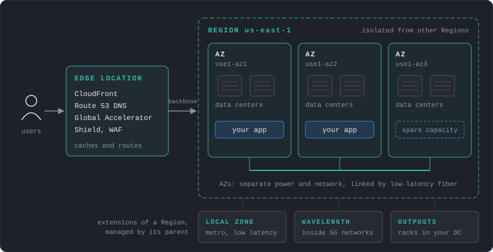
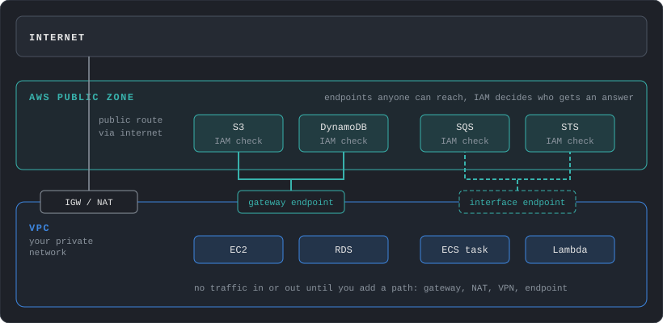
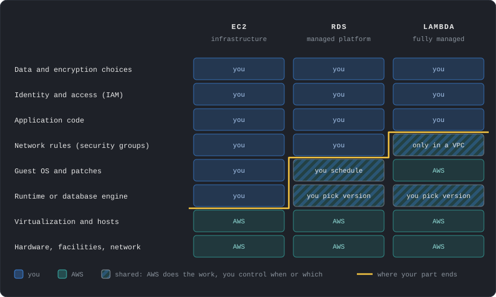
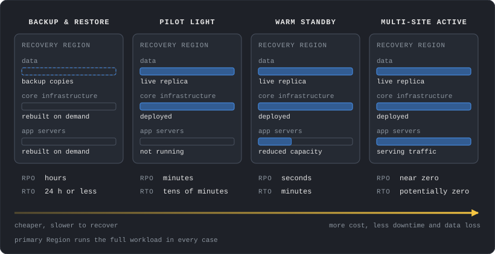
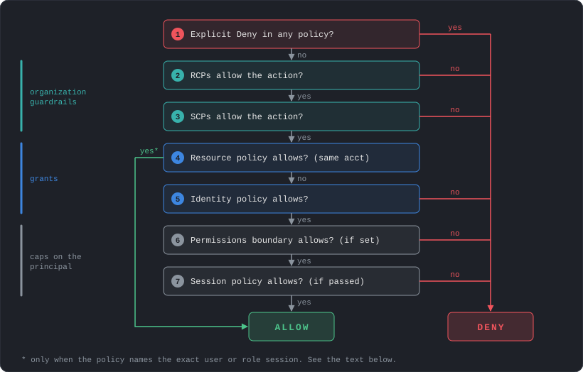
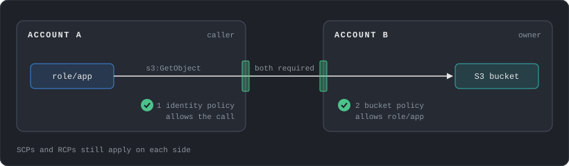
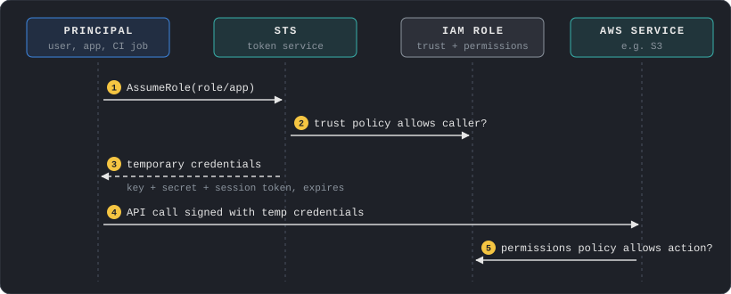
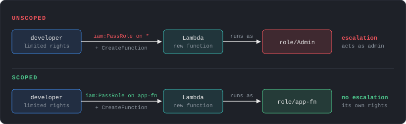
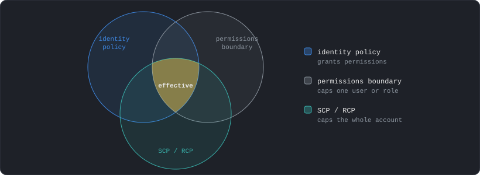
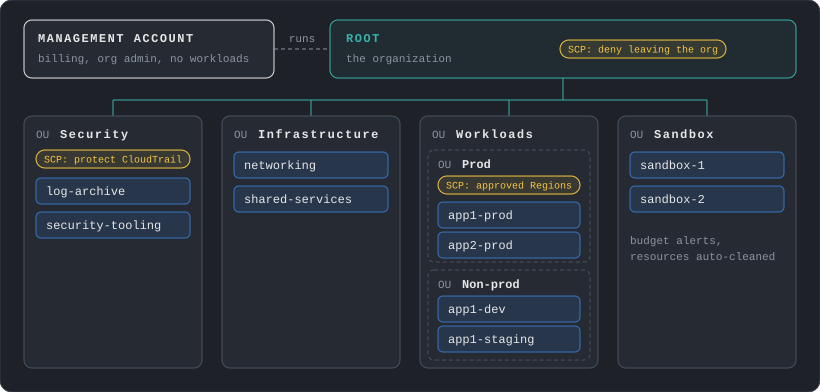

# About this series

This series covers how to design systems on AWS. It started from my study notes for the Solutions Architect Associate, but the goal is understanding how the pieces work and why you would pick one over another. Exam tricks are left out.

| # | Post | Covers |
|---|---|---|
| 1 | Foundations & Identity | Global infrastructure, shared responsibility, resilience, IAM, Organizations |
| 2 | Networking | VPC, routing, DNS, content delivery, hybrid connectivity |
| 3 | Compute & Containers | EC2, ECS/EKS, load balancing, auto scaling |
| 4 | Storage & Data | S3, block and file storage, RDS, DynamoDB |
| 5 | Serverless, IaC & Operations | Lambda, messaging, CloudFormation, logging and auditing |
| 6 | Design Review | Putting it together: tradeoffs and reference designs |

Every post follows the same layout. Each topic opens with what the thing is and how it works, then the design decisions it forces on you. Topics that need more depth get sub-chapters. Where cost or performance changes a decision, a short box covers it. Prices are for `us-east-1` at the time of writing (November 2026).

---

# Global Infrastructure

AWS is a set of isolated locations. Where you place a resource decides what failures it survives and how far it is from users.



## Regions

A Region is a geographic area with its own independent copy of most AWS services. Regions share almost nothing, so an outage in one rarely affects another.

Choosing a Region comes down to four questions:

1. **Compliance:** does the data have to stay in a country?
2. **Latency:** where are the users?
3. **Services:** is the service you need available there? New features usually land in `us-east-1` first.
4. **Cost:** prices differ per Region.

## Availability Zones

An AZ is one or more data centers inside a Region, physically separated from the other AZs but connected with low-latency private fiber. AZs are the unit of failure you design around day to day.

In the older Regions, AZ names like `us-east-1a` were mapped independently for each account, so your `1a` may be a different location from someone else's `1a`. Accounts created from November 2025 get a consistent mapping. When coordinating across accounts, use the AZ ID (`use1-az1`), which always points to the same physical location.

## Edge locations

Edge locations sit close to users and run a few services: CloudFront (CDN), Route 53 public DNS, Global Accelerator, Shield Advanced, and AWS WAF for CloudFront. They cache and route traffic.

Small pieces of code can run at the edge: CloudFront Functions run in the edge locations, and Lambda@Edge runs in AWS locations close to the viewer. They are for request and response manipulation (headers, redirects, auth checks). Servers, containers and databases stay in a Region.

## Smaller footprints

When a Region is too far away:

- **Local Zones:** a small extension of a Region in a metro area, for single-digit millisecond latency.
- **Wavelength:** AWS compute inside telecom 5G networks.
- **Outposts:** AWS hardware in your own data center, managed by AWS.

## Regional vs global services

Most services are regional: an S3 bucket, a VPC or an RDS database lives in one Region. A few are global, with one control plane for the whole account:

| Global | Regional |
|---|---|
| IAM, Organizations, Route 53, CloudFront | EC2, S3, VPC, RDS, Lambda, DynamoDB |

S3 is the common confusion. Bucket names must be unique across all AWS accounts, but each bucket and its data live in the Region chosen at creation.

Global services still have a home. The control planes of IAM, Organizations, Route 53 and CloudFront run in `us-east-1`, so changing them depends on that Region, while their data planes (authenticating requests, answering DNS) are distributed.

<div class="callout-cost" markdown="1">
- **Cross-AZ traffic:** $0.01/GB charged on each side, so $0.02 per GB moved. Keep chatty services in the same AZ when availability allows.
- **Cross-Region traffic:** typically $0.02/GB. **Internet egress:** from $0.09/GB, with the first 100 GB/month free.
- **Latency:** AZs sit within about 100 km of each other, close enough for synchronous replication. Replication between Regions is usually asynchronous, so the RPO is above zero.
- **Region prices:** an `m7g.large` costs about 59% more in `sa-east-1` than in `us-east-1`.
</div>

---

# Public and Private Services

This is about network reachability. It has nothing to do with permissions.



- **Public services** expose an endpoint on the AWS public network. Anyone can reach the endpoint, and IAM decides who gets an answer. A "public" S3 bucket is a separate thing: its policy allows anonymous reads.
- **Private services** live inside a VPC. Nothing reaches them unless you add a route, such as an internet gateway, a NAT gateway, a VPN or a VPC endpoint.

A VPC endpoint lets private resources call public services without an internet gateway or NAT. S3 and DynamoDB support free gateway endpoints, and most other services, including SQS and STS, use interface endpoints (PrivateLink). Post 2 covers them.

<div class="callout-cost" markdown="1">
- **NAT gateway:** $0.045/hour plus $0.045 per GB processed. Private subnets reaching S3 through NAT pay that fee on every GB.
- **Gateway endpoint (S3, DynamoDB):** free. Add one to every VPC that talks to S3 or DynamoDB.
- **Interface endpoint:** $0.01/hour per AZ plus $0.01/GB. The hourly fee multiplies by number of services and AZs.
</div>

---

# Shared Responsibility

AWS secures the infrastructure the cloud runs on. You secure what you put on it and how you configure it. The line moves with how managed the service is:



In every model the customer owns **identity, access and data**. Most cloud breaches are misconfigurations on the customer side: a public bucket, a leaked access key, an over-permissive role. That is why IAM gets the largest part of this post.

---

# Resilience: HA, Fault Tolerance, Disaster Recovery

These three words describe different promises.

| Term | Promise | Typical design |
|---|---|---|
| High availability | Recovers quickly after a component fails, a short interruption is acceptable | Multiple AZs, automatic failover |
| Fault tolerance | Withstands a subsystem failure and stays available | Redundant spares, no single point of failure |
| Disaster recovery | Restores the whole workload after a large event (Region outage, data loss, account compromise) | Backups and a copy of the system in another Region or account |

AWS measures availability as the percentage of time a workload is usable. HA works on components of a workload, and DR works on separate copies of the entire workload.

## RTO and RPO

Every DR plan is described by two numbers:

- **RPO (Recovery Point Objective):** the maximum acceptable time since the last recovery point, which is how much data you can lose. RPO of 1 hour means backups or replication at least every hour.
- **RTO (Recovery Time Objective):** the maximum acceptable delay between the interruption and the restoration of service.

Lower numbers cost more. The business picks them, and the architecture follows.

## DR strategies

From cheapest and slowest to most expensive and fastest, with the ranges AWS gives:



Point-in-time recovery can bring the RPO of backup and restore down to minutes.

Infrastructure as code (post 5) is what makes the cheaper strategies realistic, because rebuilding by hand under pressure fails.

## Replication is not a backup

Multi-AZ databases and cross-Region replication copy every change, including a bad `DELETE` or a ransomware encryption. Replication protects against losing hardware. Point-in-time backups and S3 versioning protect against losing data. Keep backup copies in a separate account (AWS Backup supports cross-account copies) or in a logically air-gapped vault, which is locked and can't be deleted by a compromised source account.

<div class="callout-cost" markdown="1">
- **Multi-AZ RDS:** twice the Single-AZ price, since you pay for the standby. Replication between the AZs is free.
- **Cross-Region backups:** data transfer (typically $0.02/GB) plus storage again in the second Region (about $0.05/GB-month for EBS).
- **Lower RTO and RPO** keep more infrastructure running all the time. Price the strategy before committing to the targets.
</div>

---

# IAM: How Permissions Work

IAM (Identity and Access Management) answers one question for every API call: *is this principal allowed to perform this action on this resource, under these conditions?* Every call to AWS, from the console, CLI or SDK, goes through it.

## Principals

A principal is whoever makes the request:

```text
Root user          the account owner, unlimited power
IAM user           a long-lived identity with a password and/or access keys
IAM role           an identity with no credentials of its own, assumed for temporary credentials
Federated user     a human signed in through an identity provider, mapped to a role
AWS service        e.g. EC2 or Lambda acting on your behalf through a role
```

## Policies

A policy is a JSON document listing what is allowed or denied.

```json
{
  "Version": "2012-10-17",
  "Statement": [
    {
      "Sid": "ReadReports",
      "Effect": "Allow",
      "Action": ["s3:GetObject", "s3:ListBucket"],
      "Resource": [
        "arn:aws:s3:::company-reports",
        "arn:aws:s3:::company-reports/*"
      ],
      "Condition": {
        "Bool": { "aws:MultiFactorAuthPresent": "true" }
      }
    }
  ]
}
```

| Element | Meaning |
|---|---|
| `Effect` | `Allow` or `Deny` |
| `Action` | API operations, `service:Operation` |
| `Resource` | ARNs the statement applies to |
| `Condition` | Extra checks: source IP, MFA, tags, organization, time |
| `Principal` | Who the statement applies to. Only in resource-based policies |

`ListBucket` applies to the bucket ARN and `GetObject` to the object ARN (`/*`). Mixing these up is the most common reason an S3 policy "doesn't work".

### Policy types

| Type | Attached to | Purpose |
|---|---|---|
| Identity-based | User, group, role | What this identity can do |
| Resource-based | Resource (S3 bucket, KMS key, SQS queue, role trust) | Who can access this resource, including other accounts |
| Permissions boundary | User or role | Maximum permissions identity policies can grant |
| Session policy | A single assumed-role session | Narrows permissions for that session |
| SCP / RCP | Organization, OU, account | Maximum permissions for everything in the account (see Organizations) |

AWS also counts ACLs, VPC endpoint policies and AWS RAM resource shares as policy types. They follow the same idea of controlling access from the resource side.

Identity policies come in two forms. **Managed** policies are standalone and reusable (AWS-managed or customer-managed). **Inline** policies are embedded in one identity and deleted with it. Prefer customer-managed policies: they are versioned, reusable and easy to audit.

### ARNs

Every resource has an Amazon Resource Name:

```text
arn:partition:service:region:account-id:resource

arn:aws:iam::123456789012:role/app-reader        IAM is global, so region is empty
arn:aws:s3:::company-reports/2026/q1.csv         S3 ARNs have no region or account
arn:aws:ec2:us-east-1:123456789012:instance/i-0abc
```

Wildcards work in `Resource`, which makes it easy to grant far more than intended. `arn:aws:s3:::*` is every bucket in existence.

## Evaluation logic

When a request arrives, AWS collects every policy that applies and evaluates them:



Step 4 ends the evaluation only when the resource policy names the exact principal: an IAM user ARN or a role session ARN. When it names a role ARN, the boundary and session policy still apply. When it names only the account (`arn:aws:iam::123456789012:root`), an identity policy must also allow the call. Role trust policies and KMS key policies are special cases where the resource policy must always allow the principal explicitly.

Three rules come out of this:

1. **Everything starts denied.** Without an explicit `Allow`, the answer is no. The root user is the one exception: it has full access inside its account, though SCPs and RCPs still limit it.
2. **An explicit `Deny` always wins.** No `Allow` anywhere overrides it.
3. **Guardrails only subtract.** SCPs, boundaries and session policies never grant anything. They cap what other policies can grant.

### Cross-account access

Within one account, an `Allow` in either the identity policy or the resource policy is enough. Across accounts, **both sides must allow**: the resource owner allows the external principal, and the caller's own account allows the call.



## Users, groups and the root user

### Root user

The root user is the email address that created the account. It can do anything, including closing the account, and some actions are reserved to it. AWS now enforces MFA on it by default. Don't create access keys for it, and use it only for those rare tasks. In an Organization, the management account can remove root credentials from member accounts entirely.

### IAM users

An IAM user is a permanent identity with a console password and/or access keys. Access keys never expire on their own, and leaked keys in Git repositories are one of the most frequent causes of AWS compromises.

For humans, use **IAM Identity Center** (formerly AWS SSO) connected to your identity provider. People sign in once and receive temporary role credentials. For workloads, use roles. IAM users are left for the few cases that truly need static keys, like some third-party tools.

### Groups

A group is a collection of users that share policies. Groups can't be nested, and they are not principals: a resource policy can't name a group.

## Roles

A role is an identity with permissions but no password or keys. Someone assumes it and receives temporary credentials from STS (Security Token Service), valid from 15 minutes up to the role's maximum session duration (1 to 12 hours, default 1 hour).



Every role has two policies:

| Policy | Answers |
|---|---|
| **Trust policy** | Who may assume this role |
| **Permissions policy** | What the role may do once assumed |

```json
{
  "Version": "2012-10-17",
  "Statement": [{
    "Effect": "Allow",
    "Principal": { "Service": "ec2.amazonaws.com" },
    "Action": "sts:AssumeRole"
  }]
}
```

This trust policy lets EC2 assume the role. On an instance, credentials arrive through the instance metadata service and rotate automatically, so no key is ever stored on disk.

### Where roles are used

- **AWS services:** EC2 instance profiles, Lambda execution roles, ECS task roles.
- **Cross-account access:** a role in account B trusts account A, and A's users assume it.
- **Federation:** an identity provider (Okta, Entra ID, GitHub Actions OIDC) is trusted, and its users get role credentials. CI pipelines should use OIDC federation, so no long-lived keys sit in CI secrets. For GitHub Actions, the trust policy must restrict the `token.actions.githubusercontent.com:sub` claim to your repository, or any GitHub repository could assume the role. IAM rejects GitHub trust policies without it.
- **Elevated access:** a normal role for daily work, a separate admin role that requires MFA to assume.

### The confused deputy problem

If you let a third-party SaaS assume a role in your account, another customer of that SaaS could trick it into using your role. The fix is an `ExternalId` condition in the trust policy. The vendor generates a unique value per customer and always sends it when assuming your role:

```json
"Condition": { "StringEquals": { "sts:ExternalId": "a1b2c3-unique-per-customer" } }
```

For AWS services acting on your behalf, the equivalents are `aws:SourceArn`, `aws:SourceAccount`, `aws:SourceOrgID` and `aws:SourceOrgPaths`.

## PassRole and service-linked roles

### iam:PassRole

To launch an EC2 instance or Lambda function with a role, you need permission to *pass* that role to the service:



This is a privilege escalation path. A user with limited rights but `iam:PassRole` on `*` can launch a function with an admin role and act through it. Always scope PassRole to specific role ARNs, and optionally restrict the service with the `iam:PassedToService` condition.

### Service-linked roles

Some services create their own role, with a fixed trust policy and permissions defined by AWS (for example `AWSServiceRoleForAutoScaling`). You can view their permissions but not edit them, and SCPs and RCPs don't affect them. They exist so the service can work without you designing its role.

## Permissions boundaries

A boundary caps what a user or role can ever have, whatever policies get attached later. The classic use is delegation: developers may create roles for their apps, but only with a boundary attached, so they can't create a role more powerful than allowed.



<div class="callout-cost" markdown="1">
- **Price:** IAM and IAM Identity Center are free.
- **Propagation:** IAM is eventually consistent. Create roles and change policies at setup time, never inside a request path.
- **STS:** use regional endpoints. SDKs cache credentials and refresh them before they expire, so reuse the client instead of calling `AssumeRole` per request.
</div>

---

# Multi-Account: Organizations

One account per everything stops working quickly. The account is the strongest isolation boundary in AWS: separate IAM, separate quotas, separate billing line, and a separate blast radius when something goes wrong. Real environments use many accounts.



- **Management account:** creates accounts, pays the bills, manages policies. Keep workloads out of it. SCPs don't apply to it.
- **Organizational Units (OUs):** folders for accounts. Policies attached to an OU apply to everything below it.
- **Consolidated billing:** one bill, and usage is pooled for volume discounts and Savings Plans.

## Service Control Policies

An SCP sets the maximum permissions for every principal in an account, including the account's root user. It grants nothing. An action has to be allowed by the SCP **and** by an IAM policy.

```json
{
  "Version": "2012-10-17",
  "Statement": [{
    "Sid": "DenyOutsideApprovedRegions",
    "Effect": "Deny",
    "NotAction": [
      "iam:*", "organizations:*", "sts:*", "route53:*",
      "cloudfront:*", "support:*", "budgets:*"
    ],
    "Resource": "*",
    "Condition": {
      "StringNotEquals": { "aws:RequestedRegion": ["us-east-1", "eu-west-1"] },
      "ArnNotLike": { "aws:PrincipalArn": "arn:aws:iam::*:role/OrgAdmin" }
    }
  }]
}
```

`NotAction` exempts global services, whose requests resolve to `us-east-1`. The `ArnNotLike` condition keeps an escape hatch for an administration role. Other common SCPs: prevent leaving the organization, prevent disabling CloudTrail or GuardDuty, deny root user actions in member accounts.

Two strategies:

- **Deny list:** keep the default `FullAWSAccess` and add specific denies. Easy to maintain, most organizations use it.
- **Allow list:** remove `FullAWSAccess` and allow only approved services. Tighter, but every new service needs an update.

### Resource Control Policies

SCPs limit what your principals can do. RCPs limit what can be done *to your resources*, including by principals outside your organization. A typical RCP denies access to S3 buckets, KMS keys or Secrets Manager secrets from principals outside the organization. That data perimeter holds even if someone writes a careless bucket policy. RCPs support a growing list of services and don't apply to resources in the management account, service-linked roles or AWS managed KMS keys.

## Control Tower

Control Tower automates a well-structured Organization:

- **Landing zone:** the baseline multi-account setup. Up to landing zone version 3.3 it always created a Security OU with log archive and audit accounts, plus centralized CloudTrail and Config. From version 4.0 those pieces are optional integrations you choose.
- **Controls (guardrails):** preventive (SCPs, RCPs and declarative policies), detective (AWS Config rules) and proactive (CloudFormation hooks that block non-compliant resources before creation).
- **Account Factory:** a template for creating new accounts that already follow the baseline.

You can build the same with Organizations directly. Control Tower trades flexibility for a faster, opinionated start.

<div class="callout-cost" markdown="1">
- **Price:** Organizations, SCPs and Control Tower are free. The services Control Tower turns on are billed.
- **AWS Config:** $0.003 per configuration item and $0.001 per rule evaluation. Recording every change in every account and Region grows fast, so check the bill after enabling a landing zone.
- **CloudTrail:** the first copy of management events is free in each Region. Extra copies cost $2.00 per 100k events, data events $0.10 per 100k.
</div>

---

# Design Checklist

The decisions from this post, as questions to ask about any AWS design:

- Which Regions, and why? Which failures must the system survive: an AZ, a Region, an account compromise?
- What are the RTO and RPO, and does the DR strategy actually meet them? When was the restore last tested?
- Are backups isolated from the account they protect?
- Does any human or pipeline use long-lived access keys? Can it move to Identity Center or OIDC federation?
- Is every role scoped to specific actions and resources? Is `iam:PassRole` scoped?
- Do third-party trust policies use `ExternalId`?
- Are workloads, security tooling and logs in separate accounts, with SCPs protecting the guardrails?

---

# References

Official AWS documentation, grouped by section of this post.

## Global Infrastructure

- [Regions and Availability Zones](https://aws.amazon.com/about-aws/global-infrastructure/regions_az/)
- [Fault isolation boundaries: Regions](https://docs.aws.amazon.com/whitepapers/latest/aws-fault-isolation-boundaries/regions.html)
- [Fault isolation boundaries: Global services](https://docs.aws.amazon.com/whitepapers/latest/aws-fault-isolation-boundaries/global-services.html)
- [Availability Zones and AZ IDs](https://docs.aws.amazon.com/global-infrastructure/latest/regions/aws-availability-zones.html)
- [AZ IDs across accounts (AWS RAM)](https://docs.aws.amazon.com/ram/latest/userguide/working-with-az-ids.html)
- [EC2: Regions, Zones, Local Zones, Wavelength, Outposts](https://docs.aws.amazon.com/AWSEC2/latest/UserGuide/using-regions-availability-zones.html)
- [What is AWS Local Zones](https://docs.aws.amazon.com/local-zones/latest/ug/what-is-aws-local-zones.html)
- [CloudFront: Edge functions](https://docs.aws.amazon.com/AmazonCloudFront/latest/DeveloperGuide/edge-functions.html)
- [S3 bucket naming rules](https://docs.aws.amazon.com/AmazonS3/latest/userguide/bucketnamingrules.html)
- [What to consider when selecting a Region (AWS Architecture Blog)](https://aws.amazon.com/blogs/architecture/what-to-consider-when-selecting-a-region-for-your-workloads/)

## Public and Private Services

- [Gateway endpoints](https://docs.aws.amazon.com/vpc/latest/privatelink/gateway-endpoints.html)
- [AWS services that integrate with PrivateLink](https://docs.aws.amazon.com/vpc/latest/privatelink/aws-services-privatelink-support.html)

## Shared Responsibility

- [Shared Responsibility Model](https://aws.amazon.com/compliance/shared-responsibility-model/)
- [RDS maintenance and patching](https://docs.aws.amazon.com/AmazonRDS/latest/UserGuide/USER_UpgradeDBInstance.Maintenance.html)

## Resilience and DR

- [Reliability pillar: Availability](https://docs.aws.amazon.com/wellarchitected/latest/reliability-pillar/availability.html)
- [Fault tolerance and fault isolation](https://docs.aws.amazon.com/whitepapers/latest/availability-and-beyond-improving-resilience/fault-tolerance-and-fault-isolation.html)
- [High availability is not disaster recovery](https://docs.aws.amazon.com/whitepapers/latest/disaster-recovery-workloads-on-aws/high-availability-is-not-disaster-recovery.html)
- [RTO and RPO](https://docs.aws.amazon.com/whitepapers/latest/disaster-recovery-workloads-on-aws/business-continuity-plan-bcp.html)
- [Disaster recovery options in the cloud](https://docs.aws.amazon.com/whitepapers/latest/disaster-recovery-workloads-on-aws/disaster-recovery-options-in-the-cloud.html)
- [REL13-BP02: Use defined recovery strategies](https://docs.aws.amazon.com/wellarchitected/latest/reliability-pillar/rel_planning_for_recovery_disaster_recovery.html)
- [AWS Backup: Logically air-gapped vault](https://docs.aws.amazon.com/aws-backup/latest/devguide/logicallyairgappedvault.html)

## IAM: Principals and Credentials

- [IAM security best practices](https://docs.aws.amazon.com/IAM/latest/UserGuide/best-practices.html)
- [Root user and tasks that require it](https://docs.aws.amazon.com/IAM/latest/UserGuide/id_root-user.html)
- [Access keys](https://docs.aws.amazon.com/IAM/latest/UserGuide/id_credentials_access-keys.html)
- [IAM groups](https://docs.aws.amazon.com/IAM/latest/UserGuide/id_groups.html)
- [Principal element](https://docs.aws.amazon.com/IAM/latest/UserGuide/reference_policies_elements_principal.html)
- [ARN format](https://docs.aws.amazon.com/IAM/latest/UserGuide/reference-arns.html)

## IAM: Policies and Evaluation

- [Policies and permissions](https://docs.aws.amazon.com/IAM/latest/UserGuide/access_policies.html)
- [Policy evaluation logic](https://docs.aws.amazon.com/IAM/latest/UserGuide/reference_policies_evaluation-logic.html)
- [Deny and allow evaluation flow](https://docs.aws.amazon.com/IAM/latest/UserGuide/reference_policies_evaluation-logic_policy-eval-denyallow.html)
- [Cross-account policy evaluation](https://docs.aws.amazon.com/IAM/latest/UserGuide/reference_policies_evaluation-logic-cross-account.html)
- [Permissions boundaries](https://docs.aws.amazon.com/IAM/latest/UserGuide/access_policies_boundaries.html)
- [S3 actions and the resources they apply to](https://docs.aws.amazon.com/AmazonS3/latest/userguide/using-with-s3-policy-actions.html)

## IAM: Roles and Federation

- [STS AssumeRole](https://docs.aws.amazon.com/STS/latest/APIReference/API_AssumeRole.html)
- [Roles for applications on EC2](https://docs.aws.amazon.com/IAM/latest/UserGuide/id_roles_use_switch-role-ec2.html)
- [OIDC federation and GitHub Actions](https://docs.aws.amazon.com/IAM/latest/UserGuide/id_roles_create_for-idp_oidc.html#idp_oidc_Create_GitHub)
- [Service-linked roles](https://docs.aws.amazon.com/IAM/latest/UserGuide/using-service-linked-roles.html)

## IAM: Security Pitfalls

- [Passing a role to a service (iam:PassRole)](https://docs.aws.amazon.com/IAM/latest/UserGuide/id_roles_use_passrole.html)
- [The confused deputy problem](https://docs.aws.amazon.com/IAM/latest/UserGuide/confused-deputy.html)

## Organizations

- [Service control policies](https://docs.aws.amazon.com/organizations/latest/userguide/orgs_manage_policies_scps.html)
- [SCP evaluation](https://docs.aws.amazon.com/organizations/latest/userguide/orgs_manage_policies_scps_evaluation.html)
- [SCP examples](https://docs.aws.amazon.com/organizations/latest/userguide/orgs_manage_policies_scps_examples_general.html)
- [Resource control policies](https://docs.aws.amazon.com/organizations/latest/userguide/orgs_manage_policies_rcps.html)
- [Consolidated billing](https://docs.aws.amazon.com/awsaccountbilling/latest/aboutv2/consolidated-billing.html)

## Control Tower

- [What is AWS Control Tower](https://docs.aws.amazon.com/controltower/latest/userguide/what-is-control-tower.html)
- [How Control Tower works](https://docs.aws.amazon.com/controltower/latest/userguide/how-control-tower-works.html)
- [Control behavior: preventive, detective, proactive](https://docs.aws.amazon.com/controltower/latest/controlreference/control-behavior.html)
- [Region deny control](https://docs.aws.amazon.com/controltower/latest/controlreference/primary-region-deny-policy.html)

## Cost and Performance

- [AWS pricing calculator assumptions (prices vary by Region)](https://aws.amazon.com/calculator/calculator-assumptions/)
- [EC2 On-Demand pricing and data transfer](https://aws.amazon.com/ec2/pricing/on-demand/)
- [Fault isolation boundaries: Availability Zones (distance and latency)](https://docs.aws.amazon.com/whitepapers/latest/aws-fault-isolation-boundaries/availability-zones.html)
- [VPC pricing (NAT gateway)](https://aws.amazon.com/vpc/pricing/)
- [PrivateLink pricing (interface endpoints)](https://aws.amazon.com/privatelink/pricing/)
- [RDS pricing (Multi-AZ)](https://aws.amazon.com/rds/pricing/)
- [AWS Backup pricing](https://aws.amazon.com/backup/pricing/)
- [IAM FAQs (pricing)](https://aws.amazon.com/iam/faqs/)
- [IAM eventual consistency](https://docs.aws.amazon.com/IAM/latest/UserGuide/troubleshoot_general.html#troubleshoot_general_eventual-consistency)
- [STS regional endpoints](https://docs.aws.amazon.com/IAM/latest/UserGuide/id_credentials_temp_region-endpoints.html)
- [SDK credential caching (Java SDK v2)](https://docs.aws.amazon.com/sdk-for-java/latest/developer-guide/credential-caching.html)
- [Organizations FAQs (pricing)](https://aws.amazon.com/organizations/faqs/)
- [Control Tower pricing](https://aws.amazon.com/controltower/pricing/)
- [AWS Config pricing](https://aws.amazon.com/config/pricing/)
- [CloudTrail pricing](https://aws.amazon.com/cloudtrail/pricing/)

---

Next post: **Networking**, starting with how a VPC is built.
