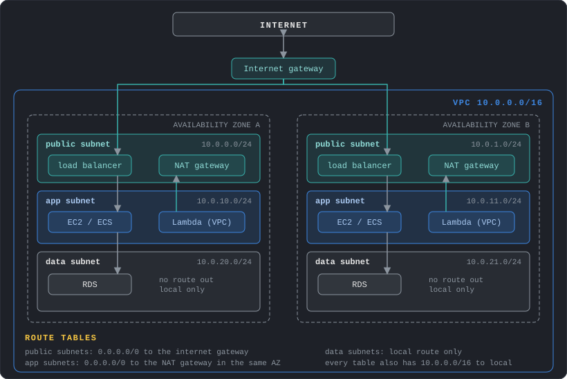
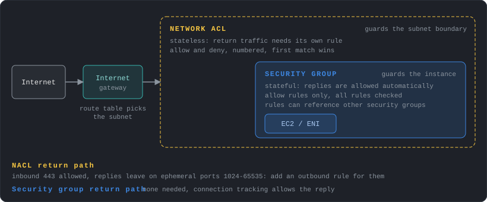
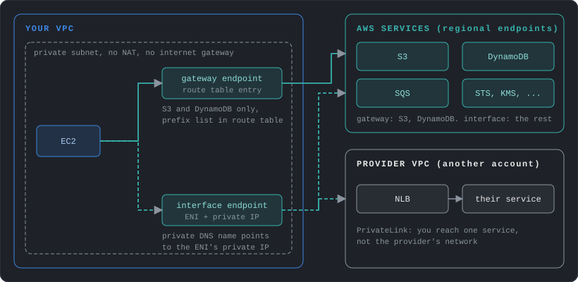
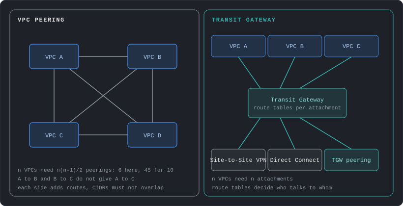
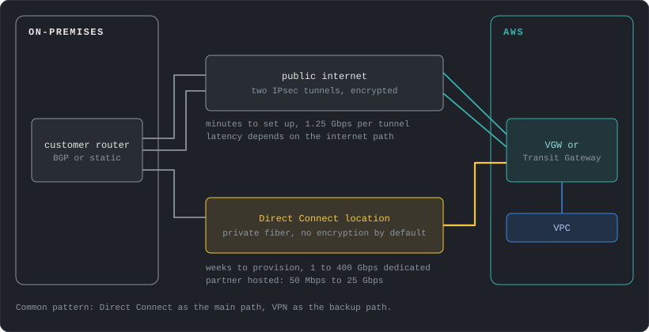
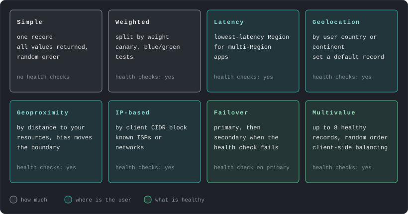
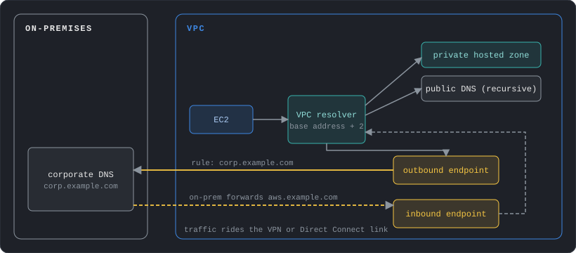
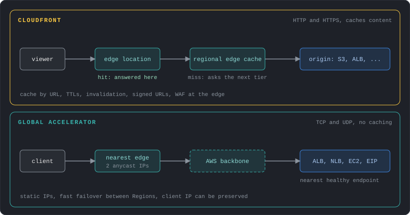

# About this post

Networking is the layer every other AWS service sits on. The first post covered where AWS runs and who can do what. This one covers how traffic moves: inside one network, between networks, between AWS and your own data centers, and from users on the internet. Prices are for `us-east-1` at the time of writing (November 2026), as in post 1.

The topics build on each other: the VPC and its routing, the controls on traffic, private paths to services, connections between VPCs and to on-premises, then DNS and content delivery on top. Moving large amounts of data into AWS is covered in post 4, next to the storage services that receive it.

---

# VPC Foundations

A VPC (Virtual Private Cloud) is a private network that belongs to one account and lives in one Region. It is divided into subnets, and each subnet lives in exactly one Availability Zone. Nothing enters or leaves a VPC until you add a path for it.



## Planning the address space

A network range is written in CIDR notation, an address followed by a prefix length: `10.0.0.0/16`. An IPv4 address has 32 bits, and the prefix says how many of them are fixed. `/16` fixes 16 bits and leaves 16 free, which gives 2^16 = 65,536 addresses. Each extra bit in the prefix halves the block: `/17` has 32,768 addresses, `/24` has 256 and `/28` has 16.

A VPC gets an IPv4 CIDR block between `/16` and `/28`. Use the private ranges from RFC 1918 (`10.0.0.0/8`, `172.16.0.0/12`, `192.168.0.0/16`). You can add secondary CIDR blocks later, up to 5 per VPC by default, but the primary block cannot be changed.

The decision that is hard to undo is overlap. Two VPCs with overlapping CIDRs cannot be peered, and a VPC that overlaps your office network cannot be joined to it over a VPN. Before creating the first VPC, pick ranges for every VPC, Region and on-premises site from one shared plan, even if most of them do not exist yet.

Each subnet loses 5 addresses to AWS: the first four (network address, VPC router, DNS server, and one reserved for future use) and the last one (broadcast, which is not supported). In `10.0.0.0/24` that is `10.0.0.0` to `10.0.0.3` and `10.0.0.255`, and the DNS server is always the VPC base address plus two.

So a `/24` holds 251 usable addresses and a `/28` holds 11. Some services consume many addresses: every network interface (ENI, a virtual network card attached to a resource) needs one, and load balancers, interface endpoints, Lambda functions in a VPC and container tasks each add their own. Size subnets for growth and keep a few spare `/24` ranges unassigned.

IPv6 works alongside IPv4. IPv6 addresses are globally unique and public by design, so only routes and security rules control reachability.

## Subnets and route tables

A route table is a list of destinations and targets. Every subnet is associated with exactly one route table, and one table can serve many subnets. Three rules explain most behavior:

- Every table has a `local` route for the VPC CIDR that cannot be removed. Traffic inside the VPC always works at the routing level.
- The most specific matching route wins (longest prefix match). A route for `10.1.0.0/16` beats `0.0.0.0/0`.
- When two routes have the same destination, static routes (the ones you add yourself, such as to an internet gateway, NAT gateway, peering connection, gateway endpoint or transit gateway) beat propagated ones (routes that a VPN or Direct Connect link adds automatically). Among propagated routes, Direct Connect beats VPN.

A **public subnet** is a subnet whose route table sends `0.0.0.0/0` to an internet gateway. A **private subnet** has no such route.

The usual layout has three tiers in every AZ you use: public subnets for load balancers and NAT gateways, private subnets for application servers, and private subnets for databases with no route out at all. A new subnet silently uses the VPC's main route table unless it is associated with another one, so keep the main table minimal (only `local`) and create explicit tables for each tier.

Every account starts with a default VPC in each Region (`172.31.0.0/16`, one public subnet per AZ, internet gateway attached). It is convenient for experiments. Production workloads belong in VPCs you design, because the default one puts instances in public subnets with public IPs by default.

## Reaching the internet

Three gateways handle internet traffic, and they cover different cases:

| Gateway | Direction | For |
|---|---|---|
| Internet gateway | In and out, IPv4 and IPv6 | Resources with a public IP: load balancers, bastions, public instances |
| NAT gateway | Out only, IPv4 | Private resources that need to call the internet (patches, third-party APIs) |
| Egress-only internet gateway | Out only, IPv6 | The IPv6 equivalent of NAT, with no address translation |

The **internet gateway** is a horizontally scaled, redundant AWS component, so there is nothing to size or patch. A resource can use it only if it has a public IPv4 address, an Elastic IP (a static public IPv4 address that belongs to your account until you release it) or an IPv6 address, and a route to the gateway exists in its subnet.

A **NAT gateway** lets private resources start connections to the internet while blocking connections started from outside. Private addresses such as `10.0.1.25` cannot be routed on the internet, so the gateway replaces the source address of each outgoing packet with its own public address and maps the replies back. A public NAT gateway sits in a public subnet, uses an Elastic IP and sends traffic to the internet gateway. It supports 5 Gbps and scales automatically to 100 Gbps. Each IP address supports up to 55,000 simultaneous connections to one destination (a unique combination of IP, port and protocol), and you can attach up to 8 addresses. NAT gateways cannot have security groups, but the subnet's network ACL applies.

A NAT gateway lives in one AZ. If you share one across zones and its AZ fails, the other zones lose internet access. The standard design creates one NAT gateway per AZ and points each private route table at the gateway in the same AZ.

Regional NAT gateways simplify this. A regional NAT gateway is created for the whole VPC, needs no public subnet, and expands to each AZ where you have workloads, so one route entry works for every subnet. Expansion into a new AZ can take up to 60 minutes, and until it finishes, traffic from the new zone crosses to another AZ. Regional gateways support up to 32 IP addresses per AZ and are not available for private NAT. A private NAT gateway has no internet path. It translates addresses for traffic to other VPCs or on-premises networks, which helps when their CIDRs overlap.

A **NAT instance** is the older approach: an EC2 instance configured to do NAT, with its source/destination check turned off. You patch it, script its failover, and its bandwidth depends on its instance type. It can do port forwarding and act as a bastion, which a NAT gateway cannot. AWS recommends NAT gateways for their availability, bandwidth and lower upkeep.

NAT gateways cannot be reached through VPC peering, and a VPN or Direct Connect link reaches one only through a transit gateway.

Two security notes. A private subnet is not a security control by itself, since security groups still decide what can talk to what. And only load balancers and a few deliberate entry points should have public IPs. To administer instances in private subnets, a bastion host (an instance with a public IP and an open SSH port) adds a machine to patch and an exposed port. Session Manager (post 3) removes both.

<div class="callout-cost" markdown="1">
- **Public IPv4 addresses:** $0.005 per hour for each address, in use or idle, so about $3.65 a month. This includes the addresses on load balancers and NAT gateways. Use IPv6 and private subnets where you can.
- **NAT gateway:** $0.045 per hour is about $33 a month per gateway, and one per AZ means about $99 a month for three zones before any data. A regional NAT gateway bills the same hourly rate for each AZ it spans. Development environments can accept one shared gateway and its single-AZ risk. Post 1 has the per-GB charge.
- **Connection limits:** many tasks calling one API through one NAT address can exhaust the 55,000 limit, which shows up as `ErrorPortAllocation`. Add IP addresses.
</div>

---

# Controlling Traffic

Routing decides where a packet can go. Security groups, network ACLs and flow logs decide whether it is allowed and let you see what happened.



| | Security group | Network ACL |
|---|---|---|
| Applies to | A network interface (instance level) | A subnet |
| Rules | Allow only | Allow and deny |
| State | Stateful: replies are allowed automatically | Stateless: replies need their own rule |
| Evaluation | All rules together | In number order, first match wins |
| Default | No inbound, all outbound | The default NACL allows everything, a new custom NACL denies everything |

## Security groups

Security groups are the primary control. A rule can use an IP range or another security group as its source. The second form is what makes layered designs readable:

- `alb-sg` allows 443 from `0.0.0.0/0`
- `app-sg` allows 8080 from `alb-sg`
- `db-sg` allows 5432 from `app-sg`

Nothing refers to an IP address, so instances can be added, replaced and scaled without editing rules, and the database can only be reached from the application tier. Create one security group per role.

Defaults are 60 rules per direction and 5 security groups per network interface. A packet is allowed if any rule in any attached group allows it. Outbound rules default to allow everything. Restricting egress is worthwhile for sensitive workloads, but it is rarely the first control to add.

## Network ACLs

A network ACL is a coarse filter at the subnet boundary. Use it for broad, rarely changing rules, such as blocking a known-bad CIDR across a whole tier. Because it is stateless, a rule allowing inbound 443 needs a matching outbound rule for the reply, which leaves on a high ephemeral port (the client picks a random port in that range for each connection, and the reply goes back to it). Allow `1024-65535` outbound for that. NAT gateways also use ports 1024 to 65535.

Rules are checked in ascending number order and the first match applies, so number them with gaps (100, 200, 300) to leave room for later rules. The default quota is 20 rules per direction.

## Flow logs and inspection

VPC Flow Logs record metadata about IP traffic: source and destination address and port, protocol, packet and byte counts, and whether it was accepted or rejected. They can be enabled for a VPC, a subnet or a single network interface and delivered to CloudWatch Logs, S3 or Data Firehose. They are collected outside the traffic path, so they do not affect throughput or latency.

A default-format record looks like this:

```text
2 123456789012 eni-0a1b2c3d 203.0.113.12 10.0.1.25 44321 443 6 20 4249 1700000000 1700000060 ACCEPT OK
```

Reading left to right: version, account, network interface, source address, destination address, source port, destination port, protocol (6 is TCP), packets, bytes, start time, end time, action, log status. A burst of `REJECT` records for one port usually points at a missing security group rule.

Flow logs miss some traffic, such as queries to the Amazon DNS server, DHCP and instance metadata. To answer "can A reach B on this port", Reachability Analyzer checks routes, security groups and ACLs and reports which one blocks the path. AWS Network Firewall adds deep packet inspection at the VPC level.

<div class="callout-cost" markdown="1">
- **Security groups and network ACLs:** free. Their limits (60 rules per group, 5 groups per interface) are the constraint.
- **Flow logs:** delivery is billed as vended logs, and CloudWatch Logs is the most expensive destination. S3 is cheaper, and keeping only `REJECT` records cuts the volume.
- **Reachability Analyzer:** $0.10 per analysis.
</div>

---

# Private Access to Services: Endpoints and PrivateLink

Post 1 introduced VPC endpoints as the way private resources call public AWS services. The two types work differently inside the VPC.



**Gateway endpoints** exist only for S3 and DynamoDB. Creating one adds a route to your route tables: the destination is an AWS-managed prefix list (the current IP ranges of the service) and the target is the endpoint. Nothing is deployed in your subnets. They work only inside the VPC and the same Region. On-premises networks and peered VPCs cannot use them.

**Interface endpoints** put an elastic network interface with a private IP in each subnet you choose. Your security groups apply to it. With private DNS enabled, the normal service name (for example `sqs.us-east-1.amazonaws.com`) resolves to the endpoint's private IP, so applications need no change. Because it is a real interface, it is reachable from peered VPCs, from a transit gateway and from on-premises over VPN or Direct Connect.

Both types support an **endpoint policy**, an IAM-style policy that limits which principals, actions and resources can pass through the endpoint.

**AWS PrivateLink** is the same interface-endpoint mechanism applied to your own services. A provider puts a Network Load Balancer (or Gateway Load Balancer for appliances) in front of a service and publishes it as an endpoint service. Consumers create an interface endpoint to it from their own VPCs and accounts. Traffic flows one way, from consumer to provider. Consumers see one service and nothing else in the provider's network, and the two sides can have overlapping CIDR ranges because there is no routing between the networks.

Design decisions:

- Add a gateway endpoint to every VPC that uses S3 or DynamoDB. It costs nothing and removes that traffic from NAT.
- Use interface endpoints for services that handle sensitive data or that private subnets call constantly (STS, KMS, Secrets Manager, ECR, CloudWatch Logs), and for environments with no internet path at all.
- Use PrivateLink to expose one service to many consumers without joining networks. It scales better than peering when consumers number in the hundreds or their CIDRs are unknown.

<div class="callout-cost" markdown="1">
- **Interface endpoints multiply:** the hourly fee is per endpoint per AZ, so 10 services in 3 AZs is 30 network interfaces. At $0.01 per hour each, that is about $219 a month before data. Put endpoints in only the AZs you use, and share them from a central VPC when many accounts need the same service.
- **Gateway endpoints:** free, with no data processing fee.
</div>

---

# Connecting VPCs

As an organization grows it ends up with many VPCs: per environment, per team, per account. Four mechanisms connect them, and they suit different sizes.



## VPC peering

A peering connection is a one-to-one private link between two VPCs. The VPCs can be in different accounts and Regions. Both sides must accept the request, add routes to the other VPC's CIDR, and allow the traffic in their security groups. In the same Region, a security group rule can name the peer's security group as its source.

Limits shape the design:

- **No overlapping CIDRs**, in IPv4 or IPv6, including secondary blocks.
- **No transitive routing.** If A is peered with B and B with C, A cannot reach C through B. A peering also does not share gateways: a peer cannot use your internet gateway, NAT gateway, VPN, Direct Connect link or gateway endpoint.
- **Everything is direct.** Each pair needs its own connection, so n VPCs need n(n-1)/2 of them: 6 for 4 VPCs and 45 for 10.

## Transit Gateway

A transit gateway is a regional router that connects VPCs, VPN connections, Direct Connect gateways and other transit gateways. Each thing you connect is an **attachment**, so n networks need n attachments. It supports up to 5,000 attachments and up to 100 Gbps per VPC attachment per AZ, with an MTU of 8,500 bytes between VPCs.

Control comes from **route tables**. Each attachment is associated with one table, which decides where its traffic can go, and can propagate its own CIDR into one or more tables (the table learns the route automatically). This allows segmentation. For example, production and development VPCs share a table that routes to a shared-services VPC and the on-premises link, and have no route to each other. Peering between transit gateways in different Regions works with static routes only.

Create each VPC attachment with a subnet in every AZ that holds workloads, because the gateway delivers traffic only to those AZs.

## PrivateLink and shared subnets

Two other approaches skip network-to-network links:

- **PrivateLink** exposes a single service to other VPCs, as described above.
- **VPC sharing** (through AWS Resource Access Manager) lets one account own the VPC and share subnets with other accounts in the organization. Workloads from several accounts then sit in the same network, and no connection is needed.

| Situation | Fit |
|---|---|
| 2 to 5 VPCs, high traffic between them | Peering |
| Many VPCs, on-premises links, segmentation needs | Transit Gateway |
| One service for many consumers, overlapping CIDRs | PrivateLink |
| Many teams, one network owner | VPC sharing |

<div class="callout-cost" markdown="1">
- **Peering:** no hourly charge and no processing fee. Data crossing AZs costs $0.01 per GB in each direction, and traffic inside one AZ is free.
- **Transit Gateway:** $0.05 per attachment per hour (about $36 a month each) plus $0.02 per GB sent to the gateway. A VPC with a chatty workload can cost more through a transit gateway than through a peering link, so measure before moving heavy traffic onto it.
- **Across Regions:** the transit gateway processing fee applies on the sending side and inter-Region transfer is added on top. The pricing example for 1 GB between two Regions totals $0.04: $0.02 processing plus $0.02 transfer.
</div>

---

# Hybrid Connectivity

Most companies connect AWS to existing networks: offices, data centers, partner sites. There are two main options.



## Site-to-Site VPN

A Site-to-Site VPN is an encrypted IPsec tunnel over the public internet between a **customer gateway** (your router or firewall) and AWS. On the AWS side it ends on a virtual private gateway (the AWS end of the VPN for one VPC), or on a transit gateway for many VPCs. Each connection has two tunnels, ending in different AZs, for redundancy. Configure both on your device.

- **Routing:** static routes, or BGP for dynamic routes. BGP is the protocol routers use to announce which networks they can reach. It is recommended because routes adjust automatically when a tunnel fails, and ECMP requires it.
- **Throughput:** up to 1.25 Gbps and 140,000 packets per second per tunnel. With a transit gateway and BGP, ECMP (equal-cost multipath) spreads traffic over several tunnels that have the same route cost, which raises the total. Large bandwidth tunnels reach 5 Gbps.
- **MTU:** the largest packet the tunnel carries is 1,446 bytes, with no jumbo frames and no Path MTU Discovery. Packets bigger than the limit get fragmented or dropped, so set the MTU and MSS (the matching limit for TCP segments) on your device.
- **Setup time:** minutes, with nothing to order.

Accelerated VPN routes the tunnels through the AWS edge for steadier performance over long distances. Client VPN connects individual remote users.

## Direct Connect

Direct Connect is a dedicated network link from your premises to an AWS Direct Connect location, a facility where AWS routers sit next to those of carriers. Traffic skips the public internet, so latency and throughput are consistent.

- **Connections:** dedicated connections of 1, 10, 100 or 400 Gbps, ordered from AWS, or hosted connections of 50 Mbps to 25 Gbps from an AWS Partner Network (APN) partner. Provisioning takes weeks, since it involves cross-connects and carriers.
- **Virtual interfaces (VIFs):** a private VIF reaches VPCs, a public VIF reaches AWS public services, and a transit VIF reaches transit gateways. A **Direct Connect gateway** lets one connection reach VPCs or transit gateways in multiple accounts and Regions.
- **Encryption:** traffic is private and not encrypted by default. Options are MACsec on supported dedicated connections, or an IPsec VPN running over the Direct Connect link.
- **Resilience:** one connection is a single point of failure. The maximum resilience model (separate devices at two or more locations) is designed for a 99.99% SLA, and the high resilience model (two locations) for 99.9%. A lone connection at one location offers neither.

A common design keeps Direct Connect as the primary path and a VPN as backup. When both advertise the same prefix by BGP, AWS prefers Direct Connect, so traffic moves to the VPN only when the primary path fails.

| | Site-to-Site VPN | Direct Connect |
|---|---|---|
| Path | Public internet, encrypted | Private link |
| Setup | Minutes | Weeks |
| Bandwidth | 1.25 Gbps per tunnel | 50 Mbps to 400 Gbps |
| Consistency | Varies with the internet | Consistent |
| Encryption | Always (IPsec) | Optional (MACsec or VPN over it) |
| Cost model | Hourly per connection | Port hours plus data out |

<div class="callout-cost" markdown="1">
- **VPN:** $0.05 per hour per connection (about $36 a month), plus data transfer out at the normal internet rates and the transit gateway attachment fee if you use one. A 5 Gbps large bandwidth connection costs $0.60 per hour.
- **Direct Connect ports:** a dedicated 1 Gbps port is $0.30 per hour (about $219 a month) and 10 Gbps is $2.25 per hour (about $1,640 a month). A resilient design needs at least two ports, which doubles that.
- **Direct Connect data:** transfer out is $0.02 per GB from a US location, compared with $0.09 per GB over the internet, and data in is free. For steady high volume the lower per-GB rate pays back the port.
</div>

---

# DNS with Route 53

DNS turns names into addresses and, in AWS, also steers traffic. Route 53 is the DNS service, and it is global.

## Hosted zones and records

A **hosted zone** holds the records for a domain. A public hosted zone answers queries from the internet. A private hosted zone answers only for the VPCs you associate with it, which is how internal names like `db.internal.example.com` work. Route 53 can also register domains.

Common record types are `A` and `AAAA` (addresses), `CNAME` (alias to another name), `MX`, `TXT` and `NS`. Route 53 adds the **alias** record, which points a name at an AWS resource such as a CloudFront distribution, a load balancer, an API Gateway endpoint or an S3 website. Alias records matter for two reasons. They work at the zone apex (the bare domain, `example.com`), where DNS rules forbid a `CNAME`, and queries to them are free.

Every record has a **TTL**, the time resolvers and clients may cache the answer. A long TTL lowers query cost and load. A short TTL makes changes and failovers take effect sooner. Lower the TTL a day before a planned migration.

## Routing policies

A routing policy decides which answer Route 53 gives for a name that has several records.



The diagram gives the one-line version of each. Three details matter in practice. Geolocation needs a default record for users who match nothing. Failover needs a health check on the primary record. Weighted is the usual tool for canary releases, such as 90/10.

## Health checks

A health check probes an endpoint over HTTP, HTTPS or TCP from checkers on the public internet, by default every 30 seconds with a fast option of 10 seconds. It marks the endpoint unhealthy after a number of consecutive failures. Routing policies that support health checks then stop returning its record. Total failover time is the detection time plus the record's TTL, so a 60-second TTL adds up to a minute on top of detection.

The checkers are outside your network, so they cannot probe private resources. For those, create a CloudWatch alarm on a metric of the resource and a health check that follows the alarm.

## DNSSEC

DNSSEC signing lets resolvers check that a DNS answer really came from Route 53 and was not altered on the way. It works for public hosted zones only. Each key-signing key (KSK) is backed by an asymmetric customer managed key in AWS KMS that you own and rotate, and Route 53 manages the zone-signing key. The chain of trust is completed by adding a DS record at the parent zone, usually through your registrar. Route 53 limits record TTLs to one week in a signed zone, and a broken DNSSEC setup can make the whole zone unresolvable, so set a CloudWatch alarm on its errors before enabling it.

## DNS inside the VPC and in hybrid setups

Every VPC has a built-in resolver at the base of the VPC range plus two (for example `10.0.0.2`). It answers for public names, for AWS-provided names such as instance hostnames, and for private hosted zones associated with the VPC. Private hosted zones require both DNS options (`enableDnsSupport` and `enableDnsHostnames`) on the VPC. Each network interface can send up to 1,024 packets per second to the resolver, a limit that cannot be raised, and it can matter for DNS-heavy workloads.

When names must resolve between AWS and on-premises, **Resolver endpoints** carry the queries over the VPN or Direct Connect link:



- An **outbound endpoint** sends queries from the VPC to your DNS servers. **Forwarding rules** choose which domains go there, such as `corp.example.com`. Rules can be shared across accounts.
- An **inbound endpoint** gives your DNS servers an address in the VPC to forward queries to, for names in your private hosted zones.

<div class="callout-cost" markdown="1">
- **Zones and queries:** $0.50 per month for each of the first 25 hosted zones and $0.10 after that. Standard queries cost $0.40 per million, latency-based $0.60 and geolocation or geoproximity $0.70. Alias queries to AWS resources are free.
- **Health checks:** $0.50 per month for an AWS endpoint and $0.75 for a non-AWS endpoint, with $1 or $2 per extra feature.
- **Resolver endpoints:** $0.125 per network interface per hour, and an endpoint uses at least two interfaces, so each costs about $180 a month, plus $0.40 per million queries through it. Share one set of endpoints across many VPCs.
</div>

---

# Content Delivery

Two services speed up access for distant users by entering the AWS network at an edge location. They solve different problems.



## CloudFront

CloudFront is a content delivery network. A **distribution** has one or more **origins** (an S3 bucket, a load balancer, an API Gateway, or any HTTP server) and **behaviors** that map URL paths to origins and caching rules. A viewer is sent to a nearby edge location. On a cache hit the edge answers. On a miss, the request goes to a regional edge cache and then to the origin, and the response is cached on the way back.

- **Caching:** a cache policy picks what is part of the cache key (path, query strings, headers, cookies) and the TTLs. Everything left out of the key increases the hit rate. Changed content can be removed early with an **invalidation**, though versioned file names avoid the need.
- **Dynamic content:** even uncacheable requests benefit, because the edge keeps warm connections to the origin over the AWS backbone.
- **Protecting the origin:** for S3, use **origin access control** (OAC). The bucket policy allows only the CloudFront service principal for your distribution, so the bucket stays private. OAC supports SSE-KMS and replaces the older origin access identity. For load balancers, allow only the CloudFront managed prefix list in the security group, or use a VPC origin so the load balancer stays in a private subnet.
- **Security:** AWS WAF attaches to a distribution. HTTPS works on the default `*.cloudfront.net` name, and custom domains use a certificate from ACM, which must be in `us-east-1` for CloudFront. Signed URLs or cookies restrict private content. Edge code (CloudFront Functions and Lambda@Edge, from post 1) adapts requests and responses.

## Global Accelerator

Global Accelerator gives your application two static anycast IP addresses (four with IPv6). Anycast means the same address is announced from many edge locations, so each user's traffic enters at the nearest one. From there traffic rides the AWS backbone to the best healthy endpoint: an Application or Network Load Balancer, an EC2 instance or an Elastic IP, in one or more Regions. It handles TCP and UDP and caches nothing.

Choose it when the application is not HTTP content that can be cached (gaming, VoIP, MQTT, custom protocols), when clients need fixed IPs to allow-list, or when you want fast failover between Regions without waiting for DNS TTLs to expire. A custom routing accelerator maps users to specific destinations, which fits session-based apps such as multiplayer games.

| | CloudFront | Global Accelerator |
|---|---|---|
| Protocols | HTTP and HTTPS (and WebSocket) | TCP and UDP |
| Caching | Yes | No |
| Addresses | DNS name, changing IPs | 2 static anycast IPs |
| Failover | Origin groups (a backup origin) | Health-based, between endpoints and Regions |
| Best for | Websites, APIs, media, downloads | Non-HTTP apps, fixed IPs, Region failover |

<div class="callout-cost" markdown="1">
- **CloudFront free allowance:** 1 TB of data out and 10 million requests each month. After that, the next 9 TB cost $0.085 per GB in the US, and HTTPS requests are $0.01 per 10,000.
- **Origin transfer:** data from an AWS origin to CloudFront is free. Serving S3 content through CloudFront often costs less than serving it from S3 directly to the internet.
- **Flat-rate plans:** CloudFront also sells plans at $0 (Free), $15 (Pro), $200 (Business) and $1,000 (Premium) per month, with the request and transfer allowances included and no overage charges. They suit a predictable bill.
- **Global Accelerator:** $0.025 per hour for each accelerator (about $18 a month), plus a data transfer premium on the dominant direction, for example $0.015 per GB from the US to Europe, on top of normal transfer charges.
</div>

---

# Design Checklist

The decisions from this post, as questions to ask about any AWS design:

- Does the CIDR plan cover every VPC, Region and on-premises network without overlap? Is there room to grow?
- Which subnets are public, and why? Does every public IP have a reason to exist?
- Is there one NAT gateway per AZ (or a regional one), with each AZ routing to its own?
- Do security groups reference each other by role instead of by IP? Is any rule open to `0.0.0.0/0` that should not be?
- Does every VPC that uses S3 or DynamoDB have a gateway endpoint? Which services need interface endpoints, and in which AZs?
- Is peering or Transit Gateway the right size for the number of VPCs, and are the data processing costs known?
- Is on-premises connectivity redundant, with a tested failover from Direct Connect to VPN?
- Are DNS TTLs and health checks set to match the failover time the system needs?
- Are static assets served through CloudFront, with S3 and load balancers closed to direct access?
- Are flow logs on for the VPCs that matter, to a destination that is cheap to keep?

---

# References

Official AWS documentation, grouped by section of this post.

## VPC Foundations

- [Subnet CIDR blocks](https://docs.aws.amazon.com/vpc/latest/userguide/subnet-sizing.html)
- [How route priority works](https://docs.aws.amazon.com/vpc/latest/userguide/route-tables-priority.html)
- [Amazon VPC quotas](https://docs.aws.amazon.com/vpc/latest/userguide/amazon-vpc-limits.html)
- [Default VPCs](https://docs.aws.amazon.com/vpc/latest/userguide/default-vpc.html)
- [Internet gateways](https://docs.aws.amazon.com/vpc/latest/userguide/VPC_Internet_Gateway.html)
- [NAT gateways](https://docs.aws.amazon.com/vpc/latest/userguide/vpc-nat-gateway.html)
- [NAT gateway basics](https://docs.aws.amazon.com/vpc/latest/userguide/nat-gateway-basics.html)
- [Regional NAT gateways](https://docs.aws.amazon.com/vpc/latest/userguide/nat-gateways-regional.html)
- [Compare NAT gateways and NAT instances](https://docs.aws.amazon.com/vpc/latest/userguide/vpc-nat-comparison.html)
- [Egress-only internet gateways](https://docs.aws.amazon.com/vpc/latest/userguide/egress-only-internet-gateway.html)
- [VPC Block Public Access](https://docs.aws.amazon.com/vpc/latest/userguide/security-vpc-bpa.html)

## Controlling Traffic

- [Infrastructure security in Amazon VPC (security groups vs network ACLs)](https://docs.aws.amazon.com/vpc/latest/userguide/infrastructure-security.html)
- [Security groups](https://docs.aws.amazon.com/vpc/latest/userguide/vpc-security-groups.html)
- [Network ACLs](https://docs.aws.amazon.com/vpc/latest/userguide/vpc-network-acls.html)
- [VPC Flow Logs](https://docs.aws.amazon.com/vpc/latest/userguide/flow-logs.html)
- [Flow log limitations](https://docs.aws.amazon.com/vpc/latest/userguide/flow-logs-limitations.html)
- [Reachability Analyzer](https://docs.aws.amazon.com/vpc/latest/reachability/what-is-reachability-analyzer.html)
- [AWS Network Firewall](https://docs.aws.amazon.com/network-firewall/latest/developerguide/what-is-aws-network-firewall.html)

## Endpoints and PrivateLink

- [Gateway endpoints](https://docs.aws.amazon.com/vpc/latest/privatelink/gateway-endpoints.html)
- [Interface endpoints](https://docs.aws.amazon.com/vpc/latest/privatelink/create-interface-endpoint.html)
- [Endpoint policies](https://docs.aws.amazon.com/vpc/latest/privatelink/vpc-endpoints-access.html)
- [Services powered by PrivateLink](https://docs.aws.amazon.com/vpc/latest/privatelink/privatelink-share-your-services.html)

## Connecting VPCs

- [VPC peering basics and limitations](https://docs.aws.amazon.com/vpc/latest/peering/vpc-peering-basics.html)
- [How transit gateways work](https://docs.aws.amazon.com/vpc/latest/tgw/how-transit-gateways-work.html)
- [Transit gateway quotas](https://docs.aws.amazon.com/vpc/latest/tgw/transit-gateway-quotas.html)
- [Transit gateway peering attachments](https://docs.aws.amazon.com/vpc/latest/tgw/tgw-peering.html)
- [Share your VPC with other accounts](https://docs.aws.amazon.com/vpc/latest/userguide/vpc-sharing.html)
- [Network-to-VPC connectivity options (whitepaper)](https://docs.aws.amazon.com/whitepapers/latest/aws-vpc-connectivity-options/network-to-amazon-vpc-connectivity-options.html)

## Hybrid Connectivity

- [Site-to-Site VPN tunnel options](https://docs.aws.amazon.com/vpn/latest/s2svpn/VPNTunnels.html)
- [Site-to-Site VPN resilience](https://docs.aws.amazon.com/vpn/latest/s2svpn/disaster-recovery-resiliency.html)
- [Site-to-Site VPN quotas](https://docs.aws.amazon.com/vpn/latest/s2svpn/vpn-limits.html)
- [What is Direct Connect](https://docs.aws.amazon.com/directconnect/latest/UserGuide/Welcome.html)
- [Direct Connect Resiliency Toolkit](https://docs.aws.amazon.com/directconnect/latest/UserGuide/resiliency_toolkit.html)
- [Direct Connect MACsec](https://docs.aws.amazon.com/directconnect/latest/UserGuide/MACsec.html)
- [AWS Client VPN](https://docs.aws.amazon.com/vpn/latest/clientvpn-admin/what-is.html)

## DNS

- [Choosing a routing policy](https://docs.aws.amazon.com/Route53/latest/DeveloperGuide/routing-policy.html)
- [Alias and non-alias records](https://docs.aws.amazon.com/Route53/latest/DeveloperGuide/resource-record-sets-choosing-alias-non-alias.html)
- [How Route 53 health checks work](https://docs.aws.amazon.com/Route53/latest/DeveloperGuide/dns-failover-determining-health-of-endpoints.html)
- [Private hosted zones](https://docs.aws.amazon.com/Route53/latest/DeveloperGuide/hosted-zones-private.html)
- [Route 53 VPC Resolver](https://docs.aws.amazon.com/Route53/latest/DeveloperGuide/resolver.html)
- [Getting started with Resolver endpoints](https://docs.aws.amazon.com/Route53/latest/DeveloperGuide/resolver-getting-started.html)
- [Configuring DNSSEC signing](https://docs.aws.amazon.com/Route53/latest/DeveloperGuide/dns-configuring-dnssec.html)
- [Route 53 DNS Firewall](https://docs.aws.amazon.com/Route53/latest/DeveloperGuide/resolver-dns-firewall.html)

## Content Delivery

- [Restrict access to an S3 origin (OAC)](https://docs.aws.amazon.com/AmazonCloudFront/latest/DeveloperGuide/private-content-restricting-access-to-s3.html)
- [VPC origins](https://docs.aws.amazon.com/AmazonCloudFront/latest/DeveloperGuide/private-content-vpc-origins.html)
- [CloudFront managed prefix list](https://aws.amazon.com/about-aws/whats-new/2022/02/amazon-cloudfront-managed-prefix-list/)
- [HTTPS requirements and ACM certificates for CloudFront](https://docs.aws.amazon.com/AmazonCloudFront/latest/DeveloperGuide/cnames-and-https-requirements.html)
- [What is Global Accelerator](https://docs.aws.amazon.com/global-accelerator/latest/dg/what-is-global-accelerator.html)

## Cost and Performance

- [Amazon VPC pricing (NAT gateway, public IPv4, peering, Reachability Analyzer)](https://aws.amazon.com/vpc/pricing/)
- [Transit Gateway pricing](https://aws.amazon.com/transit-gateway/pricing/)
- [Site-to-Site VPN pricing](https://aws.amazon.com/vpn/pricing/)
- [Direct Connect pricing](https://aws.amazon.com/directconnect/pricing/)
- [Route 53 pricing](https://aws.amazon.com/route53/pricing/)
- [CloudFront pricing (flat-rate plans)](https://aws.amazon.com/cloudfront/pricing/)
- [CloudFront pay-as-you-go pricing](https://aws.amazon.com/cloudfront/pricing/pay-as-you-go/)
- [Global Accelerator pricing](https://aws.amazon.com/global-accelerator/pricing/)
- [PrivateLink pricing](https://aws.amazon.com/privatelink/pricing/)
- [CloudWatch pricing (vended logs for flow logs)](https://aws.amazon.com/cloudwatch/pricing/)

---

Next post: **Compute & Containers**, starting with how EC2 instance types are chosen.
