# About this post

Compute is where your code runs. This post covers virtual machines (EC2), containers (ECS, EKS and Fargate), and the two services that turn a single server into an available application: load balancers and Auto Scaling. It builds on the VPC, subnets and security groups from post 2 and the IAM roles from post 1. Prices are for `us-east-1` at the time of writing (November 2026), as in the earlier posts.

Storage is in post 4: EBS volumes (the network disks most instances boot from), file and object storage, and databases. This post only covers the instance store, the local disk that belongs to the instance itself. Lambda and other serverless options are in post 5.

---

# EC2 Instances

EC2 (Elastic Compute Cloud) rents you a virtual machine in one Availability Zone. The hypervisor, the software that splits a physical server into virtual machines, is the AWS Nitro System on current instance types. Nitro moves networking, storage and security functions onto dedicated hardware cards, so almost all of the server's CPU and memory goes to your instance, and the isolation between customers is enforced in hardware.

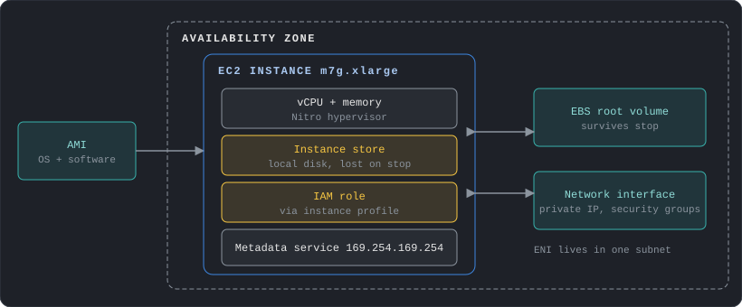

An instance is tied to its AZ. If the AZ fails, so does the instance, which is why the rest of this post ends with load balancers and Auto Scaling groups spread over several zones.

## Choosing an instance type

A name such as `m7g.xlarge` has four parts: family (`m`), generation (`7`), extra attributes (`g` means AWS Graviton, an Arm processor designed by AWS) and size (`xlarge`). Size doubles the vCPUs and memory at each step (`large`, `xlarge`, `2xlarge`, and so on).

| Family | Letters | Pick it for |
|---|---|---|
| General purpose | `m`, `t` | Web and application servers, small databases, a balanced default |
| Compute optimized | `c` | CPU-bound work: batch jobs, video encoding, game servers |
| Memory optimized | `r`, `x` | In-memory databases and caches, large analytics |
| Storage optimized | `i`, `d` | Very high local disk I/O: NoSQL databases, data warehouses |
| Accelerated | `p`, `g`, `inf`, `trn` | GPUs and ML chips for training, inference and graphics |

Start with a general purpose instance, watch CPU and memory in CloudWatch, then move to the family that matches the bottleneck. AWS Compute Optimizer reads that history and recommends a type. Newer generations usually cost less per unit of work, and Graviton instances are cheaper again for software that runs on Arm.

**Burstable instances** (the `t` family) have a baseline CPU level and earn credits while idle, which they spend to go above it. They suit workloads that are mostly quiet with short spikes. In the default `unlimited` mode, T3, T3a, T4g and T8i instances keep bursting after credits run out and charge a flat extra rate per vCPU-hour for the surplus. If the average over a rolling 24 hours stays at or below the baseline, there is no extra charge. A workload that is busy all day belongs on an `m` or `c` instance.

## Purchase options

The same instance can be bought in several ways. The discount depends on how much flexibility you give up.

| Option | Discount | What you give up | Fit |
|---|---|---|---|
| On-Demand | None | Nothing | Short-lived, unpredictable or new workloads |
| Savings Plans | Up to 72% | A commitment to spend a fixed amount per hour for 1 or 3 years | Steady baseline usage |
| Reserved Instances | Significant | A commitment to a specific instance type, Region, tenancy and OS for 1 or 3 years. Convertible ones can be exchanged but get a lower discount | Existing commitments. AWS recommends Savings Plans for new ones |
| Spot | Up to 90% | AWS can take the instance back with 2 minutes' warning | Batch, CI, stateless workers that tolerate interruption |
| Capacity Reservation | None | You pay for the reserved capacity whether or not you use it | Guaranteeing capacity in one AZ for a critical event or DR |
| Dedicated Instance | None | Hardware that no other account uses, billed per instance, with no view of the host and no host affinity | Compliance that needs single-tenant hardware |
| Dedicated Host | Varies | A whole physical server is yours, with visibility of sockets and cores and the option to pin instances to it | Bring-your-own licenses tied to sockets or cores |

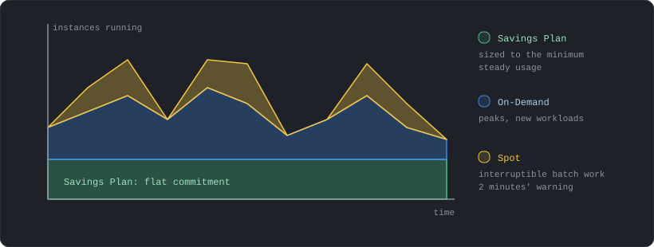

Billing is per second with a 60-second minimum. Savings Plans apply to usage automatically, so a common pattern is the layering above: a Savings Plan sized to the minimum steady usage, On-Demand for the peaks, and Spot for fault-tolerant work. Compute Savings Plans are not tied to an instance family, size, OS or Region, and they also cover Fargate and Lambda usage.

A Spot interruption notice arrives two minutes before the instance is stopped or terminated, as an EventBridge event and in the instance metadata (`spot/instance-action`). Applications should check for it every few seconds and drain work or checkpoint state.

## Placement groups

By default EC2 spreads your instances over the underlying hardware. A placement group lets you choose a different goal.

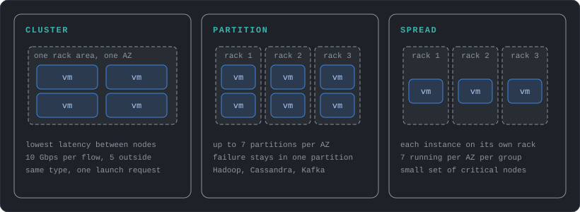

- **Cluster** packs instances close together in one AZ for low latency and high throughput between them, which suits tightly coupled work such as HPC. Instances with enhanced networking get up to 10 Gbps for a single flow inside the group, against 5 Gbps outside it. Launch all instances at once and use one instance type, or a capacity error becomes more likely.
- **Partition** divides the group into partitions that each have their own racks, power and network. A group can have up to 7 partitions per AZ, and you can see which instance is in which partition. Large replicated systems such as Cassandra, HDFS and Kafka use this to keep a hardware failure inside one partition.
- **Spread** puts each instance on distinct hardware. A group can span AZs but holds at most 7 running instances per AZ, so it fits a small set of critical instances.

Placement groups cost nothing, and an instance can be in only one at a time.

- **Commitments:** Savings Plans reduce the hourly price but bill every hour whether or not the instance runs. Size them to the usage you are sure about, not the peak.
- **Spot with burstable types:** a `t` instance launched in `unlimited` mode on Spot with no idle time pays for surplus credits. AWS recommends `standard` mode for Spot.
- **Idle resources:** a stopped instance costs nothing for compute, but its EBS volumes and Elastic IPs keep billing.

---

# Launching and Operating Instances

Three things decide what an instance looks like when it starts: the image it boots from, the script it runs on first boot, and the identity it carries.

## AMIs

An AMI (Amazon Machine Image) is the template for the root volume: operating system, software and settings. It belongs to one Region. To use it elsewhere you copy it to the other Region, which creates a new AMI ID. AMIs are built from an instance, are stored as EBS snapshots and can be shared with other accounts.

Baking the application into an AMI makes launches fast and identical. Installing it at boot with a script is more flexible and slower. Most designs combine the two: an AMI with the slow, stable parts (OS patches, runtime) and a short startup script for the configuration that changes.

## User data

User data is a script or cloud-init directive passed to the instance at launch. On Linux it runs as root, once, on the first boot only (unless you configure it to repeat), and it is limited to 16 KB before base64 encoding. Output goes to `/var/log/cloud-init-output.log`, which is the first place to look when an instance does not come up as expected.

User data is stored as an instance attribute and readable from inside the instance through the metadata service. It is not a place for secrets: put them in Secrets Manager or Parameter Store and let the script fetch them with the instance role (post 5 covers both).

## Instance roles and the metadata service

Applications on an instance should never hold access keys. Attach an IAM role through an **instance profile** (the container that hands the role to the instance), and the AWS SDKs fetch short-lived credentials automatically. The credentials come from the **instance metadata service (IMDS)**, an HTTP endpoint at `169.254.169.254` that only the instance itself can reach.

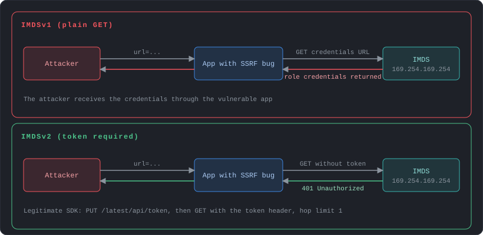

IMDS has two versions. IMDSv1 answers a plain GET request. If the application has an SSRF bug (server-side request forgery, where an attacker makes the server fetch a URL of their choosing), the attacker can ask it to fetch `http://169.254.169.254/latest/meta-data/iam/security-credentials/<role>` and walk away with the role's credentials. IMDSv2 requires a PUT request first to create a session token, then the token in a header on every GET. A simple forwarded GET, which is what most SSRF bugs produce, no longer works. PUT requests that carry an `X-Forwarded-For` header are rejected.

By default both versions are enabled. Require IMDSv2 on every instance, and set it as the default in launch templates. The token response has a hop limit of 1 by default, so containers running on the instance, which are one network hop further, cannot reach IMDS unless you raise the limit. For containers, prefer task roles (ECS) or pod identities (EKS) over giving containers access to the instance role.

## Shell access without SSH

Systems Manager Session Manager opens a shell on an instance through IAM, with no inbound port 22 or 3389, no SSH keys and no bastion host. Systems Manager has no permission on your instances by default. Grant it with an instance profile that includes the AWS managed policy `AmazonSSMManagedInstanceCore`, or at the account level with Default Host Management Configuration. The instance also needs the SSM Agent and a network path to the service, which can be the internet or the Systems Manager VPC endpoints (post 2). IAM policies control who can connect to which instances, and sessions can be logged to CloudTrail events, S3 or CloudWatch Logs. Sessions that use port forwarding or SSH tunneling are not logged. For new designs, close the SSH ports and use this.

## Status checks and recovery

EC2 runs health checks every minute and shows the result as `OK` or `impaired`. Two matter most:

- **System status checks** cover the AWS side: loss of power or network, hardware or software problems on the host. Stopping and starting an EBS-backed instance moves it to a new host (in some cases it stays on the current one). A reboot always keeps it on the same host.
- **Instance status checks** cover your side: wrong network configuration, exhausted memory, a corrupted file system, an incompatible kernel. These usually need a reboot or a configuration fix.

A CloudWatch alarm on `StatusCheckFailed_System` with the recover action brings an instance back automatically on new hardware. It keeps the instance ID and private IP address, but instance store data does not survive recovery. Auto Scaling replaces the instance instead, which fits stateless servers better.

## Metrics and logs

EC2 sends a default set of metrics to CloudWatch: CPU, network, disk activity of instance store volumes, and status checks. Data points arrive every 5 minutes. Detailed monitoring, which costs extra, makes it every minute, and status check metrics are already per minute at no charge. Memory and disk space usage are not in this set. The CloudWatch agent, installed on the instance and given permissions through the instance role, collects those operating system metrics and also ships log files to CloudWatch Logs. Metrics from the agent are billed as custom metrics. Post 5 covers CloudWatch in more detail.

## Network interfaces and IP addresses

An elastic network interface (ENI) is a virtual network card in a subnet. The IP addresses, security groups and MAC address belong to the ENI, so they follow it when it moves. Each instance has a primary ENI that cannot be detached, and secondary ENIs can be attached from the same AZ.

| Address | What to know |
|---|---|
| Private IPv4 | Taken from the subnet. Kept when the instance stops and starts, released when it terminates |
| Public IPv4 | Taken from an Amazon pool, not owned by you. Released on stop, so a new one is assigned on start |
| Elastic IP | A static public IPv4 address owned by your account until you release it. It attaches to a private IP on an ENI |
| IPv6 | Kept on stop and start, released on terminate |

Moving an ENI, or just a secondary private IP, from a failed instance to a standby sends the traffic to the standby with the same address, which makes a simple failover. Extra ENIs are also used for network appliances and for instances that must sit in two subnets. An instance that does NAT, routing or firewalling must have the source/destination check turned off on its ENI. An Elastic IP is a fix for one instance. For several instances, use a load balancer (below). All public IPv4 addresses are billed, as post 2 notes.

## Reboot, stop and terminate

Which action you take decides what survives. Most designs boot from an EBS root volume (post 4 covers EBS), and some instance types also come with **instance store** volumes: fast disks physically inside the host, included in the instance price. Instance store volumes can only be added at launch, cannot be moved to another instance, and are cryptographically erased when the instance stops, hibernates or terminates, and also when its type changes. Use them for caches, buffers and scratch data, or for data the application already replicates elsewhere.

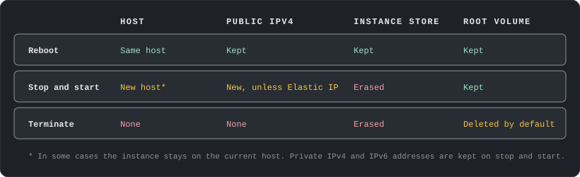

Two practical points follow. A stopped instance keeps its private IPv4 and IPv6 addresses but gets a new public IPv4 address, so use an Elastic IP when clients depend on the address. And the root volume is deleted on termination by default, while other EBS volumes are kept, which is controlled by each volume's `DeleteOnTermination` setting.

---

# Containers

A container packages an application and its dependencies into an image that runs the same everywhere. Containers share the host's kernel, so they start in seconds and use less memory than virtual machines. AWS offers a registry for the images, two orchestrators that schedule containers across machines, and two ways to supply the machines.

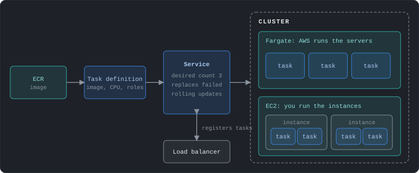

## ECR

Amazon ECR (Elastic Container Registry) stores container images in private repositories controlled by IAM. Useful features: scan on push for known vulnerabilities, lifecycle policies that delete old images, cross-Region and cross-account replication, pull-through cache for public registries, and tag immutability so that a tag cannot be overwritten. Instances and tasks need network access to ECR to pull images, so private subnets need either a NAT gateway or the ECR interface endpoints and the S3 gateway endpoint (post 2).

## ECS

Amazon ECS (Elastic Container Service) is the AWS-native orchestrator. Four terms cover it:

- **Task definition:** the blueprint. Image, CPU and memory, ports, environment variables, logging, and IAM roles.
- **Task:** one running copy of a task definition. A batch job is a task that runs and exits.
- **Service:** keeps a set number of tasks running, replaces failed ones, rolls out new versions and registers tasks with a load balancer. This is what a web application uses.
- **Cluster:** the logical group of tasks and the capacity beneath them.

Two kinds of scaling apply. Service Auto Scaling changes the number of tasks in a service. Cluster Auto Scaling changes the number of EC2 instances that hold them, which Fargate makes unnecessary.

A task uses two roles that people often mix up. The **task execution role** belongs to ECS itself: it lets the agent pull the image from ECR and write logs before the container starts. It can also fetch Secrets Manager or Parameter Store values to inject as environment variables, but only after you add those permissions, since the managed policy does not include them. The **task role** belongs to your application and holds the permissions your code needs, such as reading one S3 bucket. The container cannot use the execution role. Keeping the task role narrow is the container version of the instance role advice above.

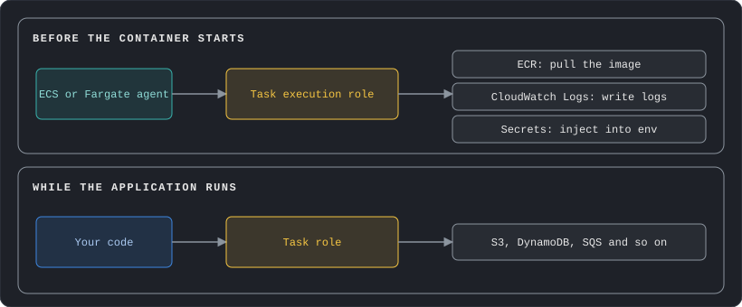

## Where the containers run

| | Fargate | EC2 (or ECS Managed Instances) |
|---|---|---|
| You manage | Task size only | Instances: type, patching, scaling the fleet (Managed Instances hands most of this to AWS) |
| Billing | vCPU and memory per second while a task runs | The instances, used or not |
| Isolation | Each task has its own isolation boundary, with no shared kernel, CPU, memory or network interface | Tasks share the instances and their kernel |
| Fit | Most services, spiky or small workloads, no desire to run servers | Steady high utilization, GPUs, special instance types |

Fargate bills from the start of the image pull until the task ends, per second with a one-minute minimum, and includes 20 GB of ephemeral storage per task. Fargate Spot is available for interruption-tolerant Linux tasks at up to a 70% discount, with a two-minute warning before a task is interrupted.

## How Fargate works

With Fargate you describe a task (image, CPU, memory, networking, roles) and AWS finds the compute, runs it in isolation, and bills for the task only. There is no instance to patch, size or log in to. What matters for an architecture is where the task sits in your network and how it stores data.

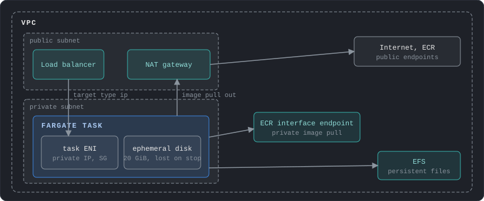

- **Networking:** every task gets its own network interface (ENI) with a private IP address in the subnet you choose. Security groups attach to that interface (up to 5), and VPC Flow Logs show the task's traffic. A public IP is optional and only works in a public subnet.
- **Load balancers:** an ALB or NLB reaches tasks by IP address, so the target group type must be `ip`, not `instance`. Classic Load Balancers are not supported.
- **Image pulls:** a task must have a route to pull its image. In a public subnet that means a public IP. In a private subnet it means a NAT gateway or, for images in ECR, an ECR interface endpoint (post 2).
- **Storage:** each task has 20 GiB of ephemeral storage by default, up to 200 GiB, which is gone when the task stops. For data that must outlive the task, mount an EFS file system (post 4), which is shared and persistent.
- **Patching:** a Fargate platform version is a specific kernel and container runtime. New tasks always start on the latest patched revision, and AWS can retire tasks that run on a vulnerable one, so a service must tolerate its tasks being replaced.

## EKS

Amazon EKS (Elastic Kubernetes Service) runs Kubernetes, the open-source orchestrator, with AWS operating the control plane (the API servers and the data store). The worker machines can be EC2 instances, Fargate or EKS Auto Mode, where AWS also manages the nodes. Pick EKS when the team already knows Kubernetes, needs its ecosystem of tools, or wants to avoid being tied to an AWS-only API. Pick ECS when the goal is the simplest way to run containers on AWS.

- **Fargate sizing:** at the Linux x86 rates (about $0.0405 per vCPU-hour and $0.0044 per GB-hour, derived from the per-second prices), one always-on task with 1 vCPU and 2 GB is about $36 a month. Right-size tasks, since you pay for what you reserve.
- **EKS control plane:** $0.10 per cluster-hour is about $73 a month before any nodes. A cluster on a Kubernetes version past standard support costs $0.60 per hour, about $438 a month. Plan upgrades.
- **Many small clusters:** each EKS cluster pays the control plane fee. Use namespaces and separate node groups before splitting into more clusters.

---

# Load Balancing

A load balancer gives clients one address and spreads their requests across healthy targets in several AZs. It also runs health checks, so a failed target stops receiving traffic without any change on the client side. Post 2 covered DNS and CloudFront in front of it. This section covers what sits inside the VPC.

**Elastic Load Balancing (ELB)** is the name of the service. It offers four types of load balancer: the Application Load Balancer (ALB), the Network Load Balancer (NLB), the Gateway Load Balancer (GWLB) and the older Classic Load Balancer (CLB). So "ELB" is the family and "ALB" is one member of it, and when a question or diagram says "ELB" without a type, it usually means any of them.

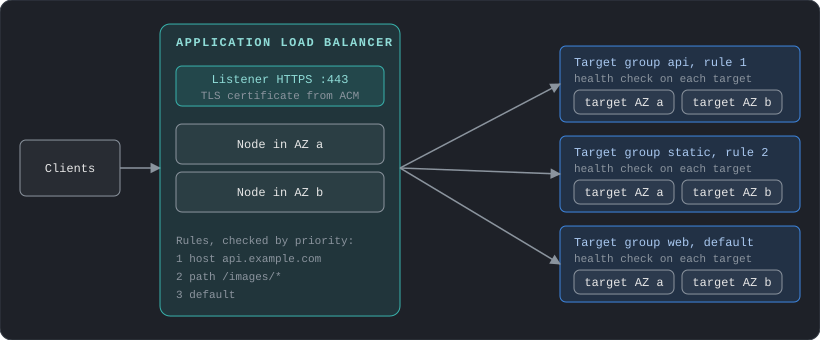

## The building blocks

A **load balancer node** is created in each AZ you enable, and the load balancer's DNS name resolves to the nodes' addresses. A **listener** accepts connections on a protocol and port. **Rules** on the listener decide the **target group**, which is a set of instances, IP addresses, Lambda functions or ECS tasks plus a health check. A target in an AZ with no load balancer node receives no traffic, so enable every AZ where you run targets.

A load balancer is either **internet-facing** (nodes with public IPs) or **internal** (private IPs only). Targets need no public address in either case. A typical multi-tier design uses an internet-facing balancer for the web tier and an internal one between the web and application tiers.

## Choosing a type

| | Application (ALB) | Network (NLB) | Gateway (GWLB) |
|---|---|---|---|
| Layer | 7 (HTTP, HTTPS, gRPC) | 4 (TCP, UDP, TLS) | 3 (IP packets) |
| Routing | By host, path, header, query string or source IP | By connection (flow hash) | Sends traffic through a fleet of security appliances |
| Static IP | No, use the DNS name | One per AZ, can be an Elastic IP | Not applicable |
| Notable features | Redirects, fixed responses, user authentication, WAF, Lambda targets, sticky sessions | Very high connection rates, preserves the client IP, TLS termination, PrivateLink source | Transparent inspection by firewalls and IDS |

The decision is usually simple. Use an ALB for web applications and APIs. Use an NLB for non-HTTP protocols, for a static address that partners can allow-list, or as the front of a PrivateLink service (post 2). Use a GWLB to insert third-party appliances into the traffic path. The Classic Load Balancer is the previous generation and should not be used for new designs.

Because an ALB terminates the client connection and opens a new one to the target, the target sees the balancer's address. The client address arrives in the `X-Forwarded-For` header. The ALB can also terminate TLS using a certificate from ACM (AWS Certificate Manager), so the instances do not have to handle certificates.

## ALB and NLB in detail

The two types differ most in how they handle a connection.

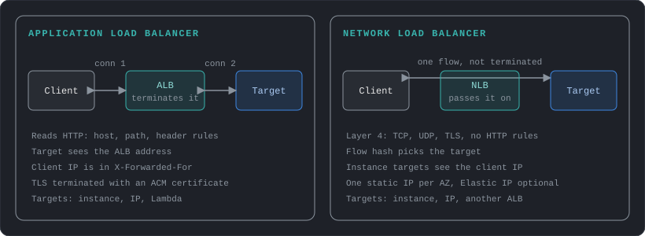

| | ALB | NLB |
|---|---|---|
| Client IP seen by the target | The balancer's address, with the client address in `X-Forwarded-For` | The client address for instance targets. For IP targets with TCP or TLS listeners it is off by default. Proxy protocol v2 can pass it on |
| Target types | Instance, IP, Lambda | Instance, IP, another ALB. No Lambda |
| Security groups | Yes | Yes, but only if one was attached when the NLB was created |
| Idle timeout | 60 seconds by default | TCP 350 seconds by default, UDP 120 seconds |
| Stickiness | Cookies, from the load balancer or your application | Source IP |
| Zones | At least two AZs, with free IP addresses in each subnet for scaling | One or more AZs, one static IP in each |
| Health checks | Per target group | Per target group, over HTTP, HTTPS or TCP |

Two consequences matter in designs. Because an NLB can forward to an ALB, a service can have both the static addresses of an NLB and the HTTP routing of an ALB. And when targets are registered by instance ID behind an NLB, the target's security group sees the real client address, so rules must allow the clients or the NLB's security group, not just the balancer.

## Cross-zone load balancing

Each node receives an equal share of the client traffic, because DNS hands out the node addresses evenly. With cross-zone load balancing off, a node sends traffic only to targets in its own AZ, so an uneven number of targets per AZ means uneven load.

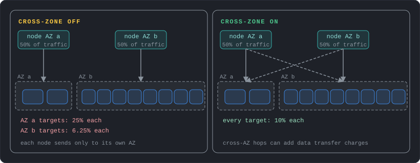

An ALB always has it on at the load balancer level, and it can be turned off per target group. An NLB and a GWLB have it off by default. Keep target counts equal across AZs, or turn cross-zone on, and decide whether the cross-AZ traffic charge is worth the better balance.

## Draining and slow start

When a target is deregistered, for example during scale-in or a deployment, the load balancer stops sending it new requests and waits for the deregistration delay (300 seconds by default) so in-flight requests can finish. An ALB target group can also use slow start, which raises the traffic to a new target gradually so a cold application is not hit with its full share at once.

## Session stickiness

Sticky sessions send a client to the same target using a cookie, either one generated by the load balancer for a set duration or one set by your application. They are a workaround for applications that keep session state in memory, and they unbalance the load and lose the session when that target fails. Moving session data to a shared store (ElastiCache, DynamoDB) removes the need.

- **Hourly charge:** an ALB or NLB costs $0.0225 per hour, about $16 a month, plus a usage charge per capacity unit (LCU for ALB at $0.008 per hour, NLCU for NLB at $0.006). Many small applications can share one ALB with host and path rules instead of one each.
- **Cross-AZ traffic:** the data transfer charge between AZs from post 1 applies when a node sends traffic to a target in another AZ. Check the load balancer pricing page for how it is billed for each type.

---

# Auto Scaling

An Auto Scaling group (ASG) manages a fleet of identical instances. It replaces failed ones and adds or removes instances as load changes. It is the piece that turns a load-balanced fleet into a self-healing, elastic application.

There are two ways to add capacity. **Vertical scaling** moves to a bigger instance: stop it, change the instance type, start it again. It means downtime, it stops at the largest instance size, and it keeps a single point of failure. **Horizontal scaling** adds more instances behind a load balancer. It needs no downtime and has no size ceiling, but the application must not keep state on one instance, so sessions and files move to shared stores. An Auto Scaling group does horizontal scaling.

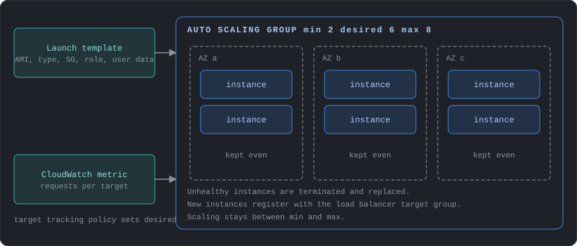

## How a group works

You give the group a **launch template** (AMI, instance type, security groups, user data, instance profile, storage), the subnets in several AZs, and three numbers. **Minimum** and **maximum** are the limits, and **desired** is the current target. The group launches or terminates instances until the running count equals desired, and spreads them evenly across the AZs. If an AZ becomes unavailable, it launches replacements in the remaining zones.

Attach the group to a load balancer target group, and new instances register automatically when they are ready and deregister before they terminate. Health checks decide when to replace an instance. The EC2 status checks are always used, and the others are optional: enable the load balancer health checks so that an instance that is running but whose application stopped responding is replaced. VPC Lattice, EBS and custom checks can be added as well.

For a Spot and On-Demand mix, define several instance types in the template so that the group can fall back to another type when one runs short of Spot capacity.

## Scaling policies

| Method | How it works | Fit |
|---|---|---|
| Target tracking | A dynamic policy. Keep a metric near a target, such as 50% average CPU or a request count per target. The group does the arithmetic | AWS recommends it for most cases |
| Step | A dynamic policy. Add or remove a number of instances depending on how far an alarm is breached | Fine control over big spikes |
| Simple | A dynamic policy with one adjustment and a cooldown between activities | Older and less flexible than the others |
| Scheduled | Change capacity at set times | Known patterns: office hours, a nightly batch |
| Predictive | Scales out ahead of daily and weekly traffic patterns, combined with dynamic scaling | Regular cycles with slow-starting instances |

Policies can be combined. When several apply at once, the group follows the one that gives the largest capacity. Mixing target tracking with step scaling can cause conflicts, so be careful.

CPU is the easy metric to start with, but the best one reflects the real bottleneck: requests per target from the load balancer, or queue depth per instance for workers reading from SQS. New instances need time to boot and warm up before they can take load, so set the instance warm-up period so that they are not counted too early and trigger further scale-out.

## Updating the fleet

To roll out a new AMI or launch template version, use **instance refresh**, which replaces instances in batches while keeping a minimum healthy percentage. **Lifecycle hooks** pause an instance during launch or termination so that it can finish work, such as installing software before it receives traffic or draining connections before it shuts down. **Warm pools** keep pre-initialized instances on standby for applications with long boot times.

When the group scales in, it first balances the AZs: it picks the zone with the most instances, ahead of any other rule. Within that zone the default termination policy removes instances on an outdated launch template first, then those closest to the next billing hour. Other policies, such as `OldestInstance` or `NewestInstance`, can be chosen when upgrading instance types or testing a new configuration, and scale-in protection keeps chosen instances from being removed.

- **Auto Scaling itself is free:** you pay for the instances, volumes and load balancers it launches. Scaling in quickly when load drops is where the savings come from.
- **Minimum size:** the minimum is a cost floor. Set it to what availability needs (usually one instance per AZ) and let scaling handle the rest.

---

# Choosing a Compute Service

EC2 and containers are the main choices, and a few other services cover narrower cases.

| You need | Use | Notes |
|---|---|---|
| Full control of the operating system and servers | EC2 | This post |
| Containers without managing servers | ECS or EKS on Fargate | See Containers above |
| Short, event-driven code | Lambda | Post 5 |
| Queued, compute-heavy jobs, such as simulations or data processing | AWS Batch | Schedules containerized jobs onto EC2, Spot, Fargate or ECS Managed Instances and scales capacity to the queue |
| Deploy a web app from code without building the stack | Elastic Beanstalk | Creates the instances, load balancer and scaling for you. No extra charge, you pay for the resources |
| A small site or learning project with a simple console | Lightsail | Virtual servers, containers, storage and databases bundled at a fixed monthly price (Linux bundles start at $5 with 0.5 GB memory, 2 vCPUs, 20 GB SSD and 1 TB transfer), with a path to move to EC2 later |

---

# Design Checklist

1. Does every tier run in at least two AZs, with the load balancer enabled in each?
2. Is each instance replaceable from an AMI, a launch template and a startup script, without manual work?
3. Is the instance type matched to the real bottleneck (CPU, memory, disk, GPU), and checked against Compute Optimizer?
4. Does the steady baseline have a Savings Plan, and does interruption-tolerant work use Spot?
5. Do instances require IMDSv2, use roles instead of access keys, and offer shell access through Session Manager with SSH closed?
6. Is anything that matters stored only on instance store, or on a root volume that is deleted on termination?
7. Fargate, ECS on EC2 or EKS: which one does the team have the skills to operate?
8. Does each container task have its own narrow task role, separate from the execution role?
9. Does the ASG scale on a metric that reflects load, and does the health check include the application?
10. Are target counts balanced across AZs, and is the cross-zone setting a conscious choice?

---

# References

## EC2 Instances

- [Amazon EC2 instance types](https://docs.aws.amazon.com/ec2/latest/instancetypes/instance-types.html)
- [Nitro-based instances](https://docs.aws.amazon.com/ec2/latest/instancetypes/ec2-nitro-instances.html)
- [Burstable performance instances](https://docs.aws.amazon.com/AWSEC2/latest/UserGuide/burstable-performance-instances.html)
- [Unlimited mode for burstable instances](https://docs.aws.amazon.com/AWSEC2/latest/UserGuide/burstable-performance-instances-unlimited-mode.html)
- [Spot Instance interruption notices](https://docs.aws.amazon.com/AWSEC2/latest/UserGuide/spot-instance-termination-notices.html)
- [Reserved Instances](https://docs.aws.amazon.com/AWSEC2/latest/UserGuide/ec2-reserved-instances.html)
- [Dedicated Hosts and Dedicated Instances](https://docs.aws.amazon.com/AWSEC2/latest/UserGuide/dedicated-hosts-overview.html)
- [Placement groups](https://docs.aws.amazon.com/AWSEC2/latest/UserGuide/placement-groups.html)
- [Placement strategies](https://docs.aws.amazon.com/AWSEC2/latest/UserGuide/placement-strategies.html)

## Launching and Operating

- [User data](https://docs.aws.amazon.com/AWSEC2/latest/UserGuide/user-data.html)
- [Instance metadata service](https://docs.aws.amazon.com/AWSEC2/latest/UserGuide/configuring-instance-metadata-service.html)
- [Session Manager](https://docs.aws.amazon.com/systems-manager/latest/userguide/session-manager.html)
- [IAM roles for Amazon EC2](https://docs.aws.amazon.com/AWSEC2/latest/UserGuide/iam-roles-for-amazon-ec2.html)
- [Status checks for instances](https://docs.aws.amazon.com/AWSEC2/latest/UserGuide/monitoring-system-instance-status-check.html)
- [Network interfaces](https://docs.aws.amazon.com/AWSEC2/latest/UserGuide/using-eni.html)
- [Instance IP addressing](https://docs.aws.amazon.com/AWSEC2/latest/UserGuide/using-instance-addressing.html)
- [EC2 CloudWatch metrics](https://docs.aws.amazon.com/AWSEC2/latest/UserGuide/viewing_metrics_with_cloudwatch.html)
- [CloudWatch agent](https://docs.aws.amazon.com/AmazonCloudWatch/latest/monitoring/Install-CloudWatch-Agent.html)
- [Instance state changes (reboot, stop, terminate)](https://docs.aws.amazon.com/AWSEC2/latest/UserGuide/ec2-instance-lifecycle.html)
- [Instance store data persistence](https://docs.aws.amazon.com/AWSEC2/latest/UserGuide/instance-store-lifetime.html)

## Containers

- [What is Amazon ECS](https://docs.aws.amazon.com/AmazonECS/latest/developerguide/Welcome.html)
- [Architect for Fargate](https://docs.aws.amazon.com/AmazonECS/latest/developerguide/AWS_Fargate.html)
- [Fargate task networking](https://docs.aws.amazon.com/AmazonECS/latest/developerguide/fargate-task-networking.html)
- [Storage options for ECS tasks](https://docs.aws.amazon.com/AmazonECS/latest/developerguide/using_data_volumes.html)
- [Task execution IAM role](https://docs.aws.amazon.com/AmazonECS/latest/developerguide/task_execution_IAM_role.html)
- [What is Amazon ECR](https://docs.aws.amazon.com/AmazonECR/latest/userguide/what-is-ecr.html)
- [What is AWS Batch](https://docs.aws.amazon.com/batch/latest/userguide/what-is-batch.html)
- [What is Elastic Beanstalk](https://docs.aws.amazon.com/elasticbeanstalk/latest/dg/Welcome.html)
- [Amazon Lightsail](https://aws.amazon.com/lightsail/)
- [What is Amazon EKS](https://docs.aws.amazon.com/eks/latest/userguide/what-is-eks.html)

## Load Balancing

- [How Elastic Load Balancing works](https://docs.aws.amazon.com/elasticloadbalancing/latest/userguide/how-elastic-load-balancing-works.html)
- [Application Load Balancers](https://docs.aws.amazon.com/elasticloadbalancing/latest/application/introduction.html)
- [Network Load Balancers](https://docs.aws.amazon.com/elasticloadbalancing/latest/network/network-load-balancers.html)
- [ALB target group attributes (draining, slow start, stickiness)](https://docs.aws.amazon.com/elasticloadbalancing/latest/application/edit-target-group-attributes.html)

## Auto Scaling

- [Auto Scaling groups](https://docs.aws.amazon.com/autoscaling/ec2/userguide/auto-scaling-groups.html)
- [Choose your scaling method](https://docs.aws.amazon.com/autoscaling/ec2/userguide/scaling-overview.html)
- [Termination policies](https://docs.aws.amazon.com/autoscaling/ec2/userguide/ec2-auto-scaling-termination-policies.html)
- [Dynamic scaling](https://docs.aws.amazon.com/autoscaling/ec2/userguide/as-scale-based-on-demand.html)
- [Health checks for Auto Scaling instances](https://docs.aws.amazon.com/autoscaling/ec2/userguide/ec2-auto-scaling-health-checks.html)

## Cost and Performance

- [Amazon EC2 pricing](https://aws.amazon.com/ec2/pricing/)
- [What are Savings Plans](https://docs.aws.amazon.com/savingsplans/latest/userguide/what-is-savings-plans.html)
- [AWS Fargate pricing](https://aws.amazon.com/fargate/pricing/)
- [Amazon EKS pricing](https://aws.amazon.com/eks/pricing/)
- [Elastic Load Balancing pricing](https://aws.amazon.com/elasticloadbalancing/pricing/)

---

Next post: **Storage & Data**, starting with how S3 stores objects and how its storage classes are chosen.
