# About this post

Every workload has to keep data somewhere. AWS offers three kinds of storage, and they differ in how an application reaches the data: block storage is a disk, file storage is a shared folder, and object storage is a collection of items read and written through an API. This post covers each kind, then how to back data up and how to move it in from on-premises. Prices are for `us-east-1` at the time of writing (November 2026), as in the earlier posts.

Databases have their own post (5), because they add replication, failover and query engines on top of storage. Lambda and event-driven design are in post 6.

---

# Three Kinds of Storage

The first decision is which kind of storage fits how the data is used.

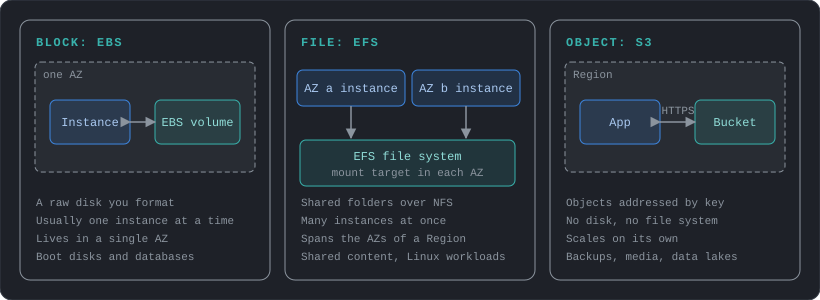

| | Block (EBS) | File (EFS, FSx) | Object (S3) |
|---|---|---|---|
| How it is used | A raw disk that you format | A shared folder over a network protocol | Items read and written by key over HTTPS |
| Scope | One AZ | Regional (EFS) | Regional |
| Shared by | Usually one instance | Many instances and servers | Any number of clients |
| Change part of a file | Yes | Yes | No, an object is replaced as a whole |
| Typical use | Boot disks, databases | Shared content, home directories | Backups, media, data lakes, static sites |
| Price per GB-month | $0.08 (gp3) | $0.30 (EFS Standard) | $0.023 (S3 Standard) |

The price gap is large, so a common design keeps hot data on EBS or EFS and everything else on S3. Post 3 covered the instance store, the local disk that lives and dies with an instance.

---

# Block Storage: EBS

An EBS (Elastic Block Store) volume is a disk that is attached to an instance over the network. It lives in one AZ, AWS replicates it within that AZ, and it can only be attached to instances in the same AZ. The data survives stopping and starting the instance. gp3, gp2, io1, st1 and sc1 volumes are designed for 99.8% to 99.9% durability (an annual failure rate of 0.1% to 0.2%), and `io2` Block Express for 99.999%. At those rates a volume can fail, so keep snapshots.

## Volume types

| Type | Medium | Max IOPS | Max throughput | Use |
|---|---|---|---|---|
| `gp3` | SSD | 80,000 | 2,000 MiB/s | Default for boot volumes, databases and most workloads |
| `gp2` | SSD | 16,000 | 250 MiB/s | Older default, IOPS tied to volume size |
| `io2` Block Express | SSD | 256,000 | 4,000 MiB/s | Latency-sensitive databases that need sustained IOPS |
| `io1` | SSD | 64,000 | 1,000 MiB/s | Provisioned IOPS, older generation |
| `st1` | HDD | 500 | 500 MiB/s | Large sequential reads: logs, data warehouses |
| `sc1` | HDD | 250 | 250 MiB/s | Cold data at the lowest cost |

IOPS (I/O operations per second) matters for many small reads and writes, and throughput for large sequential ones. A `gp3` volume includes 3,000 IOPS and 125 MiB/s whatever its size, and more of either can be bought without growing the volume. `gp2` ties IOPS to size, so people grew volumes just to get speed. New designs should use `gp3`. HDD volumes cannot be boot volumes.

Performance has two ceilings. The volume has its own limits, and the instance has an EBS bandwidth limit, so a fast volume on a small instance will not reach its speed. Some instance types are EBS-optimized by default, with dedicated bandwidth between the instance and EBS, and others offer it for an hourly fee. The 256,000 IOPS of `io2` needs a Nitro instance.

Size, type, IOPS and throughput can be changed while the volume is in use, with no detach and no restart (Elastic Volumes). A volume can be modified up to four times in 24 hours, size can only grow, and a root volume cannot become `st1` or `sc1`. Remember to extend the file system after growing a volume.

**Multi-Attach** lets one `io1` or `io2` volume attach to up to 16 Nitro instances in the same AZ. Ordinary file systems such as XFS and ext4 cannot be written by several servers at once, so it needs a cluster-aware file system or an application that orders its own writes.

## Snapshots

A snapshot is a point-in-time backup of a volume. The first one copies the whole volume, and later ones store only the blocks that changed. Snapshots are kept in S3, which you cannot browse, and are replicated across the AZs of the Region, so a volume can be restored in any AZ. Deleting one snapshot does not always free space, because other snapshots may reference the same blocks.

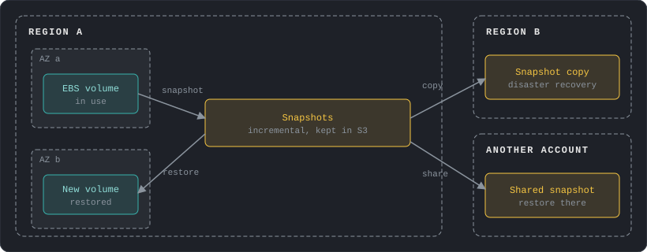

AWS does not back up volumes on its own. Amazon Data Lifecycle Manager (free) automates snapshot creation, retention and deletion on a schedule, and AWS Backup (below) does the same for many services at once. Snapshots belong to a Region. A copy to another Region is a full copy, and the transfer is billed. A snapshot can be shared with specific accounts, but a snapshot encrypted with the default AWS managed key cannot be shared. It needs a customer managed key, and the key must be shared with the other account too. Only unencrypted snapshots can be made public.

Four features protect the snapshots themselves:

- **Archive tier:** moves a snapshot to storage that costs up to 75% less. The minimum stay is 90 days and a restore takes up to 72 hours. Archived snapshots are always full copies, so archive monthly or yearly snapshots, not daily ones.
- **Recycle Bin:** keeps deleted snapshots, volumes and AMIs for a retention period you set, so an accidental delete can be undone.
- **Snapshot lock:** a WORM setting (write once, read many) that stops anyone deleting a snapshot, whatever their IAM permissions. In compliance mode the lock cannot be removed once its cooling-off period ends.
- **Fast Snapshot Restore:** a volume restored from a snapshot starts slowly, because its blocks are downloaded from S3 the first time they are read. Fast Snapshot Restore makes new volumes perform at full speed immediately. It is enabled per snapshot and per AZ, up to 5 snapshots per Region, and is meant for launching many instances from one snapshot.

## Encryption

EBS encrypts with a KMS key (explained in the Encryption and KMS section below), and the work happens on the host, so data is protected at rest, in transit between the instance and the volume, and in every snapshot and volume made from it. Turn on **encryption by default** for the account in each Region and every new volume is encrypted, with the AWS managed key or a customer managed one.

Three rules to remember. An existing unencrypted volume cannot be encrypted in place: snapshot it, copy the snapshot with encryption on, and create a new volume from the copy. Encryption cannot be removed from a volume or snapshot. And the key of an existing volume cannot be changed, though a snapshot copy can use a different key.

- **gp3 over gp2:** `gp3` costs $0.08 per GB-month against $0.10 for `gp2`, and includes the 3,000 IOPS baseline. Extra IOPS cost $0.005 per IOPS-month and extra throughput $0.04 per MiB/s-month.
- **Provisioned IOPS:** `io2` costs $0.125 per GB-month plus $0.065 per IOPS-month for the first 32,000. Buy it only for volumes that need sustained IOPS beyond what `gp3` offers.
- **Snapshots:** standard storage is $0.05 per GB-month and the archive tier is $0.0125, with a $0.03 per GB fee to restore. Archive early deletion bills the rest of the 90 days.
- **Fast Snapshot Restore:** $0.75 per hour for each snapshot in each AZ, about $540 a month if left on. Enable it before the launches that need it and disable it afterwards.

---

# File Storage: EFS and FSx

A file system is shared storage that many servers mount at once. EFS (Elastic File System) is the AWS-native one. It speaks NFS (the Unix network file protocol), grows and shrinks on its own, and is reached from Linux instances (Windows instances are not supported).

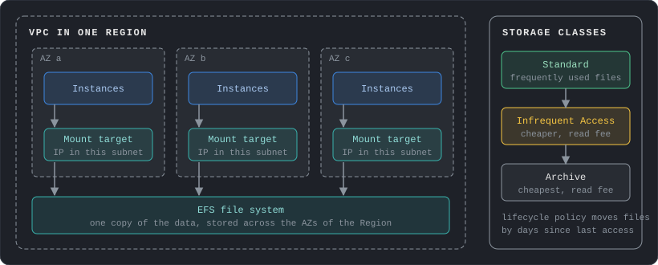

A **Regional** file system stores data across several AZs and has one **mount target** in each AZ, which is an IP address in your subnet that serves NFS. A **One Zone** file system lives in a single AZ, costs less and can lose data if that AZ is damaged. Open port 2049 in the security group. On-premises Linux servers can mount EFS over Direct Connect or a Site-to-Site VPN (post 2).

| Setting | Options | Guidance |
|---|---|---|
| Throughput mode | Elastic (default, recommended), Provisioned, Bursting | Elastic for spiky or unpredictable load, and you pay per amount read and written. Provisioned when you know the throughput and use a good share of it. Bursting scales with stored size |
| Performance mode | General Purpose (default), Max I/O | Use General Purpose. Max I/O is an older mode with higher latency and is not available on One Zone or Elastic throughput |
| Storage class | Standard, Infrequent Access, Archive | A lifecycle policy moves files after 30 days without access to Infrequent Access and after 90 days to Archive. Moving a file back to Standard on its next access is optional |

**Access points** are application-specific entry points that force a POSIX identity (user and group ID) and a root directory on everyone who uses them, which lets many applications share one file system safely. Encryption at rest is chosen when the file system is created, and encryption in transit is chosen when it is mounted.

**FSx** is a family of managed file systems for needs that EFS does not meet:

| FSx for | Protocols | Pick it for |
|---|---|---|
| Windows File Server | SMB, with Active Directory and NTFS permissions | Windows applications and file shares |
| Lustre | POSIX, Linux only | High-speed computing, machine learning, video processing. Can link to an S3 bucket |
| NetApp ONTAP | NFS, SMB, iSCSI, NVMe | Moving NetApp storage to AWS, with snapshots, clones and tiering |
| OpenZFS | NFS | Moving ZFS or Linux file servers to AWS |

- **EFS is the expensive tier:** Standard is $0.30 per GB-month, roughly 13 times S3 Standard. Infrequent Access is $0.025 and Archive $0.008, with a fee to read from them, so lifecycle policies are where the savings are. One Zone Standard is $0.16.
- **Throughput:** Elastic adds $0.03 per GB read and $0.06 per GB written. Provisioned throughput is $6.00 per MiB/s-month above the baseline included with Standard storage.

---

# Object Storage: S3

S3 (Simple Storage Service) stores **objects** in **buckets**. An object is data plus metadata, identified by a **key** such as `reports/2026/11/sales.csv`. The part of the key before the final slash is a **prefix**, which is part of the name that tools display as a folder. Buckets are Regional, bucket names are globally unique, and an object is written and replaced as a whole.

S3 has strong read-after-write consistency for new objects, overwrites, deletes and listings. If two clients write the same key at once, the last write wins. A single upload can be up to 5 GB, and multipart uploads reach about 50 TB.

## Storage classes

**Durability** is the chance of keeping data without loss, and every class is designed for 11 nines (99.999999999%). **Availability** is the chance of reaching it when you ask, and it varies by class. The classes also differ in how many AZs hold the data, how fast and how expensive it is to read, and how long you pay for it at minimum.

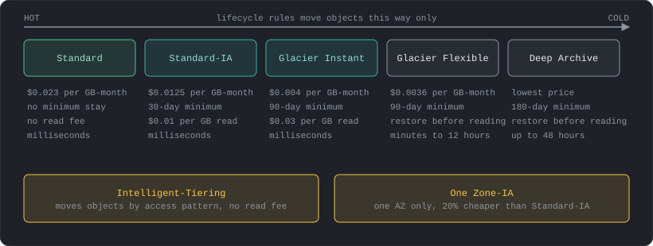

| Class | AZs | Availability | Minimum stay | Read cost | Price per GB-month |
|---|---|---|---|---|---|
| Standard | 3 or more | 99.99% | None | None | $0.023 |
| Intelligent-Tiering | 3 or more | 99.9% | None | None | $0.023 down to $0.004, by access |
| Standard-IA | 3 or more | 99.9% | 30 days | $0.01 per GB | $0.0125 |
| One Zone-IA | 1 | 99.5% | 30 days | $0.01 per GB | $0.01 |
| Glacier Instant Retrieval | 3 or more | 99.9% | 90 days | $0.03 per GB | $0.004 |
| Glacier Flexible Retrieval | 3 or more | 99.99% after restore | 90 days | Minutes to 12 hours to restore | $0.0036 |
| Glacier Deep Archive | 3 or more | 99.99% after restore | 180 days | Up to 48 hours to restore | Lowest of all |

Standard-IA, One Zone-IA and Glacier Instant Retrieval bill for at least 128 KB per object. **Intelligent-Tiering** moves each object between tiers by itself: Frequent, then Infrequent after 30 days without access, then Archive Instant Access after 90 days, and back to Frequent when it is read. Opt-in Archive and Deep Archive tiers go colder still. It adds a monitoring charge per object, and objects under 128 KB are not monitored. It has no retrieval fee, so it suits data whose access pattern is unknown.

Only One Zone-IA and Express One Zone (a single-AZ class for very low latency, using a different type of bucket) are not resilient to the loss of an AZ.

## Lifecycle rules

A lifecycle rule applies actions to objects by age or filter, so data moves down the table above without anyone doing it by hand.

- **Transition** moves objects to a colder class. Transitions only go colder, and Deep Archive is the end of the line.
- **Expiration** deletes objects. In a versioned bucket it adds a delete marker.
- **Noncurrent version** actions transition or delete old versions, and can keep only the newest N.
- **Abort incomplete multipart uploads** cleans up half-finished uploads that otherwise bill silently.

Three details cause most surprises:

- Objects smaller than 128 KB do not transition unless a size filter says so (since September 2024).
- Leaving a class before its minimum stay is allowed but bills the remaining days, and one rule cannot move an object out of a class before that period has passed.
- MFA Delete and lifecycle rules cannot be used together.

## Versioning and Object Lock

**Versioning** keeps every version of an object. Once enabled, it can only be suspended and never removed.

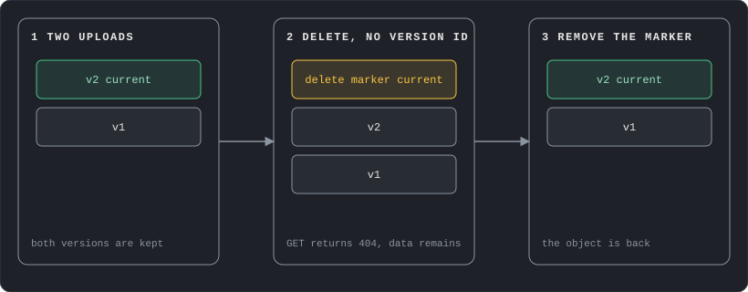

A delete without a version ID adds a **delete marker**, so the object looks gone while every version stays. Deleting the marker by its version ID brings the object back, and deleting a real version by its ID removes it for good. Each version is billed as a full object, so pair versioning with a lifecycle rule for old versions. **MFA Delete** additionally requires an MFA code to change the versioning state or permanently delete a version. Only the root user can turn it on, and only through the CLI or API.

**Object Lock** gives WORM protection (write once, read many) to the versions in a versioned bucket.

| Protection | Who can remove it | How long |
|---|---|---|
| Governance mode | Users with the bypass permission | Until the retention period ends |
| Compliance mode | No one, including root | Until the retention period ends |
| Legal hold | Users with the legal hold permission | No end date, independent of retention |

Use compliance mode for regulated records, and try governance mode first while testing.

## Access control

S3 evaluates several layers, and a request needs to pass them all.

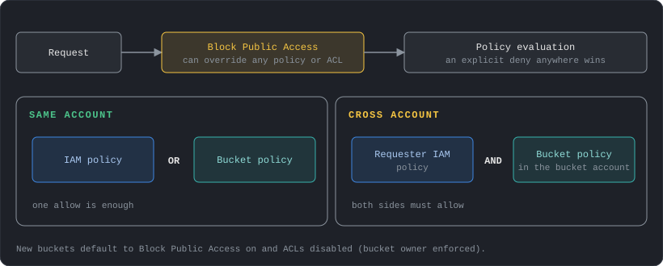

- **Block Public Access** has four settings that override any policy or ACL that would make data public. It works at account, bucket and access point level, and is on by default for new buckets.
- **Object Ownership** defaults to bucket owner enforced for new buckets, which disables ACLs (the old per-object permission lists) so that the bucket owner owns every object and policies are the only access control. Leave it that way.
- **Policies** work as post 1 described. Inside one account, an allow in either the IAM policy or the bucket policy is enough. Across accounts, both the requester's IAM policy and the bucket policy must allow, and an explicit deny always wins.
- **Access points** are named endpoints with their own policy, each of which can be limited to a VPC. They keep a bucket policy short when many applications share one bucket. Only object operations work through them.

## Encryption at rest

Every new object is encrypted at rest with SSE-S3 (S3-managed keys, AES-256) at no cost, and this cannot be turned off. The other options change who controls the key, and the KMS section below explains the keys behind them.

| Option | Key held by | Pick it for |
|---|---|---|
| SSE-S3 | S3 | The default, with nothing to manage |
| SSE-KMS | A KMS key you choose | Key policy control and an audit trail of every use in CloudTrail |
| DSSE-KMS | A KMS key, applied in two layers | Rules that require two layers of encryption |
| SSE-C | You send the key with each request | Keeping keys fully outside AWS. Disabled by default on new buckets since April 2026 |
| Client-side | You encrypt before upload | Data that must never reach AWS in plain text |

SSE-KMS calls KMS for every object, which adds cost and request limits. **Bucket Keys** let S3 use a short-lived bucket-level key and cut KMS request costs by up to 99%. They apply to new objects only and are not supported for DSSE-KMS.

## Replication

Replication copies new objects to a destination bucket automatically. **Same-Region replication (SRR)** copies within a Region and **cross-Region replication (CRR)** across Regions, and either can target another account.

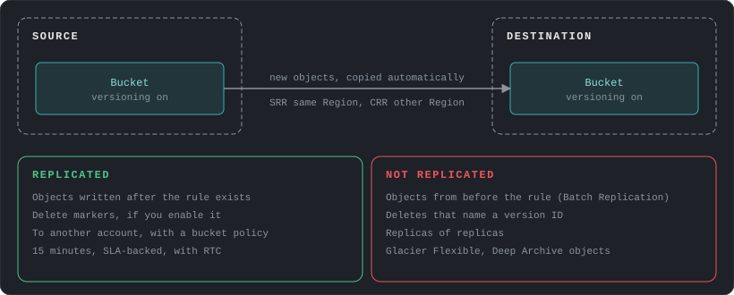

Versioning must be on in both buckets. Replication is not retroactive, so use S3 Batch Replication for existing objects, and also for chains of buckets, because replicas are not replicated again. **Replication Time Control** adds a 15-minute, SLA-backed replication target. Typical uses are disaster recovery, compliance copies in another Region, and keeping data near users or in another account.

## Presigned URLs

A presigned URL gives temporary access to one object without sharing credentials or making the bucket public.

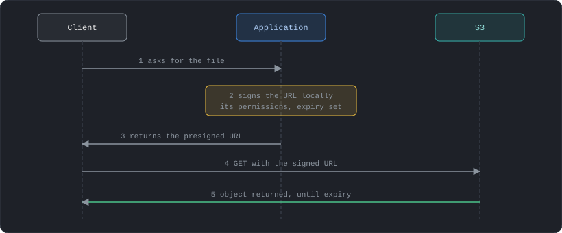

Anyone with valid credentials can create one, but it only works if its creator is allowed that action, and it carries the creator's permissions. Treat it like a password until it expires. An IAM user can set an expiry up to 7 days. A URL signed with role or temporary credentials stops working when that session ends, which may be as short as an hour. A presigned URL goes straight to S3. To serve private content through the CDN instead, use CloudFront signed URLs (post 2).

## Performance

S3 supports at least 3,500 write and 5,500 read requests per second per prefix, with no limit on the number of prefixes, so spreading keys over prefixes scales further. For large objects:

- **Multipart upload** splits an object into up to 10,000 parts of 5 MiB to 5 GiB, uploaded in parallel and retried individually. Use it from about 100 MB.
- **Byte-range fetches** read parts of an object in parallel, or only the part needed.
- **Transfer Acceleration** sends uploads to the nearest CloudFront edge location and over the AWS backbone, which helps when clients are far from the bucket. It is enabled per bucket, needs a DNS-compatible bucket name without dots, and costs extra per GB.

## Events, website hosting and inventory

- **Event notifications** send object created and deleted events to SQS (standard queues), SNS, Lambda or EventBridge. EventBridge is the way to reach FIFO queues and many other targets. Delivery is at least once, so handlers must tolerate duplicates, and writing to the same bucket that triggers a function can create a loop.
- **Static website hosting** serves a bucket over HTTP at a website endpoint, with public content only and no HTTPS. For HTTPS, put CloudFront in front, with origin access control keeping the bucket private (post 2). A bucket encrypted with SSE-KMS must be served this way.
- **S3 Inventory** produces a scheduled list of objects and metadata, and **Storage Lens** shows usage and activity across an organization, which is where the cost surprises usually show up.

## Logging and auditing

Two logs record who accessed what, and they differ in reliability and cost.

| | Server access logs | CloudTrail data events |
|---|---|---|
| What they record | Requests to a bucket | Object-level API calls |
| Delivery | Best effort, usually within hours, can be incomplete | Within about 5 minutes |
| Scope | The whole bucket | Can be limited to a prefix |
| Log file integrity validation | No | Yes |
| Cost | No delivery charge, you pay to store the logs | An extra fee per event |
| Also records | Lifecycle transitions and expirations, authentication failures | Neither |

Server access logs go to another bucket in the same Region and account, or to CloudWatch Logs. AWS recommends CloudTrail for security auditing, and server access logs suit traffic analysis.

- **Requests:** PUT, COPY, POST and LIST cost $0.005 per 1,000 and GET $0.0004 per 1,000 on Standard. Millions of tiny objects make requests the main cost, so combine small files.
- **Minimum stays and small objects:** moving an object out of an IA or Glacier class early bills the remaining days, and objects under 128 KB are billed as 128 KB in the IA classes. Check object size before writing a lifecycle rule.
- **Intelligent-Tiering:** the monitoring charge is $0.0025 per 1,000 objects a month, which is worth it for large objects with unknown access and a waste for billions of small ones.
- **Data transfer:** data in from the internet is free and the first 100 GB a month out is free. Transfer to another Region is billed by the source Region, for example $0.01 per GB from N. Virginia to Ohio. A VPC gateway endpoint (post 2) keeps traffic from instances free of NAT charges.

---

# Encryption and KMS

Every storage service above, and many others, encrypts data through **AWS KMS** (Key Management Service), which creates and holds keys that never leave KMS unencrypted. Three kinds of key show up:

| Key type | Who manages it | Rotation | Cost |
|---|---|---|---|
| Customer managed | You: policy, rotation, deletion | Optional automatic | Monthly fee plus a fee per use |
| AWS managed (alias such as `aws/ebs`) | The service creates it in your account, and you cannot change it | Automatic every year | No monthly fee, a fee per use |
| AWS owned | The service, in its own account, and you cannot see it | The service decides | Free |

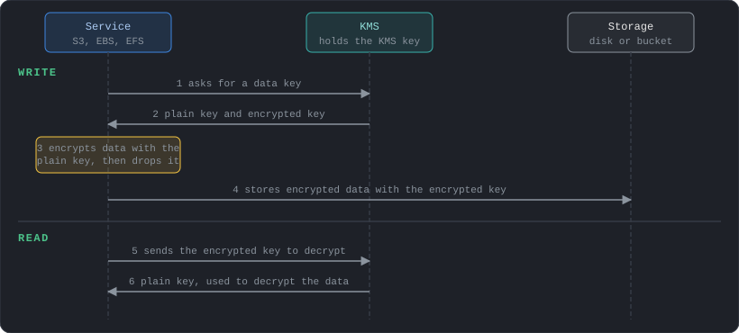

Access to a key is controlled by its key policy together with IAM policies and grants. Services use **envelope encryption**, shown above. The bulk data never goes to KMS: it hands out a data key, the service encrypts locally, and the data key is stored next to the data, encrypted under the KMS key. Only KMS can decrypt that data key, so every use of an encrypted object involves a KMS call, which is why S3 Bucket Keys exist. When a key rotates, KMS keeps the old key material, so existing data still decrypts. A key lives in one Region unless it is created as a multi-Region key. Data encrypted under an AWS managed key cannot be shared with another account, which is why shared encrypted snapshots need a customer managed key.

---

# Backup and Protection

Durable storage does not protect against deletion, corruption or ransomware, so a backup is a separate copy under separate permissions.

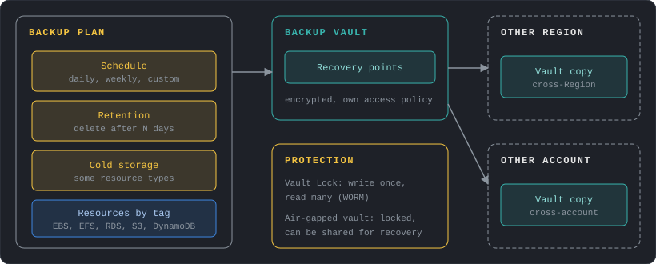

**AWS Backup** is one place to schedule and control backups for EC2, EBS, EFS, FSx, S3, RDS, Aurora, DynamoDB and more.

- A **backup plan** holds the schedule, retention, and an optional move to cold storage (available for some resource types). Resources join a plan by tag.
- A **backup vault** stores the recovery points (the backups). It is encrypted and has its own access policy, and backups stay in it even if the source resource is deleted.
- **Vault Lock** makes a vault WORM, so no one can delete backups or shorten retention. A **logically air-gapped vault** goes further, with locked, immutable backups that can be shared to another account for recovery.
- **Cross-Region and cross-account copies** protect against a Region outage or a compromised account. Cross-account copies need AWS Organizations (post 1).
- **Restore testing** runs scheduled restores to prove that backups work, and measures how long they take.

Combine this with the service features above: versioning and Object Lock for S3, snapshots with Recycle Bin and snapshot lock for EBS.

- **Warm storage:** AWS Backup charges per GB-month by resource type, for example $0.05 for EBS, EFS and S3, plus $0.02 per GB restored. Retention length is the main cost lever.
- **Cross-Region copies:** every copy pays transfer and a second storage bill. Copy only what the recovery objective requires.

---

# Moving Data In

Getting data to AWS depends on how much there is, how fast the link is, and whether it is a one-off move or a continuing flow.

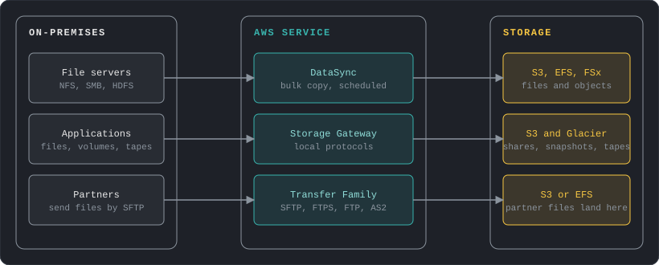

| Service | What it does | Pick it for |
|---|---|---|
| DataSync | Copies files and objects between on-premises storage (NFS, SMB, HDFS, object storage), other clouds and S3, EFS or FSx, with encryption, integrity checks and bandwidth limits | One-off migrations and scheduled copies |
| Storage Gateway | A local appliance or VM that exposes standard protocols and stores data in AWS | Keeping on-premises applications unchanged |
| Transfer Family | Managed SFTP, FTPS, FTP and AS2 endpoints in front of S3 or EFS | Partners who send files with existing tools |
| AWS Transform MGN (Application Migration Service) | Replicates whole servers, physical, virtual or cloud, to EC2 block by block and converts them for launch, with cutovers typically in minutes | Lift-and-shift of servers, not just their files |
| S3 Transfer Acceleration | Faster uploads to one bucket from far away over the AWS backbone | Many users or sites uploading from other continents |
| Direct Connect or VPN | A private network link (post 2) that other services use | A permanent, steady flow |

Storage Gateway comes in these types:

| Gateway | Local applications see | Data is stored in |
|---|---|---|
| S3 File Gateway | NFS or SMB shares | S3, as objects |
| Volume Gateway, cached | iSCSI volumes | S3, with hot data cached locally |
| Volume Gateway, stored | iSCSI volumes holding all data | Local disks, with snapshots sent to S3 |
| Tape Gateway | Virtual tapes | Glacier Flexible Retrieval or Deep Archive |

FSx File Gateway is closed to new customers, and AWS points to FSx for Windows File Server instead.

AWS has retired the Snow devices for new customers: Snowcone was discontinued in 2024, Snowball Edge is closed to new customers since November 2025, and Snowball support ends on December 31, 2026. For offline transfers AWS points to DataSync, Data Transfer Terminal and partners.

- **DataSync:** $0.0125 per GB copied in basic mode, which is $12.50 per TB. A first migration of tens of terabytes costs hundreds of dollars before any storage.
- **Transfer Family:** $0.30 per protocol-hour for each enabled protocol, about $219 a month for one endpoint left running, plus $0.04 per GB transferred over SFTP, FTPS and FTP. Delete test endpoints.

---

# Design Checklist

1. Which kind of storage fits the access pattern: disk, shared folder or object?
2. Are EBS volumes `gp3` (or a deliberate exception) and encrypted, with encryption by default on?
3. Are snapshots scheduled, retained by policy, and protected from deletion by Recycle Bin or snapshot lock?
4. Does a shared file system really need EFS, and do its lifecycle policies move cold files to cheaper classes?
5. Does every S3 bucket have Block Public Access on, ACLs disabled and access given by policy?
6. Are objects moved to colder classes by lifecycle rules, with minimum stays and small objects checked first?
7. Is versioning on where deletes must be recoverable, with a rule that expires old versions?
8. Is the encryption choice deliberate (SSE-S3 or SSE-KMS with Bucket Keys), and who can use the key?
9. Where does data need to exist twice: another AZ, another Region, another account?
10. Is there a backup that a compromised account or an attacker cannot delete (vault lock, Object Lock)?
11. How will existing data reach AWS, and is the link or service sized for the volume?

---

# References

## Block Storage

- [EBS volume types](https://docs.aws.amazon.com/ebs/latest/userguide/ebs-volume-types.html)
- [Elastic Volumes](https://docs.aws.amazon.com/ebs/latest/userguide/ebs-modify-volume.html)
- [Multi-Attach](https://docs.aws.amazon.com/ebs/latest/userguide/ebs-volumes-multi.html)
- [EBS-optimized instances](https://docs.aws.amazon.com/AWSEC2/latest/UserGuide/ebs-optimized.html)
- [EBS snapshots](https://docs.aws.amazon.com/ebs/latest/userguide/ebs-snapshots.html)
- [Snapshot archive](https://docs.aws.amazon.com/ebs/latest/userguide/snapshot-archive.html)
- [Recycle Bin](https://docs.aws.amazon.com/ebs/latest/userguide/recycle-bin.html)
- [Data Lifecycle Manager](https://docs.aws.amazon.com/ebs/latest/userguide/snapshot-lifecycle.html)
- [Snapshot lock](https://docs.aws.amazon.com/ebs/latest/userguide/ebs-snapshot-lock.html)
- [Fast Snapshot Restore](https://docs.aws.amazon.com/ebs/latest/userguide/ebs-fast-snapshot-restore.html)
- [Share a snapshot](https://docs.aws.amazon.com/ebs/latest/userguide/ebs-modifying-snapshot-permissions.html)
- [EBS encryption](https://docs.aws.amazon.com/ebs/latest/userguide/ebs-encryption.html)
- [Encryption by default](https://docs.aws.amazon.com/ebs/latest/userguide/encryption-by-default.html)
- [AWS KMS keys](https://docs.aws.amazon.com/kms/latest/developerguide/concepts.html)

## File Storage

- [What is Amazon EFS](https://docs.aws.amazon.com/efs/latest/ug/whatisefs.html)
- [How EFS works](https://docs.aws.amazon.com/efs/latest/ug/how-it-works.html)
- [EFS performance](https://docs.aws.amazon.com/efs/latest/ug/performance.html)
- [EFS lifecycle management](https://docs.aws.amazon.com/efs/latest/ug/lifecycle-management-efs.html)
- [EFS access points](https://docs.aws.amazon.com/efs/latest/ug/efs-access-points.html)
- [FSx for Windows File Server](https://docs.aws.amazon.com/fsx/latest/WindowsGuide/what-is.html)
- [FSx for Lustre](https://docs.aws.amazon.com/fsx/latest/LustreGuide/what-is.html)
- [FSx for NetApp ONTAP](https://docs.aws.amazon.com/fsx/latest/ONTAPGuide/what-is-fsx-ontap.html)
- [FSx for OpenZFS](https://docs.aws.amazon.com/fsx/latest/OpenZFSGuide/what-is-fsx.html)

## Object Storage

- [Comparing S3 storage classes](https://docs.aws.amazon.com/AmazonS3/latest/userguide/storage-class-intro.html)
- [Glacier storage classes](https://docs.aws.amazon.com/AmazonS3/latest/userguide/glacier-storage-classes.html)
- [Intelligent-Tiering](https://docs.aws.amazon.com/AmazonS3/latest/userguide/intelligent-tiering-overview.html)
- [Lifecycle transition considerations](https://docs.aws.amazon.com/AmazonS3/latest/userguide/lifecycle-transition-general-considerations.html)
- [Versioning](https://docs.aws.amazon.com/AmazonS3/latest/userguide/Versioning.html)
- [MFA Delete](https://docs.aws.amazon.com/AmazonS3/latest/userguide/MultiFactorAuthenticationDelete.html)
- [Object Lock](https://docs.aws.amazon.com/AmazonS3/latest/userguide/object-lock.html)
- [Logging options for S3](https://docs.aws.amazon.com/AmazonS3/latest/userguide/logging-with-S3.html)
- [Block Public Access](https://docs.aws.amazon.com/AmazonS3/latest/userguide/access-control-block-public-access.html)
- [Object Ownership](https://docs.aws.amazon.com/AmazonS3/latest/userguide/about-object-ownership.html)
- [Cross-account policy evaluation](https://docs.aws.amazon.com/IAM/latest/UserGuide/reference_policies_evaluation-logic-cross-account.html)
- [Access points](https://docs.aws.amazon.com/AmazonS3/latest/userguide/access-points.html)
- [Default encryption FAQ](https://docs.aws.amazon.com/AmazonS3/latest/userguide/default-encryption-faq.html)
- [Server-side encryption](https://docs.aws.amazon.com/AmazonS3/latest/userguide/serv-side-encryption.html)
- [Bucket Keys](https://docs.aws.amazon.com/AmazonS3/latest/userguide/bucket-key.html)
- [Replication](https://docs.aws.amazon.com/AmazonS3/latest/userguide/replication.html)
- [What is and is not replicated](https://docs.aws.amazon.com/AmazonS3/latest/userguide/replication-what-is-isnot-replicated.html)
- [Presigned URLs](https://docs.aws.amazon.com/AmazonS3/latest/userguide/using-presigned-url.html)
- [CloudFront signed URLs and cookies](https://docs.aws.amazon.com/AmazonCloudFront/latest/DeveloperGuide/PrivateContent.html)
- [Request rate and performance](https://docs.aws.amazon.com/AmazonS3/latest/userguide/optimizing-performance.html)
- [Transfer Acceleration](https://docs.aws.amazon.com/AmazonS3/latest/userguide/transfer-acceleration.html)
- [Event notifications](https://docs.aws.amazon.com/AmazonS3/latest/userguide/EventNotifications.html)
- [Website endpoints](https://docs.aws.amazon.com/AmazonS3/latest/userguide/WebsiteEndpoints.html)
- [S3 Inventory](https://docs.aws.amazon.com/AmazonS3/latest/userguide/storage-inventory.html)
- [S3 Storage Lens](https://docs.aws.amazon.com/AmazonS3/latest/userguide/storage_lens.html)

## Backup and Data Transfer

- [What is AWS Backup](https://docs.aws.amazon.com/aws-backup/latest/devguide/whatisbackup.html)
- [Restore testing](https://docs.aws.amazon.com/aws-backup/latest/devguide/restore-testing.html)
- [Logically air-gapped vault](https://docs.aws.amazon.com/aws-backup/latest/devguide/logicallyairgappedvault.html)
- [S3 File Gateway](https://docs.aws.amazon.com/filegateway/latest/files3/WhatIsStorageGateway.html)
- [Volume Gateway](https://docs.aws.amazon.com/storagegateway/latest/vgw/WhatIsStorageGateway.html)
- [Tape Gateway](https://docs.aws.amazon.com/storagegateway/latest/tgw/WhatIsStorageGateway.html)
- [Switching from FSx File Gateway](https://aws.amazon.com/blogs/storage/switch-your-file-share-access-from-amazon-fsx-file-gateway-to-amazon-fsx-for-windows-file-server/)
- [What is AWS Transform MGN](https://docs.aws.amazon.com/mgn/latest/ug/what-is-application-migration-service.html)
- [What is DataSync](https://docs.aws.amazon.com/datasync/latest/userguide/what-is-datasync.html)
- [What is AWS Transfer Family](https://docs.aws.amazon.com/transfer/latest/userguide/what-is-aws-transfer-family.html)
- [AWS Snow device updates](https://aws.amazon.com/blogs/storage/aws-snow-device-updates/)

## Cost and Performance

- [Amazon S3 pricing](https://aws.amazon.com/s3/pricing/)
- [Amazon EBS pricing](https://aws.amazon.com/ebs/pricing/)
- [Amazon EFS pricing](https://aws.amazon.com/efs/pricing/)
- [AWS Backup pricing](https://aws.amazon.com/backup/pricing/)
- [DataSync pricing](https://aws.amazon.com/datasync/pricing/)
- [Transfer Family pricing](https://aws.amazon.com/aws-transfer-family/pricing/)
- [Price List file, S3 (us-east-1)](https://pricing.us-east-1.amazonaws.com/offers/v1.0/aws/AmazonS3/current/us-east-1/index.json)
- [Price List file, EC2 and EBS (us-east-1)](https://pricing.us-east-1.amazonaws.com/offers/v1.0/aws/AmazonEC2/current/us-east-1/index.json)
- [Price List file, EFS (us-east-1)](https://pricing.us-east-1.amazonaws.com/offers/v1.0/aws/AmazonEFS/current/us-east-1/index.json)

---

Next post: **Databases**, starting with how RDS and Aurora handle failover and read scaling.
