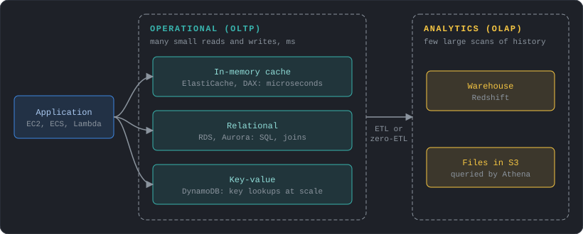
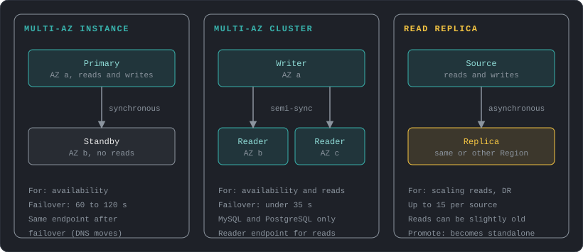
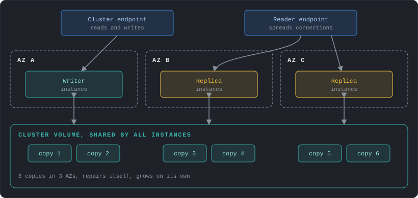
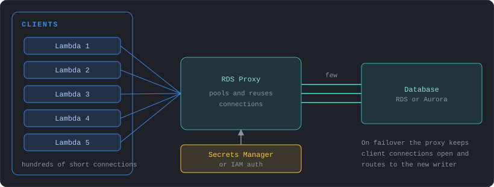
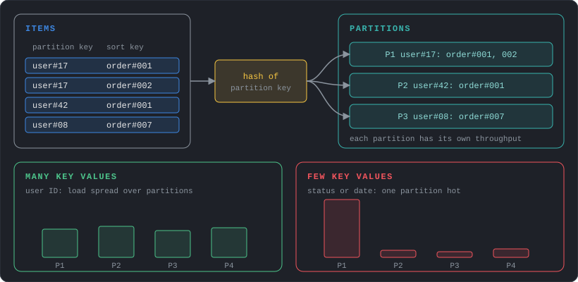
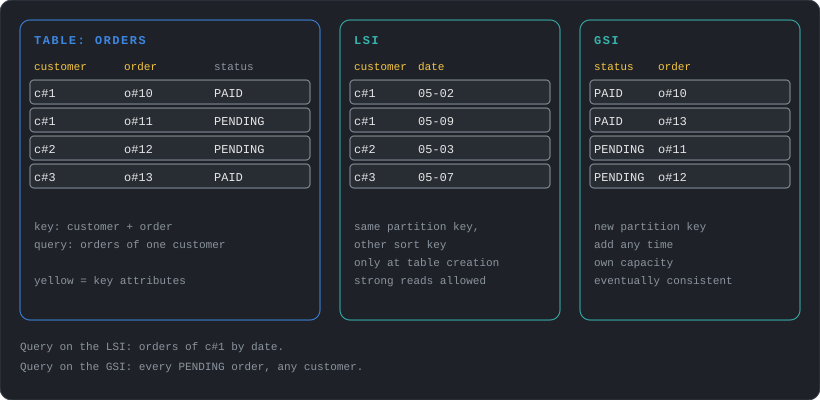
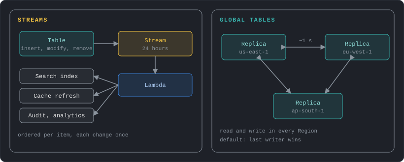
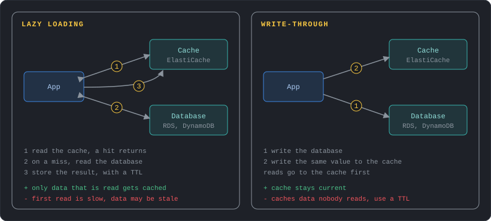
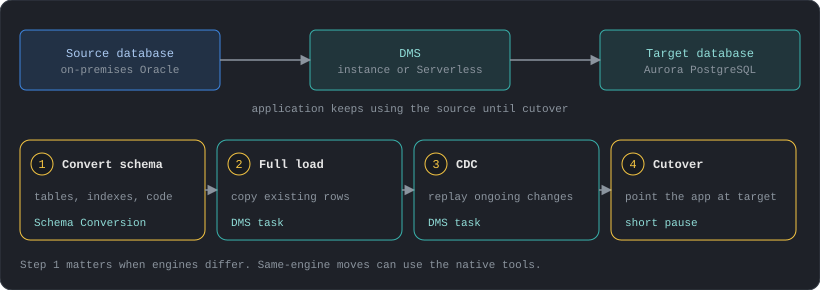

# About this post

A database adds replication, failover and a query engine on top of the storage from post 4. AWS runs most of that for you, but the design choices stay yours: which kind of database, how many copies, in which AZs and Regions, and how the application connects. This post covers relational databases (RDS and Aurora), DynamoDB, caching, analytics and migration. Prices are for `us-east-1` at the time of writing (November 2026), as in the earlier posts.

Lambda is in post 6, and Secrets Manager rotation and monitoring with CloudWatch are in post 7.

---

# Choosing a Database

The first question is how the application reads and writes data. Operational databases (OLTP, online transaction processing) handle many small reads and writes from users. Analytics stores (OLAP, online analytical processing) handle fewer, larger queries over history.

| Data and access pattern | Fit |
|---|---|
| Tables with relations, joins, transactions across rows | RDS or Aurora |
| Lookups by key at any scale, predictable latency | DynamoDB |
| Repeated reads of the same data, microsecond latency | ElastiCache, or DAX in front of DynamoDB |
| Aggregations over large history | Redshift, or Athena on files in S3 |
| Documents, graphs, time series, search | A purpose-built database (end of this post) |

Relational databases guarantee ACID transactions (atomicity, consistency, isolation, durability): a group of changes either all happen or none do, and committed data is not lost. They scale mostly vertically, by moving to a bigger instance, plus read copies. DynamoDB scales horizontally by spreading data over partitions, and in exchange the queries it can run are limited to the keys you design.

---

# Relational Databases: RDS

RDS (Relational Database Service) runs a database engine on instances that AWS manages. The engines are MySQL, PostgreSQL, MariaDB, Oracle, SQL Server and Db2. AWS installs, patches and backs up the engine and handles failover. You own the schema, queries, indexes, parameters and sizing, as in the shared responsibility model from post 1. There is no SSH access to the host. RDS Custom (Oracle and SQL Server) gives OS access for software that needs it, and the responsibility for that layer moves to you.

The application connects to a DNS endpoint, never to an IP address. Storage is EBS (post 4): `gp3` for most databases, `io2` when sustained IOPS matter. Storage autoscaling grows a volume when free space stays at or below 10% for 5 minutes, up to a maximum you set. Storage can grow and never shrink.

## High availability and read replicas

RDS offers three layouts, and they solve different problems.

- **Multi-AZ DB instance:** a standby in another AZ receives every write synchronously, so a committed transaction exists in two AZs. The standby serves no traffic. On failure, RDS points the endpoint's DNS name to the standby, typically within 60 to 120 seconds. Applications must reconnect and should not cache DNS for long.
- **Multi-AZ DB cluster:** a writer and two readable standbys in three AZs. A write commits once one standby acknowledges it (semi-synchronous). Failover is typically under 35 seconds, and a reader endpoint spreads reads over the standbys. MySQL and PostgreSQL only.
- **Read replica:** an asynchronous copy that serves reads. Up to 15 per source, in the same or another Region. Replicas can lag, so reads may return slightly old data. A replica can be **promoted** to a standalone database, which breaks replication. A cross-Region replica is a common disaster recovery design (post 1 covers the strategies).

## Backups and restore

Automated backups take a daily snapshot and upload transaction logs every 5 minutes, which allows **point-in-time recovery** to any second within the retention period, up to 35 days. Manual snapshots stay until you delete them, even after the database is deleted. Every restore creates a new database with a new endpoint, so the application's connection settings must change, or DNS (Route 53, post 2) must point to the new one. Snapshots can be copied to other Regions and shared with other accounts, with the same KMS key rules as EBS snapshots (post 4).

An RDS instance can be stopped for up to 7 days, after which RDS starts it again for maintenance.

## Security

- **Network:** put databases in private subnets with public access off. The database's security group allows the engine port (3306 for MySQL, 5432 for PostgreSQL) only from the application's security group.
- **Encryption at rest:** chosen at creation with a KMS key, and it covers storage, backups, snapshots and replicas. To encrypt an existing database, snapshot it, copy the snapshot with encryption on, and restore from the copy.
- **Encryption in transit:** TLS, which can be required through an engine parameter (for example `rds.force_ssl` on PostgreSQL).
- **Credentials:** RDS can keep the master password in Secrets Manager and rotate it every 7 days by default. **IAM database authentication** (MySQL, MariaDB, PostgreSQL) replaces passwords with a token valid for 15 minutes, generated from the caller's IAM role.

## Changes and upgrades

Engine versions reach end of standard support. RDS then enrolls the database in **Extended Support** automatically and charges for it per vCPU-hour, for up to 3 years before a forced upgrade. Plan major upgrades before the end-of-support date.

**Blue/Green Deployments** (MySQL, MariaDB, PostgreSQL) create a synchronized copy (green) of the production database (blue). You upgrade or change the green copy, test it, then switch over, which usually takes under a minute and keeps the endpoint names.

- **Multi-AZ doubles the bill:** a `db.m7g.large` PostgreSQL instance costs $0.168 an hour in one AZ (about $123 a month) and $0.337 in Multi-AZ (about $246). `gp3` storage goes from $0.115 to $0.23 per GB-month. Use Multi-AZ for production and single-AZ for development.
- **Extended Support:** $0.10 per vCPU-hour in years 1 and 2 and $0.20 in year 3. For a 2-vCPU instance that is about $146 a month on top of the instance.
- **Backup storage:** free up to the size of the provisioned storage in the Region. Long retention and many manual snapshots are what grow it.

---

# Aurora

Aurora is AWS's own MySQL- and PostgreSQL-compatible engine, run through RDS. It separates compute from storage: instances run the engine, and all of them share one **cluster volume**.

The cluster volume keeps six copies of the data across three AZs, repairs damaged copies on its own, and grows as data grows (up to 256 TiB on recent engine versions). Because replicas read the same volume, they don't copy data from the writer, and replica lag is usually well under 100 ms. Even a single-instance Aurora cluster keeps its data in three AZs, but without a replica a failure means waiting for a new instance, typically under 10 minutes.

## Replicas and endpoints

A cluster has one writer and up to 15 **Aurora Replicas**. If the writer fails, Aurora promotes a replica, picked by a priority tier you set, and service is typically back in under 60 seconds, often under 30.

| Endpoint | Points to | Use |
|---|---|---|
| Cluster | The current writer | Writes and reads that need the latest data |
| Reader | All replicas, connections spread over them | Read traffic |
| Custom | A group of instances you choose | Separating reporting from application reads |
| Instance | One instance | Diagnostics |

The reader endpoint balances connections. Every query on a connection runs on the replica it opened against, so a long-lived connection pool stays on the same replicas.

## Global Database

**Aurora Global Database** replicates a cluster to up to 10 secondary Regions at the storage layer, with typical lag under a second. Secondary clusters serve local reads, and write forwarding can send their writes to the primary. A **switchover** moves the primary Region for maintenance or tests with no data loss, and a **failover** promotes a secondary during an outage, where recent writes can be lost. Use it when a Region-level disaster needs an RPO of seconds and an RTO of minutes.

## Serverless and storage options

**Aurora Serverless** instances adjust their capacity continuously in ACUs (Aurora capacity units, about 2 GiB of memory each), between a minimum and maximum you set. The minimum can be 0 ACU, so an idle cluster pauses and you pay only for storage. Serverless and provisioned instances can sit in the same cluster. It fits variable or unpredictable load, development databases and many small databases. For steady, high load, provisioned instances cost less.

Aurora has two storage configurations. **Standard** charges per I/O request. **I/O-Optimized** has no I/O charge and higher instance and storage prices, and AWS recommends it when I/O is 25% or more of the Aurora bill.

Two features come from the shared storage design:

- **Cloning** creates a new cluster that shares the source's pages and copies only the pages that change (copy-on-write), so a clone of a large database is ready in minutes and costs little until it diverges.
- **Backtrack** (Aurora MySQL) rewinds a cluster in place to a time in the last 72 hours, without restoring a backup. It must be enabled when the cluster is created.

- **Standard or I/O-Optimized:** a `db.r7g.large` Aurora PostgreSQL instance costs $0.276 an hour on Standard and $0.359 on I/O-Optimized. Storage is $0.10 against $0.225 per GB-month, and Standard adds $0.20 per million I/O requests. Check the I/O line of the bill before choosing.
- **Serverless:** $0.12 per ACU-hour, so one ACU running all month is about $88 and a paused cluster at 0 ACU pays only for storage. A cluster that stays near its maximum costs more than a provisioned instance of the same size.
- **Global Database:** each secondary Region pays for its own instances and storage, plus $0.20 per million replicated write I/Os and data transfer between Regions.

---

# RDS Proxy

Each database connection uses memory on the database server, and opening one costs time (TLS, authentication). Applications that open many short connections, such as Lambda functions that scale to hundreds of copies, can exhaust a database.

**RDS Proxy** sits between the application and the database and shares a pool of connections among clients. It reads database credentials from Secrets Manager and can require IAM authentication from clients, so applications don't hold database passwords. During a failover it keeps client connections open and sends them to the new writer, which AWS says cuts failover time by up to 66% for Aurora.

It works with RDS for MySQL, PostgreSQL, MariaDB and SQL Server, and with Aurora. It runs inside the database's VPC and cannot be reached from the internet. Some session state (temporary tables, session variables) **pins** a client to one database connection, which reduces the sharing, so keep sessions simple.

- **Proxy pricing:** $0.015 per vCPU-hour of the database instances behind the proxy, with a minimum of 2 vCPUs, so about $22 a month in front of a 2-vCPU instance.

---

# DynamoDB

DynamoDB is a serverless key-value and document database. There are no instances: you create a table and pay for requests and storage. Data is stored on SSDs and replicated across three AZs. Latency stays in single-digit milliseconds at any size, as long as the table is designed for its queries.

## Tables, items and keys

A table holds **items** (rows) made of **attributes** (fields), up to 400 KB per item. Only the primary key is fixed, and other attributes can differ between items. The primary key is either a **partition key** alone, or a partition key plus a **sort key**. Items with the same partition key are stored together, ordered by sort key, which is how one query returns a customer's orders in order.

DynamoDB hashes the partition key to place each item on a **partition**, and each partition serves up to 3,000 read units and 1,000 write units per second. A key with many distinct values, such as a user ID, spreads load evenly. A key with few values, such as a status or today's date, sends most traffic to one partition (a **hot partition**) and gets throttled while the rest of the table is idle.

Design starts from the queries. List every access pattern first, then choose keys that answer them. Joins don't exist, so related data is often stored in the same table under the same partition key.

## Capacity and consistency

| Mode | How you pay | Fit |
|---|---|---|
| On-demand | Per request | The recommended default: new, spiky or unknown traffic |
| Provisioned | Per hour for reserved read and write units, with auto scaling | Steady, predictable traffic at high volume |

A read unit is one strongly consistent read per second of up to 4 KB, or two eventually consistent reads. A write unit is one write per second of up to 1 KB. Transactions use twice the units.

Reads are **eventually consistent** by default: a read right after a write may return the old value. A **strongly consistent** read returns the latest value and costs twice as much. Strong reads work on the table and on local indexes, not on global indexes.

## Reading data

- **GetItem** reads one item by its full key.
- **Query** reads the items under one partition key, optionally narrowed by a sort key condition (`begins_with`, `between`).
- **Scan** reads the whole table and is billed for everything it reads.

Query and Scan return up to 1 MB per call. A filter expression is applied after the read, so it shrinks the result while the bill still counts every item read. If an access pattern needs a Scan, it usually needs an index.

## Secondary indexes

An index is a copy of selected attributes under a different key, kept up to date by DynamoDB.

| | Local secondary index (LSI) | Global secondary index (GSI) |
|---|---|---|
| Key | Same partition key, other sort key | Any partition key and sort key |
| Created | Only with the table | Any time |
| Per table | 5 | 20 (default quota) |
| Consistency | Eventual or strong | Eventual only |
| Capacity | Shares the table's | Its own |
| Limit | 10 GB per partition key value | None |

Use a GSI for most new access patterns. In provisioned mode, a GSI without enough write capacity throttles writes to the table itself, so size it with the table.

## Streams, TTL and transactions

- **DynamoDB Streams** record every insert, update and delete for 24 hours, ordered per item, and can trigger a Lambda function (diagram below). Uses: updating a search index or cache, sending events, auditing. **Kinesis Data Streams for DynamoDB** is the alternative when changes must be kept longer, up to a year, or read by more consumers.
- **TTL** (time to live) deletes items after a timestamp attribute you choose, free of charge, typically within a few days of expiry. Filter expired items out of reads until then.
- **Transactions** group up to 100 actions in one all-or-nothing request, within one Region.

## Global tables

A **global table** is a set of replicas in several Regions. Every replica accepts reads and writes, and changes reach the other Regions, typically within a second.

By default, if two Regions update the same item at about the same time, the last write wins. **Multi-Region strong consistency** is an alternative mode for three Regions where every replica reads the latest data, at the cost of higher write latency and no TTL, LSIs or transactions. It is chosen when the table is created.

## Backups and security

**Point-in-time recovery** restores a table to any second in the last 1 to 35 days. On-demand backups and AWS Backup (post 4) keep copies longer. A restore creates a new table. **Export to S3** writes a table to S3 for analytics without using table capacity.

Data is always encrypted at rest, with an AWS owned key by default, or an AWS managed or customer managed KMS key. Instances reach DynamoDB through a free gateway endpoint (post 2). IAM policies can limit a user to items whose partition key matches their own ID with the `dynamodb:LeadingKeys` condition.

- **On-demand vs provisioned:** on-demand costs $0.625 per million writes and $0.125 per million reads. One write unit provisioned for a month costs about $0.47 and allows 2.6 million writes, which would cost about $1.64 on demand. Provisioned is cheaper when traffic stays above roughly 30% of what you provision.
- **Indexes multiply writes:** every write to the table also writes each GSI that holds the item, and each is billed. Project only the attributes an index needs.
- **Global tables:** each replica pays for every replicated write ($0.625 per million on demand), so a table in three Regions pays for each write three times, plus transfer between Regions.
- **Storage:** $0.25 per GB-month after the first 25 GB, and $0.10 with the Standard-IA table class, which has higher request prices. Point-in-time recovery adds $0.20 per GB-month.

---

# Caching

A cache keeps frequently read data in memory, so repeated reads take microseconds and don't reach the database.

**ElastiCache** is a managed in-memory store with three engines: **Valkey** (an open-source fork of Redis, and AWS's recommended choice, priced lower), **Redis OSS** and **Memcached**. Valkey and Redis OSS support replicas with automatic failover across AZs, backups, sharding over many nodes (cluster mode), and data structures such as sorted sets and lists. Memcached is a simple multi-threaded cache with no replication. **ElastiCache Serverless** removes node sizing, and you pay for data stored and requests.

Two patterns fill a cache, and most designs combine them with a **TTL** (time to live), so stale entries expire:

- **Lazy loading** caches only what is read. A miss costs three trips, and data can be stale until it expires.
- **Write-through** updates the cache on every write, so reads are current, and the cache fills with data that may never be read.

Caching only helps when the same data is read many times. Data that must always be current, or that is read once, belongs in the database.

**DAX** (DynamoDB Accelerator) is a write-through cache built for DynamoDB. It uses the DynamoDB API through a DAX client, so the application code barely changes, and it runs as a cluster of up to 11 nodes in your VPC. It serves eventually consistent reads only, and strongly consistent reads pass through to DynamoDB. Use DAX for DynamoDB read-heavy tables, and ElastiCache for everything else or when the application must control what is cached.

**MemoryDB** is a related service: Valkey- and Redis-compatible, with every write stored in a Multi-AZ transaction log, so it can be the primary database for data that needs microsecond reads.

- **Nodes run all the time:** a `cache.r7g.large` node costs $0.1752 an hour on Valkey (about $128 a month) and $0.219 on Redis OSS, and each replica is another node. A production DAX cluster of three `dax.r5.large` nodes costs about $560 a month.
- **Serverless:** Valkey costs $0.084 per GB-hour of data and $0.0023 per million ECPUs (ElastiCache Processing Units, a measure of requests), with a minimum of 100 MB, about $6 a month. Redis OSS and Memcached bill at least 1 GB.

---

# Analytics: Redshift and Athena

Analytics queries read millions of rows to compute totals. Running them on the production database slows the application, so data is copied to a store built for it.

**Redshift** is a data warehouse. It stores data by column, so a query that sums one column reads only that column, and it compresses well. A leader node plans each query and compute nodes run parts of it in parallel (MPP, massively parallel processing). RG and RA3 nodes keep data in managed storage on S3 and cache it locally, so compute and storage scale separately. **Redshift Serverless** bills by capacity used while queries run, with no cluster to size. Data arrives by `COPY` from S3, by **zero-ETL integrations** that replicate Aurora, RDS and DynamoDB tables continuously without pipelines, or is queried in place in S3 with **Redshift Spectrum**.

**Athena** runs SQL directly on files in S3, with nothing to provision. Table definitions (schemas and partitions) live in the **AWS Glue Data Catalog**, often filled by Glue crawlers. You pay per data scanned, so the layout of the files decides the cost:

- **Columnar formats** (Parquet, ORC) let a query read only the columns it uses.
- **Compression** reduces the bytes scanned.
- **Partitioning** by folder, such as `year=2026/month=11/`, lets a query with `WHERE year = 2026` skip the other folders.

Athena suits ad-hoc questions and logs already in S3 (CloudTrail, VPC Flow Logs, S3 access logs). Redshift suits dashboards and reports that run all day over the same data.

- **Athena:** $5 per TB scanned, with a minimum of 10 MB per query. A query that reads 1 TB of CSV every hour costs about $3,650 a month, and the same data as compressed Parquet with partitions can cost a small fraction of that.
- **Redshift Serverless:** $0.375 per RPU-hour (Redshift processing unit) while queries run, with a base capacity from 4 RPU, plus $0.024 per GB-month of managed storage. Lower the base capacity for light workloads and set a usage limit.

---

# Migrating Databases

**DMS** (Database Migration Service) copies data from a source database to a target, between the same engine or different ones, while the source stays in use.

A migration runs on a replication instance or on DMS Serverless. A **task** does a full load of existing data, then **CDC** (change data capture): it reads the source's transaction log and applies each change to the target, so both stay in sync until the application switches over. CDC needs logging enabled on the source, such as binary logs on MySQL.

DMS creates only basic tables on the target. Secondary indexes, foreign keys, views and stored procedures come from **DMS Schema Conversion** in the console (or the older, downloadable AWS Schema Conversion Tool), which also reports what cannot be converted automatically, as when moving from Oracle to PostgreSQL. Same-engine moves can use the engine's native tools, which DMS can also run for MySQL, PostgreSQL and MongoDB.

- **Replication instance:** a `dms.c5.large` costs $0.119 an hour, about $87 a month, and DMS Serverless $0.0819 per DCU-hour. Delete replication instances when the migration ends.

---

# Other Purpose-Built Databases

AWS runs a database for most data models. These come up less often, and each replaces a self-managed open-source engine.

| Service | Data model | Pick it for |
|---|---|---|
| DocumentDB | JSON documents, MongoDB-compatible | Applications already written for MongoDB |
| Neptune | Graph (Gremlin, openCypher, SPARQL) | Relationships: fraud rings, recommendations, network maps |
| Keyspaces | Wide-column, Cassandra-compatible | Moving Cassandra workloads, serverless |
| Timestream for InfluxDB | Time series | Metrics and sensor data with InfluxDB tools |
| OpenSearch Service | Search index | Full-text search, log analytics |
| Aurora DSQL | Distributed SQL, PostgreSQL-compatible | Active-active relational data across Regions, serverless |

Two have closed: QLDB (ledger) reached end of support in July 2025, and Timestream for LiveAnalytics closed to new customers in June 2025.

---

# Design Checklist

1. Which access patterns does the data have, and which kind of database fits them?
2. Is the database in private subnets, encrypted at creation, with TLS required and no passwords in code?
3. What does a failover cost: Multi-AZ instance, Multi-AZ cluster or Aurora replicas, and does the application reconnect cleanly?
4. Are reads that can be slightly old sent to replicas or a cache, and reads that cannot sent to the writer?
5. What are the RPO and RTO, and do backups, cross-Region copies or Global Database meet them? Has a restore been tested?
6. Is there a plan for engine end of support, before Extended Support charges start?
7. For DynamoDB, were the access patterns listed first, and does the partition key spread load evenly?
8. Does any access pattern rely on Scan where an index would do?
9. Is a proxy needed because of many short-lived connections?
10. Do analytics queries run outside the production database?

---

# References

## Relational Databases

- [What is Amazon RDS](https://docs.aws.amazon.com/AmazonRDS/latest/UserGuide/Welcome.html)
- [RDS Custom](https://docs.aws.amazon.com/AmazonRDS/latest/UserGuide/rds-custom.html)
- [RDS storage](https://docs.aws.amazon.com/AmazonRDS/latest/UserGuide/CHAP_Storage.html)
- [Storage autoscaling](https://docs.aws.amazon.com/AmazonRDS/latest/UserGuide/USER_PIOPS.Autoscaling.html)
- [Multi-AZ DB instance](https://docs.aws.amazon.com/AmazonRDS/latest/UserGuide/Concepts.MultiAZSingleStandby.html)
- [Multi-AZ DB cluster](https://docs.aws.amazon.com/AmazonRDS/latest/UserGuide/multi-az-db-clusters-concepts.html)
- [Multi-AZ failover](https://docs.aws.amazon.com/AmazonRDS/latest/UserGuide/Concepts.MultiAZ.Failover.html)
- [Read replicas](https://docs.aws.amazon.com/AmazonRDS/latest/UserGuide/USER_ReadRepl.html)
- [Automated backups](https://docs.aws.amazon.com/AmazonRDS/latest/UserGuide/USER_WorkingWithAutomatedBackups.html)
- [Point-in-time recovery](https://docs.aws.amazon.com/AmazonRDS/latest/UserGuide/USER_PIT.html)
- [Stopping an instance](https://docs.aws.amazon.com/AmazonRDS/latest/UserGuide/USER_StopInstance.html)
- [RDS encryption](https://docs.aws.amazon.com/AmazonRDS/latest/UserGuide/Overview.Encryption.html)
- [Secrets Manager integration](https://docs.aws.amazon.com/AmazonRDS/latest/UserGuide/rds-secrets-manager.html)
- [IAM database authentication](https://docs.aws.amazon.com/AmazonRDS/latest/UserGuide/UsingWithRDS.IAMDBAuth.html)
- [Extended Support](https://docs.aws.amazon.com/AmazonRDS/latest/UserGuide/extended-support.html)
- [Blue/Green Deployments](https://docs.aws.amazon.com/AmazonRDS/latest/UserGuide/blue-green-deployments-overview.html)

## Aurora and RDS Proxy

- [Aurora high availability](https://docs.aws.amazon.com/AmazonRDS/latest/AuroraUserGuide/Concepts.AuroraHighAvailability.html)
- [Aurora storage](https://docs.aws.amazon.com/AmazonRDS/latest/AuroraUserGuide/Aurora.Overview.StorageReliability.html)
- [Aurora replication](https://docs.aws.amazon.com/AmazonRDS/latest/AuroraUserGuide/Aurora.Replication.html)
- [Aurora endpoints](https://docs.aws.amazon.com/AmazonRDS/latest/AuroraUserGuide/Aurora.Overview.Endpoints.html)
- [Aurora Global Database](https://docs.aws.amazon.com/AmazonRDS/latest/AuroraUserGuide/aurora-global-database.html)
- [Aurora Serverless](https://docs.aws.amazon.com/AmazonRDS/latest/AuroraUserGuide/aurora-serverless-v2.how-it-works.html)
- [Aurora cloning](https://docs.aws.amazon.com/AmazonRDS/latest/AuroraUserGuide/Aurora.Managing.Clone.html)
- [Aurora Backtrack](https://docs.aws.amazon.com/AmazonRDS/latest/AuroraUserGuide/AuroraMySQL.Managing.Backtrack.html)
- [Aurora quotas](https://docs.aws.amazon.com/AmazonRDS/latest/AuroraUserGuide/CHAP_Limits.html)
- [RDS Proxy](https://docs.aws.amazon.com/AmazonRDS/latest/UserGuide/rds-proxy.html)

## DynamoDB

- [Partitions and data distribution](https://docs.aws.amazon.com/amazondynamodb/latest/developerguide/HowItWorks.Partitions.html)
- [Partition key design](https://docs.aws.amazon.com/amazondynamodb/latest/developerguide/bp-partition-key-design.html)
- [Capacity modes](https://docs.aws.amazon.com/amazondynamodb/latest/developerguide/capacity-mode.html)
- [Read consistency](https://docs.aws.amazon.com/amazondynamodb/latest/developerguide/HowItWorks.ReadConsistency.html)
- [Filter expressions](https://docs.aws.amazon.com/amazondynamodb/latest/developerguide/Query.FilterExpression.html)
- [Local secondary indexes](https://docs.aws.amazon.com/amazondynamodb/latest/developerguide/LSI.html)
- [Global secondary indexes](https://docs.aws.amazon.com/amazondynamodb/latest/developerguide/GSI.html)
- [Change data capture (Streams)](https://docs.aws.amazon.com/amazondynamodb/latest/developerguide/streamsmain.html)
- [Time to live](https://docs.aws.amazon.com/amazondynamodb/latest/developerguide/TTL.html)
- [Transactions](https://docs.aws.amazon.com/amazondynamodb/latest/developerguide/transaction-apis.html)
- [Global tables](https://docs.aws.amazon.com/amazondynamodb/latest/developerguide/V2globaltables_HowItWorks.html)
- [Point-in-time recovery](https://docs.aws.amazon.com/amazondynamodb/latest/developerguide/Point-in-time-recovery.html)
- [Fine-grained access control](https://docs.aws.amazon.com/amazondynamodb/latest/developerguide/specifying-conditions.html)
- [Gateway endpoint for DynamoDB](https://docs.aws.amazon.com/vpc/latest/privatelink/vpc-endpoints-ddb.html)

## Caching

- [What is ElastiCache](https://docs.aws.amazon.com/AmazonElastiCache/latest/dg/WhatIs.html)
- [Choosing an engine](https://docs.aws.amazon.com/AmazonElastiCache/latest/dg/SelectEngine.html)
- [Caching strategies](https://docs.aws.amazon.com/AmazonElastiCache/latest/dg/Strategies.html)
- [DAX concepts](https://docs.aws.amazon.com/amazondynamodb/latest/developerguide/DAX.concepts.html)
- [What is MemoryDB](https://docs.aws.amazon.com/memorydb/latest/devguide/what-is-memorydb.html)

## Analytics and Migration

- [Redshift clusters and nodes](https://docs.aws.amazon.com/redshift/latest/mgmt/working-with-clusters.html)
- [Redshift Serverless capacity](https://docs.aws.amazon.com/redshift/latest/mgmt/serverless-capacity.html)
- [Redshift Spectrum](https://docs.aws.amazon.com/redshift/latest/dg/c-using-spectrum.html)
- [Zero-ETL integrations](https://docs.aws.amazon.com/redshift/latest/mgmt/zero-etl-using.html)
- [Athena partition projection](https://docs.aws.amazon.com/athena/latest/ug/partition-projection.html)
- [Glue crawlers](https://docs.aws.amazon.com/glue/latest/dg/add-crawler.html)
- [What is DMS](https://docs.aws.amazon.com/dms/latest/userguide/CHAP_Introduction.html)
- [DMS Serverless](https://docs.aws.amazon.com/dms/latest/userguide/CHAP_Serverless.html)
- [DMS tasks](https://docs.aws.amazon.com/dms/latest/userguide/CHAP_Tasks.Creating.html)
- [MySQL as a DMS source](https://docs.aws.amazon.com/dms/latest/userguide/CHAP_Source.MySQL.html)
- [DMS Schema Conversion](https://docs.aws.amazon.com/dms/latest/userguide/CHAP_SchemaConversion.html)
- [Homogeneous data migrations](https://docs.aws.amazon.com/dms/latest/userguide/data-migrations.html)

## Other Databases

- [What is DocumentDB](https://docs.aws.amazon.com/documentdb/latest/developerguide/what-is.html)
- [What is Neptune](https://docs.aws.amazon.com/neptune/latest/userguide/intro.html)
- [What is Keyspaces](https://docs.aws.amazon.com/keyspaces/latest/devguide/what-is-keyspaces.html)
- [Timestream for LiveAnalytics availability change](https://docs.aws.amazon.com/timestream/latest/developerguide/AmazonTimestreamForLiveAnalytics-availability-change.html)
- [What is OpenSearch Service](https://docs.aws.amazon.com/opensearch-service/latest/developerguide/what-is.html)
- [What is Aurora DSQL](https://docs.aws.amazon.com/aurora-dsql/latest/userguide/what-is-aurora-dsql.html)

## Cost and Performance

- [RDS pricing](https://aws.amazon.com/rds/pricing/)
- [Aurora pricing](https://aws.amazon.com/rds/aurora/pricing/)
- [RDS Proxy pricing](https://aws.amazon.com/rds/proxy/pricing/)
- [DynamoDB pricing](https://aws.amazon.com/dynamodb/pricing/)
- [ElastiCache pricing](https://aws.amazon.com/elasticache/pricing/)
- [Redshift pricing](https://aws.amazon.com/redshift/pricing/)
- [Athena pricing](https://aws.amazon.com/athena/pricing/)
- [DMS pricing](https://aws.amazon.com/dms/pricing/)
- [Price List file, RDS and Aurora (us-east-1)](https://pricing.us-east-1.amazonaws.com/offers/v1.0/aws/AmazonRDS/current/us-east-1/index.json)
- [Price List file, DynamoDB (us-east-1)](https://pricing.us-east-1.amazonaws.com/offers/v1.0/aws/AmazonDynamoDB/current/us-east-1/index.json)

---

Next post: **Serverless and Messaging**, starting with how Lambda runs code without servers.
