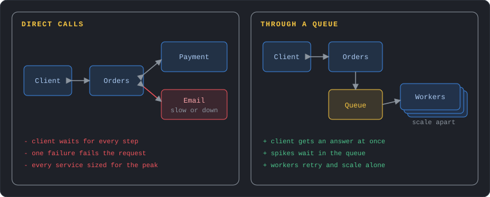
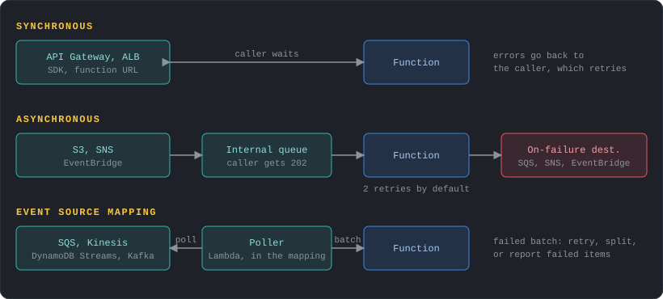
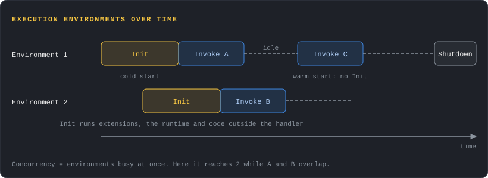
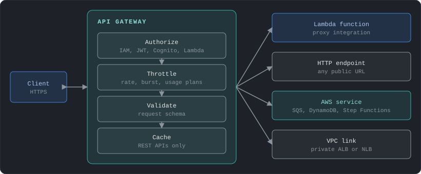
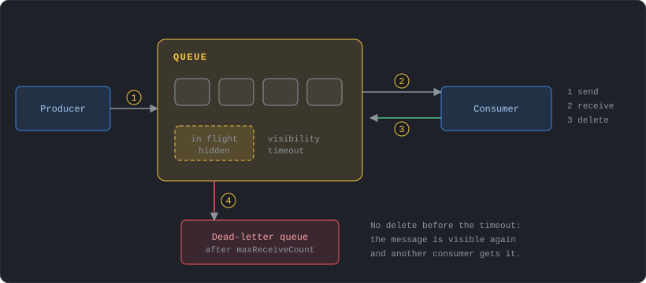
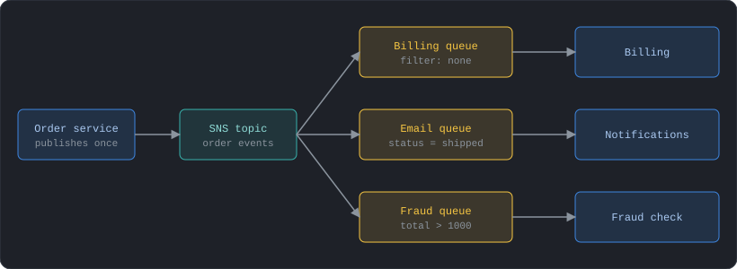
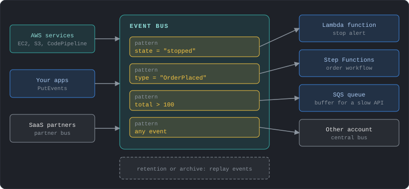
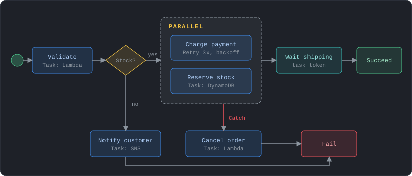
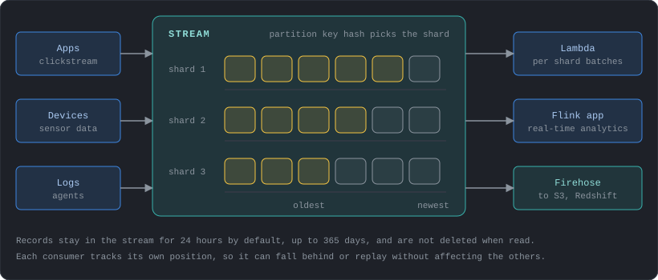
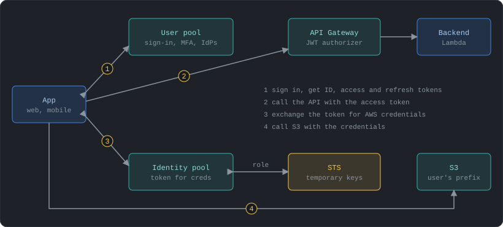

# About this post

Serverless services run code and move data without instances to size or patch. You pay per request or per unit of work, capacity follows traffic, and AWS spreads the service across AZs. Most of these services talk through events and messages, so this post covers both halves: compute (Lambda, API Gateway, Step Functions) and messaging (SQS, SNS, EventBridge, Kinesis), plus Cognito for user sign-in. Prices are for `us-east-1` at the time of writing (November 2026), as in the earlier posts.

CloudFormation, CloudWatch and Secrets Manager are in post 7.

---

# Event-Driven Design

When one service calls another and waits, the caller depends on the callee being up and fast. A message between them removes that dependency: the sender records what happened and moves on, and the receiver processes it when it can. This is called **decoupling**.

Two terms come up in every messaging service:

- **At-least-once delivery:** a message can arrive more than once, after a retry or a timeout. Consumers must be **idempotent**, meaning that processing the same message twice has the same effect as once, for example by recording processed message IDs.
- **Ordering:** most services do not guarantee order. When order matters, use a service that keeps it per key (SQS FIFO, SNS FIFO, Kinesis).

---

# Lambda

Lambda runs a function when an event arrives. You upload code (a zip file or a container image), choose memory, and set a trigger. Lambda creates **execution environments**, isolated micro VMs that each run one request at a time, and adds or removes them with traffic.

In October 2026 AWS renamed standard functions to **Lambda Event Functions**, when it launched **Lambda Web Functions** (a serverless HTTP server, Node.js only at launch). The API and the CLI still say "function", and this post means event functions.

## Limits that shape a design

| Setting | Value |
|---|---|
| Timeout | Up to 15 minutes |
| Memory | 128 MB to 10,240 MB. CPU grows with memory: 1,769 MB gives one vCPU |
| `/tmp` storage | 512 MB by default, up to 10,240 MB, lost when the environment ends |
| Payload | 6 MB synchronous, 1 MB asynchronous |
| Package | 50 MB zipped upload, 250 MB unzipped with layers, 10 GB container image |

Work longer than 15 minutes belongs in Step Functions, ECS (post 3) or AWS Batch. A CPU-bound function runs faster with more memory, and since you pay per GB-second, the faster run often costs about the same.

## How a function is invoked

- **Synchronous:** the caller waits for the result, as with API Gateway, an ALB (post 3) or a direct SDK call. Errors return to the caller, which decides whether to retry.
- **Asynchronous:** S3, SNS and EventBridge put the event on an internal queue and get an answer at once. Lambda retries a failed event twice by default and keeps it up to 6 hours. After that, an **on-failure destination** (SQS, SNS, EventBridge, another function or S3) receives the event with the error details. Destinations are the newer alternative to a dead-letter queue.
- **Event source mapping:** Lambda polls SQS, Kinesis, DynamoDB Streams, Kafka, Amazon MQ or DocumentDB, groups records into batches and invokes the function with them. A failed batch is retried. With SQS, the function can return **partial batch failures** so only the failed messages are retried. With streams, a failed batch blocks its shard until it succeeds, expires or is split, so set a retry limit and an on-failure destination.

A function **URL** gives a function its own HTTPS endpoint, with IAM authentication or none. It suits webhooks and simple endpoints that don't need API Gateway features.

## Versions and aliases

Publishing a function creates a numbered **version**, a snapshot whose code and most settings can no longer change. The editable copy is `$LATEST`. An **alias** is a named pointer to a version, such as `live`, so triggers and callers use the alias and a release only moves the pointer. A **weighted alias** splits traffic between two versions, such as 95% and 5%, for a canary release with a fast rollback. AWS SAM (Serverless Application Model, a CloudFormation extension covered in post 7) can shift the weights step by step through CodeDeploy.

## Execution environments and cold starts

A new environment runs **Init**: it starts extensions and the runtime and runs your code outside the handler. Init is limited to 10 seconds. The handler then runs for each request, and the environment is reused for later requests until Lambda shuts it down. The delay of Init on a request is a **cold start**.

- Create SDK clients and database connections outside the handler, so warm requests reuse them.
- Never rely on memory or `/tmp` surviving between requests: any environment can disappear.
- **Provisioned concurrency** keeps a number of environments initialized at all times, for latency-sensitive APIs.
- **SnapStart** (Java, Python, .NET) runs Init when you publish a version, saves a snapshot of the memory and disk, and resumes new environments from it.

## Concurrency and scaling

**Concurrency** is the number of requests running at the same moment: requests per second times average duration. 100 requests per second that each take 0.5 seconds need 50 environments. Each Region has a default quota of 1,000 concurrent executions per account, shared by all functions, and each function can add 1,000 environments every 10 seconds. API Gateway's default of 10,000 requests per second can exceed that quota, so check both.

**Reserved concurrency** sets aside part of the quota for a function and also caps it there. Use it to protect a critical function from the others, and to stop a function from overwhelming a database that only takes a few hundred connections (RDS Proxy, post 5, is the other half of that fix).

## Networking and permissions

By default a function runs in an AWS-owned network with internet access. Attach it to your VPC to reach private resources such as RDS. Lambda then creates **Hyperplane ENIs**, network interfaces shared by all functions with the same subnet and security group combination. A function in a VPC has no internet access and never gets a public IP, even in a public subnet: route its private subnets through a NAT gateway, or use VPC endpoints (post 2).

Two policies control a function. The **execution role** is what the function may do, such as write to a DynamoDB table. The **resource-based policy** is who may invoke it, such as S3 from a given bucket or another account. Give each function its own role with only what it needs.

Two recent options change the model. **Lambda Managed Instances** run functions on EC2 instances in your own account, priced as EC2 plus a management fee, for steady high-volume work where Savings Plans help. **Durable functions** let one function run a multi-step workflow for up to a year, saving progress at checkpoints and replaying after a failure.

- **Requests and duration:** $0.20 per million requests plus $0.0000166667 per GB-second on x86. One million requests a month at 512 MB and 200 ms is 100,000 GB-seconds, about $1.67 plus $0.20. Arm (Graviton) costs 20% less per GB-second.
- **Provisioned concurrency:** $0.0000041667 per GB-second while enabled, whether used or not, so 1 GB kept warm costs about $11 a month before any requests. Enable it only for functions where cold starts matter.
- **VPC functions:** the NAT gateway for internet access costs far more than the function itself in small workloads (post 2). Use gateway endpoints for S3 and DynamoDB.

---

# API Gateway

API Gateway is the managed front door for HTTP APIs. It receives requests, authorizes and throttles them, and passes them to an **integration**.

It offers three API types:

| | REST API | HTTP API | WebSocket API |
|---|---|---|---|
| Use | Full feature set | Simple, lower-cost proxy to Lambda or HTTP | Two-way connections: chat, live updates |
| Caching, API keys, usage plans | Yes | No | No |
| Request validation, WAF, resource policies | Yes | No | No |
| Private endpoint | Yes | No | No |
| Authorizers | IAM, Cognito, Lambda | IAM, JWT (works with Cognito), Lambda | IAM, Lambda |

Start with an HTTP API, and move to a REST API when you need a feature from the table.

- **Endpoint types** (REST): **edge-optimized** sends requests through CloudFront locations (post 2), **Regional** serves clients in the same Region or your own CloudFront distribution, and **private** is reachable only from a VPC through an interface endpoint.
- **Integrations:** Lambda, any HTTP endpoint, AWS service APIs directly (such as putting a message on SQS without a function in between), and private ALBs or NLBs through a **VPC link**.
- **Throttling:** 10,000 requests per second per account and Region, with a burst of 5,000, shared by all APIs. **Usage plans** with **API keys** set per-client rates and quotas. API keys identify clients and are not an authentication method.
- **Timeouts:** an integration must answer within 29 seconds (30 for HTTP APIs). Regional and private REST APIs can raise this, and REST APIs can stream responses for up to 15 minutes. Long jobs should return at once and finish asynchronously.
- **Caching** (REST): responses are cached per stage for 300 seconds by default, up to 3,600.
- **Custom domain names** replace the generated `execute-api` URL with your own, such as `api.example.com`, pointed at the API with a Route 53 alias record. The ACM certificate must be in the API's Region for a Regional endpoint and in `us-east-1` for edge-optimized, the same CloudFront rule as in post 2.

**AppSync** is the GraphQL alternative: one endpoint where clients ask for exactly the fields they need from several data sources (DynamoDB, Lambda, HTTP), with real-time subscriptions over WebSockets for apps that share live data.

- **REST vs HTTP:** REST costs $3.50 per million requests and HTTP $1.00 per million. At 100 million requests a month that is $350 against $100.
- **Cache:** billed per hour while enabled, from $0.02 an hour for 0.5 GB (about $15 a month). It pays off when it saves backend calls.
- **WebSocket:** $1.00 per million messages plus $0.25 per million connection minutes.

---

# SQS

SQS (Simple Queue Service) is a managed queue. Producers send messages, consumers poll for them, and the queue holds them in between, up to 14 days (4 by default). Messages can be up to 1 MiB, and larger payloads go to S3 with a pointer in the message.

A received message is not removed. It becomes invisible for the **visibility timeout** (30 seconds by default, up to 12 hours), and the consumer deletes it after processing. If the consumer crashes, the message reappears and another consumer gets it. Set the timeout longer than processing takes. With Lambda, AWS recommends at least six times the function timeout.

A **dead-letter queue** (DLQ) receives messages that were received more than `maxReceiveCount` times without being deleted, so one bad message (a **poison message**) stops blocking the work. Alarm on the DLQ's depth, fix the cause, then **redrive** the messages back to the source queue.

| | Standard | FIFO |
|---|---|---|
| Delivery | At least once | Exactly once processing |
| Order | Best effort | Strict, per message group ID |
| Throughput | Nearly unlimited | 300 calls/s per API action, 3,000 messages/s with batching, up to 70,000 in high-throughput mode in us-east-1 |

FIFO queues drop duplicates sent within 5 minutes, by a deduplication ID or a hash of the body. Ordering applies within a **message group**, such as one customer's orders, and different groups are processed in parallel.

Other settings:

- **Long polling** waits up to 20 seconds for messages before returning. Short polling (the default) returns at once and often empty. Use long polling.
- **Delay queues** hide new messages for up to 15 minutes.
- **Fair queues** (standard queues) stop one busy tenant, identified by the message group ID, from delaying messages of the others.
- **Encryption:** new queues are encrypted with SQS-managed keys by default, and KMS keys are an option.
- **Scaling consumers:** an Auto Scaling group (post 3) can scale on queue depth per instance, and Lambda scales its pollers with the queue on its own.

- **Per request:** $0.40 per million on standard queues and $0.50 on FIFO. Every 64 KB of a message counts as one request, so a 1 MiB message is 16.
- **Empty receives:** every poll is billed, even one that returns nothing. Long polling and batches of up to 10 messages cut the request count.

---

# SNS

SNS (Simple Notification Service) is publish/subscribe. A publisher sends a message to a **topic**, and SNS pushes a copy to every **subscription**: SQS queues, Lambda functions, HTTPS endpoints, Firehose, email, SMS and mobile push.

The common pattern is **fan-out**: SNS in front of several SQS queues. Each consumer gets its own queue, so it can be slow, fail or be redeployed without affecting the others, and a new consumer is one more subscription.

- **Filter policies** on a subscription deliver only matching messages, by message attributes or by the body. Without filters, every subscriber gets everything and discards what it doesn't need.
- **Retries:** deliveries to SQS and Lambda are retried for up to 23 days. HTTPS endpoints get a retry policy you can tune. A subscription can have its own DLQ for messages that still fail.
- **FIFO topics** keep order per message group and deliver to SQS queues only. They can archive messages and replay them to subscribers.
- **Message size:** 256 KiB by default. Raising a topic to 1 MiB limits it to SQS, Lambda and Firehose subscriptions.
- **Security:** each subscribed queue's access policy must allow the topic to send to it.

SNS email is meant for operational notifications to subscribed addresses. Email to customers (transactional, formatted or bulk) goes through **SES** (Simple Email Service).

- **Publishing:** $0.50 per million requests. Deliveries to SQS and Lambda have no delivery charge, HTTPS costs $0.06 per 100,000 and email $2.00 per 100,000. Filtering on the message body adds $0.09 per GB.

---

# EventBridge

EventBridge (formerly CloudWatch Events) is an event router. Events arrive on an **event bus**, each rule or subscriber matches them against a **pattern** (a JSON filter on any field), and sends matches to a **target**.

- **Sources:** the **default bus** receives events from AWS services (an EC2 instance stopped, an S3 object created, a pipeline failed). **Custom buses** take your applications' events through `PutEvents`, and **partner buses** take events from SaaS providers.
- **Targets:** Lambda, SQS, SNS, Step Functions, Kinesis and other AWS services, buses in other accounts or Regions (for central collection), and **API destinations**, which call any HTTP endpoint with managed authentication and rate limits.
- **Delivery:** at least once and in any order. A failed delivery is retried with backoff for up to 24 hours, then goes to the target's DLQ if one is set.
- **Size:** up to 1 MB per `PutEvents` request.

There are now two kinds of custom bus. The **Classic** bus uses rules with up to 5 targets each, and an **archive** keeps events for **replay**. The newer **Custom Event Bus** uses **subscribers**, each with a filter and one target. It keeps events for 1 to 365 days, so a subscriber can replay from any position, and it can deliver in order within an event group. AWS recommends it for new applications.

Two related services:

- **EventBridge Scheduler** runs one-time or recurring schedules (cron or rate expressions, with time zones) that call almost any AWS API, at up to millions of schedules. It replaces scheduled rules on a bus, which AWS now calls legacy.
- **EventBridge Pipes** connect one source (SQS, Kinesis, DynamoDB Streams, Kafka, Amazon MQ) to one target, with optional filtering and enrichment in between, without a function to glue them.

## Choosing a messaging service

| Need | Service |
|---|---|
| Buffer work for one consumer group, absorb spikes, retry | SQS |
| Push one message to many subscribers, fan-out to queues | SNS |
| Route events by content to many targets, AWS service events, SaaS, cross-account | EventBridge |
| High-volume ordered records, several readers, replay | Kinesis Data Streams |
| Existing apps using JMS, AMQP or MQTT | Amazon MQ (managed ActiveMQ and RabbitMQ) |
| Existing Kafka applications | Amazon MSK (managed Kafka) |

- **Events:** $1.00 per million custom or partner events, counted per 64 KB.
- **Scheduler:** the first 14 million invocations a month are free, then $1.00 per million. **Pipes** cost $0.40 per million requests.

---

# Step Functions

Step Functions runs workflows defined as **state machines**: a JSON definition (Amazon States Language) of steps, built in code or in the visual Workflow Studio. The service keeps the state between steps, so each step can be a short Lambda function or a direct call to another AWS service.

- **States:** Task (do work), Choice (branch), Parallel (branches at the same time), Map (the same steps for each item in a list), Wait, Pass, Succeed and Fail. **Distributed Map** runs up to 10,000 child workflows in parallel, for example one per file in an S3 prefix.
- **Errors:** a **Retry** block retries a failed state with backoff (3 attempts by default, doubling the wait). A **Catch** block sends the error to another state, such as a step that undoes earlier work.
- **Integrations:** more than 200 services through SDK calls. A task can wait for a job to finish (`.sync`, such as an ECS task or Glue job), or pause until an external system returns a **task token** (`.waitForTaskToken`), for human approvals.

| | Standard | Express |
|---|---|---|
| Maximum duration | 1 year | 5 minutes |
| Execution | Exactly once | At least once (asynchronous) or at most once (synchronous) |
| History | Kept 90 days, visible in the console | CloudWatch Logs only |
| Billing | Per state transition | Per execution and duration |
| Fit | Long, auditable business processes | High-volume, short event processing |

Put orchestration in Step Functions and keep business logic in the tasks. Retries, timeouts and waits written inside one long Lambda function cost duration and get lost when the function fails.

- **Standard:** $0.025 per 1,000 state transitions. A 10-state workflow run one million times a month costs about $250.
- **Express:** $1.00 per million executions plus $0.00001667 per GB-second. The same volume, short and high-rate, usually costs a fraction of Standard.

---

# Streaming: Kinesis

A queue hands each message to one consumer and deletes it. A **stream** keeps an ordered log of records for a retention period, and any number of consumers read it independently, each at its own position.

## Kinesis Data Streams

- **Shards:** a stream is split into shards. Each takes 1 MB/s or 1,000 records/s of writes and serves 2 MB/s of reads shared by its consumers. The producer's **partition key** is hashed to pick the shard, and order is kept within a shard. A key with few values creates a hot shard, as with DynamoDB partitions (post 5).
- **Enhanced fan-out:** each registered consumer gets its own 2 MB/s per shard, pushed to it, at about 70 ms of latency.
- **Capacity:** **on-demand** scales by itself, up to double the previous 30-day peak. **Provisioned** means you set the number of shards and split or merge them.
- **Retention:** 24 hours by default, up to 365 days. Any consumer can replay from an earlier point.
- **Consumers:** Lambda (one batch per shard at a time, more with a parallelization factor), Managed Service for Apache Flink, Firehose, and applications using the Kinesis Client Library.

## Amazon Data Firehose

Firehose (formerly Kinesis Data Firehose) delivers streaming data to a destination with no consumer code: S3, Redshift, OpenSearch, Apache Iceberg tables, Splunk, Snowflake or HTTP endpoints. It buffers records by size (1 to 128 MiB) or time (0 to 900 seconds) before writing, so delivery is near real time. On the way it can transform records with Lambda, convert JSON to Parquet, and partition S3 output by fields in the data. Firehose doesn't keep data for replay.

## Managed Service for Apache Flink

Runs Apache Flink applications (Java, Scala, Python or SQL) for real-time processing such as windows, aggregations and joins on streams. It replaced Kinesis Data Analytics, whose SQL applications reached end of support in January 2026.

- **Provisioned shards:** $0.015 per shard-hour (about $11 a month per shard) plus $0.014 per million PUT payload units. The bill grows with shards, so size them to the real throughput.
- **On-demand:** $0.04 per stream-hour (about $29 a month) plus $0.08 per GB written and $0.04 per GB read. It is simpler, and more expensive for steady high traffic.
- **Enhanced fan-out:** $0.015 per consumer-shard-hour plus $0.013 per GB read, for each registered consumer.
- **Firehose:** $0.029 per GB ingested, plus $0.018 per GB for format conversion.

---

# Cognito

Cognito handles sign-in for your application's end users. Your own staff sign in to AWS through IAM Identity Center (post 1). It has two parts that are often used together.

- **User pool:** a user directory. It handles sign-up, sign-in, MFA, password resets and federation with Google, Apple, Facebook, Amazon, SAML and OIDC providers, and issues **JWTs** (JSON Web Tokens, signed tokens the API can verify on its own): an ID token, an access token and a refresh token. **Managed login** provides hosted sign-in pages, and Lambda triggers customize steps such as sign-up checks.
- **Identity pool:** exchanges a token (from a user pool or another provider, or none for guest access) for **temporary AWS credentials** from STS, tied to an IAM role. The app can then call S3 or DynamoDB directly. Role policies can use the identity ID, such as `${cognito-identity.amazonaws.com:sub}` in an S3 prefix, so each user reaches only their own objects.

API Gateway validates user pool tokens with a Cognito authorizer (REST) or a JWT authorizer (HTTP), and an ALB can sign users in on an HTTPS listener (post 3). Use the user pool alone when all access goes through your API. Add an identity pool when clients must reach AWS services directly.

- **Per monthly active user:** the first 10,000 are free on the Lite and Essentials plans. Then $0.0055 per user on Lite, $0.015 on Essentials (the default) and $0.02 on Plus, which adds threat protection.
- **Machine-to-machine:** service clients using the client credentials grant pay $0.00225 per token request. Cache tokens until they expire.

---

# Design Checklist

1. Which steps must happen before the user gets an answer, and which can go to a queue or event?
2. Is every consumer idempotent, so a duplicate message does no harm?
3. Does every queue, asynchronous function and event target have a DLQ or on-failure destination, with an alarm on it?
4. Is each SQS visibility timeout longer than the processing time, and does each stream mapping have a retry limit?
5. Are Lambda concurrency limits set so a spike cannot exhaust the account quota or a downstream database?
6. Are cold starts acceptable for this path, or does it need provisioned concurrency or SnapStart?
7. Does each function have its own least-privilege role, and do VPC functions reach S3 and DynamoDB through endpoints?
8. Is the API type (HTTP or REST) chosen by the features needed, with throttling per client?
9. Is a multi-step process orchestrated in Step Functions, with Standard or Express chosen by duration and volume?
10. Does the messaging service match the pattern: queue, fan-out, routing, or a replayable stream?

---

# References

## Lambda

- [Lambda quotas](https://docs.aws.amazon.com/lambda/latest/dg/gettingstarted-limits.html)
- [Lambda Web Functions announcement](https://aws.amazon.com/about-aws/whats-new/2026/10/aws-lambda-web-functions/)
- [Memory and computing power](https://docs.aws.amazon.com/lambda/latest/dg/configuration-memory.html)
- [Execution environment lifecycle](https://docs.aws.amazon.com/lambda/latest/dg/lambda-runtime-environment.html)
- [Asynchronous invocation and error handling](https://docs.aws.amazon.com/lambda/latest/dg/invocation-async-error-handling.html)
- [Destinations](https://docs.aws.amazon.com/lambda/latest/dg/invocation-async-retain-records.html)
- [Event source mappings](https://docs.aws.amazon.com/lambda/latest/dg/invocation-eventsourcemapping.html)
- [Lambda with SQS](https://docs.aws.amazon.com/lambda/latest/dg/with-sqs.html)
- [Lambda with Kinesis](https://docs.aws.amazon.com/lambda/latest/dg/with-kinesis.html)
- [Function URLs](https://docs.aws.amazon.com/lambda/latest/dg/urls-configuration.html)
- [Scaling behavior](https://docs.aws.amazon.com/lambda/latest/dg/scaling-behavior.html)
- [Configuring concurrency](https://docs.aws.amazon.com/lambda/latest/dg/configuration-concurrency.html)
- [SnapStart](https://docs.aws.amazon.com/lambda/latest/dg/snapstart.html)
- [VPC networking](https://docs.aws.amazon.com/lambda/latest/dg/configuration-vpc.html)
- [Internet access for VPC functions](https://docs.aws.amazon.com/lambda/latest/dg/configuration-vpc-internet.html)
- [Function versions](https://docs.aws.amazon.com/lambda/latest/dg/configuration-versions.html)
- [Weighted aliases](https://docs.aws.amazon.com/lambda/latest/dg/configuring-alias-routing.html)
- [Lambda permissions](https://docs.aws.amazon.com/lambda/latest/dg/lambda-permissions.html)
- [Lambda Managed Instances](https://docs.aws.amazon.com/lambda/latest/dg/lambda-managed-instances.html)
- [Durable functions](https://docs.aws.amazon.com/lambda/latest/dg/durable-functions.html)

## API Gateway

- [HTTP APIs and REST APIs compared](https://docs.aws.amazon.com/apigateway/latest/developerguide/http-api-vs-rest.html)
- [Endpoint types](https://docs.aws.amazon.com/apigateway/latest/developerguide/api-gateway-api-endpoint-types.html)
- [Quotas](https://docs.aws.amazon.com/apigateway/latest/developerguide/limits.html)
- [REST API execution quotas](https://docs.aws.amazon.com/apigateway/latest/developerguide/api-gateway-execution-service-limits-table.html)
- [Response streaming](https://docs.aws.amazon.com/apigateway/latest/developerguide/response-transfer-mode.html)
- [Caching](https://docs.aws.amazon.com/apigateway/latest/developerguide/api-gateway-caching.html)
- [Custom domain names](https://docs.aws.amazon.com/apigateway/latest/developerguide/how-to-custom-domains.html)
- [Certificates for custom domain names](https://docs.aws.amazon.com/apigateway/latest/developerguide/how-to-specify-certificate-for-custom-domain-name.html)
- [What is AppSync](https://docs.aws.amazon.com/appsync/latest/devguide/what-is-appsync.html)

## SQS and SNS

- [SQS message quotas](https://docs.aws.amazon.com/AWSSimpleQueueService/latest/SQSDeveloperGuide/quotas-messages.html)
- [Short and long polling](https://docs.aws.amazon.com/AWSSimpleQueueService/latest/SQSDeveloperGuide/sqs-short-and-long-polling.html)
- [FIFO exactly-once processing](https://docs.aws.amazon.com/AWSSimpleQueueService/latest/SQSDeveloperGuide/FIFO-queues-exactly-once-processing.html)
- [Dead-letter queues](https://docs.aws.amazon.com/AWSSimpleQueueService/latest/SQSDeveloperGuide/sqs-dead-letter-queues.html)
- [Fair queues](https://docs.aws.amazon.com/AWSSimpleQueueService/latest/SQSDeveloperGuide/sqs-fair-queues.html)
- [Server-side encryption](https://docs.aws.amazon.com/AWSSimpleQueueService/latest/SQSDeveloperGuide/sqs-configure-sqs-sse-queue.html)
- [SQS as a Lambda event source](https://docs.aws.amazon.com/lambda/latest/dg/services-sqs-configure.html)
- [SNS subscriptions](https://docs.aws.amazon.com/sns/latest/dg/sns-create-subscribe-endpoint-to-topic.html)
- [SNS delivery retries](https://docs.aws.amazon.com/sns/latest/dg/sns-message-delivery-retries.html)
- [SNS large payloads](https://docs.aws.amazon.com/sns/latest/dg/large-message-payloads.html)
- [SNS quotas](https://docs.aws.amazon.com/general/latest/gr/sns.html)

## EventBridge and Step Functions

- [What is EventBridge](https://docs.aws.amazon.com/eventbridge/latest/userguide/eb-what-is.html)
- [Custom Event Bus](https://docs.aws.amazon.com/eventbridge/latest/userguide/eb-custom-bus-what-is.html)
- [PutEvents](https://docs.aws.amazon.com/eventbridge/latest/userguide/eb-putevents.html)
- [Retry policy](https://docs.aws.amazon.com/eventbridge/latest/userguide/eb-rule-retry-policy.html)
- [Cross-account events](https://docs.aws.amazon.com/eventbridge/latest/userguide/eb-cross-account.html)
- [EventBridge quotas](https://docs.aws.amazon.com/eventbridge/latest/userguide/eb-quota.html)
- [What is EventBridge Scheduler](https://docs.aws.amazon.com/scheduler/latest/UserGuide/what-is-scheduler.html)
- [Pipes sources](https://docs.aws.amazon.com/eventbridge/latest/userguide/eb-pipes-event-source.html)
- [SNS, SQS or EventBridge decision guide](https://docs.aws.amazon.com/decision-guides/latest/sns-or-sqs-or-eventbridge/sns-or-sqs-or-eventbridge.html)
- [Standard and Express workflows](https://docs.aws.amazon.com/step-functions/latest/dg/choosing-workflow-type.html)
- [Workflow states](https://docs.aws.amazon.com/step-functions/latest/dg/workflow-states.html)
- [Error handling](https://docs.aws.amazon.com/step-functions/latest/dg/concepts-error-handling.html)
- [Service integration patterns](https://docs.aws.amazon.com/step-functions/latest/dg/connect-to-resource.html)

## Streaming and Cognito

- [Kinesis key concepts](https://docs.aws.amazon.com/streams/latest/dev/key-concepts.html)
- [Kinesis quotas](https://docs.aws.amazon.com/streams/latest/dev/service-sizes-and-limits.html)
- [Capacity modes](https://docs.aws.amazon.com/streams/latest/dev/how-do-i-size-a-stream.html)
- [Enhanced fan-out](https://docs.aws.amazon.com/streams/latest/dev/enhanced-consumers.html)
- [Data retention](https://docs.aws.amazon.com/streams/latest/dev/kinesis-extended-retention.html)
- [What is Amazon Data Firehose](https://docs.aws.amazon.com/firehose/latest/dev/what-is-this-service.html)
- [Firehose buffering](https://docs.aws.amazon.com/firehose/latest/dev/buffering.html)
- [What is Managed Service for Apache Flink](https://docs.aws.amazon.com/managed-flink/latest/java/what-is.html)
- [Kinesis Data Analytics for SQL discontinuation](https://docs.aws.amazon.com/kinesisanalytics/latest/dev/discontinuation.html)
- [What is Amazon MSK](https://docs.aws.amazon.com/msk/latest/developerguide/what-is-msk.html)
- [What is Amazon MQ](https://docs.aws.amazon.com/amazon-mq/latest/developer-guide/welcome.html)
- [Cognito feature plans](https://docs.aws.amazon.com/cognito/latest/developerguide/cognito-sign-in-feature-plans.html)
- [Identity pools](https://docs.aws.amazon.com/cognito/latest/developerguide/cognito-identity.html)
- [Identity pool IAM roles](https://docs.aws.amazon.com/cognito/latest/developerguide/iam-roles.html)
- [ALB authentication](https://docs.aws.amazon.com/elasticloadbalancing/latest/application/listener-authenticate-users.html)

## Cost and Performance

- [Lambda pricing](https://aws.amazon.com/lambda/pricing/)
- [API Gateway pricing](https://aws.amazon.com/api-gateway/pricing/)
- [SQS pricing](https://aws.amazon.com/sqs/pricing/)
- [SNS pricing](https://aws.amazon.com/sns/pricing/)
- [EventBridge pricing](https://aws.amazon.com/eventbridge/pricing/)
- [Step Functions pricing](https://aws.amazon.com/step-functions/pricing/)
- [Kinesis Data Streams pricing](https://aws.amazon.com/kinesis/data-streams/pricing/)
- [Firehose pricing](https://aws.amazon.com/firehose/pricing/)
- [Cognito pricing](https://aws.amazon.com/cognito/pricing/)
- [Price List file, Lambda (us-east-1)](https://pricing.us-east-1.amazonaws.com/offers/v1.0/aws/AWSLambda/current/us-east-1/index.json)
- [Price List file, Kinesis (us-east-1)](https://pricing.us-east-1.amazonaws.com/offers/v1.0/aws/AmazonKinesis/current/us-east-1/index.json)

---

Next post: **IaC and Operations**, starting with how CloudFormation turns a template into a stack.
