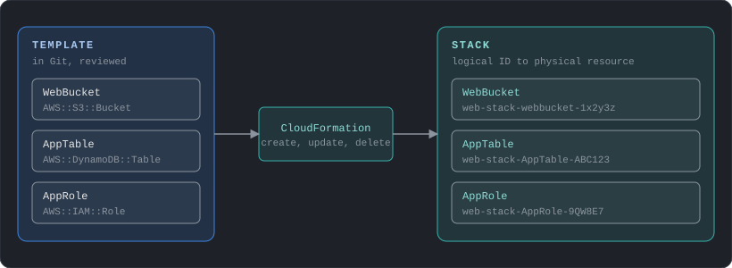
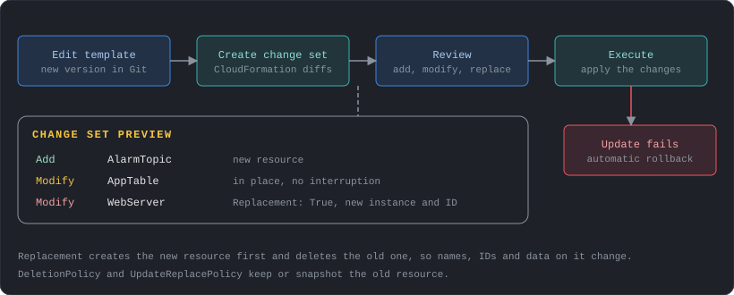
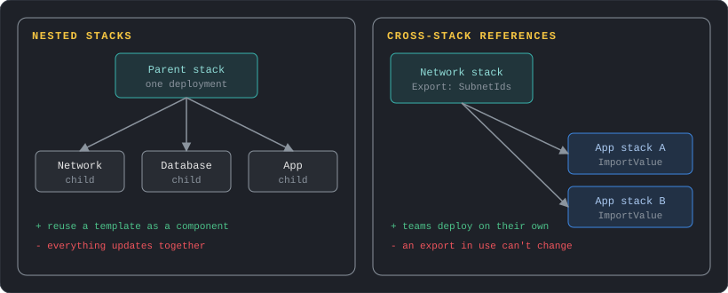
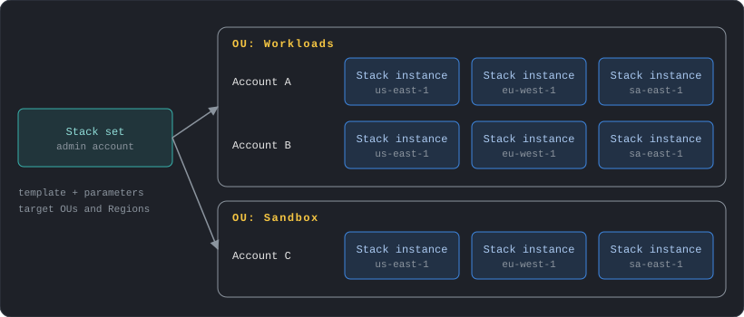
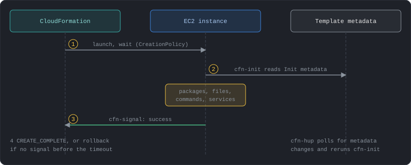
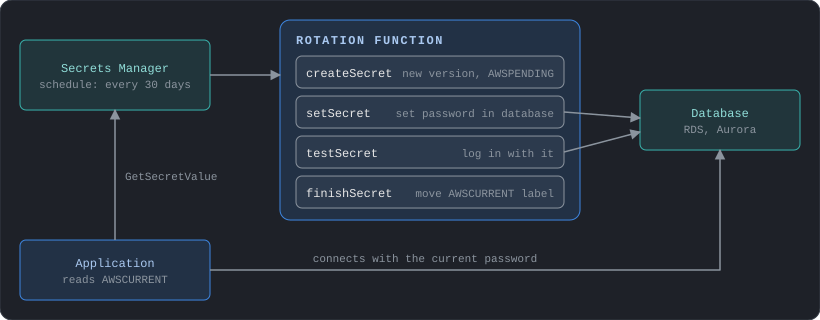
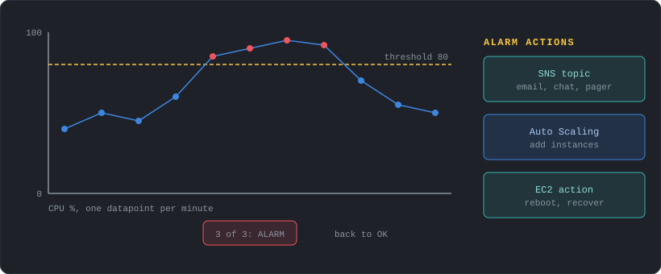
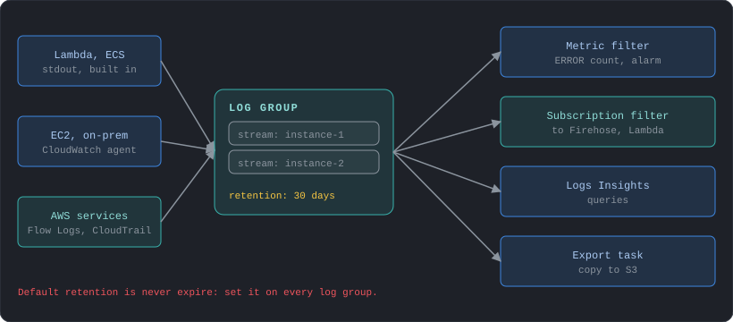
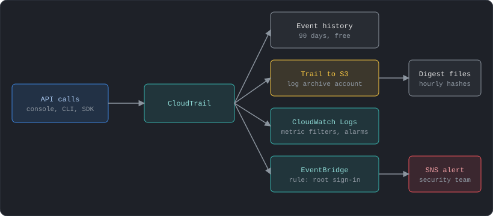

# About this post

Everything in the earlier posts can be built by clicking in the console, and that works once. Infrastructure as code (IaC) describes the resources in files, so an environment can be reviewed, rebuilt in another Region or account, and changed in a controlled way. Once it runs, the system needs secrets kept out of code, metrics and logs to see how it behaves, and an audit trail of who changed what. This post covers those four parts: CloudFormation and the tools built on it, secrets, CloudWatch and CloudTrail. Prices are for `us-east-1` at the time of writing (November 2026), as in the earlier posts.

AI and machine learning services are in post 8.

---

# CloudFormation

CloudFormation reads a **template** (YAML or JSON) and creates the resources it describes as a **stack**. It works out the order from the references between resources, calls the AWS APIs, and records which real resource belongs to each entry of the template.



A **logical ID** is the name of a resource inside the template, such as `AppTable`. The **physical ID** is the real name or ID in the account. Leave physical names out where you can: CloudFormation then generates unique ones, and the same template can run twice in one account and Region without name conflicts.

## A template

```yaml
AWSTemplateFormatVersion: "2010-09-09"
Description: Orders service storage

Parameters:
  Env:
    Type: String
    AllowedValues: [dev, prod]

Conditions:
  IsProd: !Equals [!Ref Env, prod]

Resources:
  UploadsBucket:
    Type: AWS::S3::Bucket
    DeletionPolicy: Retain
    UpdateReplacePolicy: Retain
    Properties:
      VersioningConfiguration:
        Status: !If [IsProd, Enabled, Suspended]

  OrdersTable:
    Type: AWS::DynamoDB::Table
    Properties:
      TableName: !Sub "orders-${Env}"
      BillingMode: PAY_PER_REQUEST
      AttributeDefinitions:
        - AttributeName: pk
          AttributeType: S
      KeySchema:
        - AttributeName: pk
          KeyType: HASH
      PointInTimeRecoverySpecification:
        PointInTimeRecoveryEnabled: !If [IsProd, true, false]

Outputs:
  TableArn:
    Value: !GetAtt OrdersTable.Arn
    Export:
      Name: !Sub "${AWS::StackName}-TableArn"
```

Only `Resources` is required. The other sections:

| Section | Purpose |
|---|---|
| `Parameters` | Values given at deploy time, such as the environment |
| `Mappings` | Lookup tables, such as an instance size per environment |
| `Conditions` | Booleans that decide whether a resource or property is used |
| `Rules` | Checks on parameter combinations before anything is created |
| `Transform` | Macros that expand the template, such as SAM (below) |
| `Outputs` | Values to show or export to other stacks |

**Intrinsic functions** connect the pieces. `!Ref` returns a parameter or a resource's main ID, `!GetAtt` another attribute such as an ARN, `!Sub` builds strings, `!If` picks a value by condition, `!ImportValue` reads another stack's export, and `!FindInMap` reads a mapping. **Pseudo parameters** such as `AWS::Region`, `AWS::AccountId`, `AWS::StackName` and `AWS::NoValue` (which removes a property) keep templates portable.

CloudFormation derives the creation order from `!Ref` and `!GetAtt`. **`DependsOn`** forces an order where no reference exists, such as an instance that downloads packages at boot and must wait for the internet gateway to be attached to the VPC.

**Dynamic references** pull values from Parameter Store and Secrets Manager at deploy time, so secrets never sit in the template:


```yaml
  OrdersDb:
    Type: AWS::RDS::DBInstance
    Properties:
      Engine: postgres
      DBInstanceClass: db.t4g.micro
      AllocatedStorage: "20"
      MasterUsername: "{{resolve:secretsmanager:prod/orders/db:SecretString:username}}"
      MasterUserPassword: "{{resolve:secretsmanager:prod/orders/db:SecretString:password}}"
```


`{{resolve:ssm:name}}` reads a plain parameter, and `{{resolve:ssm-secure:name}}` a SecureString, which only some password properties accept. Prefer having a service manage its own secret where it can, such as RDS with `ManageMasterUserPassword` (post 5).

Limits worth knowing: 500 resources, 200 parameters and 200 outputs per template, a template body of 51,200 bytes in a request or 1 MB from S3, and 2,000 stacks per Region by default. A stack that approaches 500 resources should be split.

## Updating a stack

Change the template and update the stack. Each changed property has an **update behavior** listed in the resource reference: **no interruption**, **some interruption** (such as a reboot), or **replacement**, where CloudFormation creates a new resource, points references to it, and deletes the old one. Replacement changes the physical ID, and data on the old resource is gone unless a policy keeps it.



A **change set** previews an update before anything happens:

```bash
aws cloudformation create-change-set --stack-name orders-prod \
  --change-set-name add-alarm --template-body file://template.yaml \
  --parameters ParameterKey=Env,ParameterValue=prod

aws cloudformation describe-change-set --stack-name orders-prod \
  --change-set-name add-alarm \
  --query 'Changes[].ResourceChange.[Action,LogicalResourceId,Replacement]'

aws cloudformation execute-change-set --stack-name orders-prod \
  --change-set-name add-alarm
```

Protections for stateful resources:

- **DeletionPolicy** decides what happens when a resource leaves the stack or the stack is deleted: `Delete` (default), `Retain`, `RetainExceptOnCreate` or `Snapshot` (RDS, EBS volumes, ElastiCache, Redshift, Neptune). RDS clusters and standalone instances default to `Snapshot`.
- **UpdateReplacePolicy** does the same for the old resource during a replacement.
- **Stack policies** deny updates to chosen resources, such as the production database, unless overridden for one update.
- **Termination protection** blocks deleting the stack.

When an update fails, CloudFormation **rolls back** to the last working state. **Rollback triggers** watch up to 5 CloudWatch alarms during and after the update (up to 180 minutes) and roll back if one fires. For fast iteration in development, "preserve successfully provisioned resources" keeps what worked so you can fix and retry. **Express mode** (2026) skips waiting for resources to stabilize and turns rollback off by default, which suits development stacks.

**Drift** is a change made outside CloudFormation, such as a security group rule added in the console. **Drift detection** compares the stack's resources with the template, and **drift-aware change sets** (2025) can revert those changes during a deployment. Treat drift as a process failure: changes go through the template.

## Splitting into stacks

One stack for everything grows slow and risky. Split by lifecycle and ownership: the network changes rarely, the application several times a day.



- **Nested stacks** (`AWS::CloudFormation::Stack`) let a parent template include child templates as components, deployed together.
- **Exports and imports** share values between independent stacks in the same account and Region. An export in use cannot be changed or deleted, so export only stable values such as VPC and subnet IDs.
- **`Fn::GetStackOutput`** (2026) reads another stack's output across accounts and Regions without an export. Nothing stops the other stack from being deleted, so handle that case.

## StackSets: many accounts and Regions

A **stack set** deploys one template as **stack instances** in many accounts and Regions from one administrator account. Typical uses are the baseline every account needs: an IAM role for the security team, a CloudTrail or Config setup, budget alarms, a shared VPC layout.



| | Self-managed permissions | Service-managed permissions |
|---|---|---|
| Accounts | Any account IDs you list | Accounts in AWS Organizations OUs |
| Roles | You create an administration role and an execution role in every target account | Created by StackSets through Organizations trusted access |
| New accounts | Added by hand | **Automatic deployment** when an account joins a target OU, and removal when it leaves |
| Run from | Any account | Management account or up to 5 delegated administrators |
| Limits | | No macros or transforms in the template |

Use service-managed permissions inside an organization. Self-managed fits accounts outside it, such as a partner's account.

```bash
aws cloudformation create-stack-set --stack-set-name security-baseline \
  --template-body file://baseline.yaml --capabilities CAPABILITY_NAMED_IAM \
  --permission-model SERVICE_MANAGED \
  --auto-deployment Enabled=true,RetainStacksOnAccountRemoval=false

aws cloudformation create-stack-instances --stack-set-name security-baseline \
  --deployment-targets OrganizationalUnitIds=ou-ab12-workloads \
  --regions us-east-1 eu-west-1 \
  --operation-preferences MaxConcurrentPercentage=25,FailureTolerancePercentage=10,RegionConcurrencyType=PARALLEL
```

**Operation preferences** control the rollout: how many accounts deploy at once, how many failures stop the operation, and whether Regions run in sequence (the default) or in parallel. Roll out to a small share first so a broken template stops early.

Other organization-wide pieces: **Hooks** check resources before CloudFormation provisions them and can block non-compliant ones (Control Tower's proactive controls, post 1, are hooks), and SCPs (post 1) still apply to whatever CloudFormation does in each account.

## Who CloudFormation acts as

By default CloudFormation uses the caller's permissions. A **service role** is an IAM role that CloudFormation assumes instead. Developers then need permission to update stacks and `iam:PassRole` for that role, without direct rights over the resources. The role stays attached to the stack, and anyone allowed to update the stack can use it, so limit who can update stacks that carry powerful roles.

Templates that create IAM resources need an explicit acknowledgment, `CAPABILITY_IAM` or `CAPABILITY_NAMED_IAM`, so nobody creates roles by accident.

## Bootstrapping instances

When CloudFormation launches an EC2 instance, the instance is "created" long before the software on it is ready. A **creation policy** makes CloudFormation wait for a signal from the instance.




```yaml
  WebServer:
    Type: AWS::EC2::Instance
    CreationPolicy:
      ResourceSignal:
        Timeout: PT15M
    Metadata:
      AWS::CloudFormation::Init:
        config:
          packages:
            yum:
              nginx: []
          services:
            systemd:
              nginx:
                enabled: true
                ensureRunning: true
    Properties:
      ImageId: "{{resolve:ssm:/aws/service/ami-amazon-linux-latest/al2023-ami-kernel-default-arm64}}"
      InstanceType: t4g.small
      UserData:
        Fn::Base64: !Sub |
          #!/bin/bash
          yum install -y aws-cfn-bootstrap
          /opt/aws/bin/cfn-init -s ${AWS::StackName} -r WebServer --region ${AWS::Region}
          /opt/aws/bin/cfn-signal -e $? -s ${AWS::StackName} -r WebServer --region ${AWS::Region}
```


**cfn-init** applies the `AWS::CloudFormation::Init` metadata (packages, files, users, commands, services). **cfn-signal** sends the exit code. Without a success signal before the timeout (up to 12 hours), the resource fails and the stack rolls back. **cfn-hup** is a daemon that checks for metadata changes every 15 minutes and reruns cfn-init. AWS recommends creation policies over the older wait conditions for instances and Auto Scaling groups. For fleets, baking software into the AMI (post 3) makes instances ready faster than installing at boot.

## Custom resources

A **custom resource** calls a Lambda function (or SNS topic) on create, update and delete, for anything CloudFormation cannot do natively, such as calling a third-party API or looking up a value. The function must respond to a presigned S3 URL, or the stack waits for the timeout (1 hour by default, set with `ServiceTimeout`). A function that crashes without responding leaves the stack stuck for that hour, so always send a response, also on errors and on delete.

## Other tools around CloudFormation

- **IaC generator** scans an account for resources not managed by any stack and builds a template from them, for importing hand-made resources.
- **Resource import** brings existing resources into a stack without recreating them.
- **Stack refactoring** (2025) moves resources between stacks or renames logical IDs without replacing them.
- **Git sync** deploys a stack from a template in GitHub, GitLab or Bitbucket on every push.
- The **deployment timeline** in the console shows each resource's progress and highlights the likely cause of a failure.

<div class="callout-cost" markdown="1">
- **CloudFormation itself:** no charge for `AWS::*` resource types. Third-party resource types and custom hooks cost $0.0009 per handler operation after 1,000 free a month, plus $0.00008 per second beyond 30 seconds per operation.
- **Retained resources still bill:** a `Retain` policy leaves buckets, volumes and snapshots behind after the stack is deleted. Track them with tags and delete what is no longer needed.
</div>

---

# CDK, SAM and Terraform

CloudFormation templates get long, and many teams write them through another tool.

## AWS CDK

The **CDK** (Cloud Development Kit) defines infrastructure in TypeScript, Python, Java, C#, Go or JavaScript. Running `cdk synth` produces a CloudFormation template and `cdk deploy` deploys it, so CDK keeps CloudFormation's state handling and rollback.

```typescript
const table = new dynamodb.Table(this, 'Orders', {
  partitionKey: { name: 'pk', type: dynamodb.AttributeType.STRING },
  billingMode: dynamodb.BillingMode.PAY_PER_REQUEST,
  pointInTimeRecoverySpecification: { pointInTimeRecoveryEnabled: true },
});

const fn = new lambda.Function(this, 'Handler', {
  runtime: lambda.Runtime.NODEJS_22_X,
  handler: 'index.handler',
  code: lambda.Code.fromAsset('src'),
});

table.grantReadWriteData(fn);  // writes a least-privilege IAM policy
```

**Constructs** come in three levels: L1 (`Cfn*` classes, one to one with CloudFormation types), L2 (resources with sensible defaults and helper methods such as `grantReadWriteData`), and L3 patterns (several resources together, such as a load-balanced Fargate service). `cdk bootstrap` prepares each account and Region once with a `CDKToolkit` stack holding an S3 bucket, an ECR repository and deployment roles. `cdk diff` shows changes before deploying.

## AWS SAM

**SAM** (Serverless Application Model) is a CloudFormation transform for serverless applications. A short `AWS::Serverless::Function` with an event expands into the function, its role and the API Gateway or queue mapping:

```yaml
Transform: AWS::Serverless-2016-10-31
Resources:
  GetOrder:
    Type: AWS::Serverless::Function
    Properties:
      Runtime: python3.13
      Handler: app.handler
      CodeUri: src/
      Policies:
        - DynamoDBReadPolicy:
            TableName: !Ref OrdersTable
      Events:
        Api:
          Type: HttpApi
          Properties:
            Path: /orders/{id}
            Method: get
```

The SAM CLI builds (`sam build`), runs functions locally (`sam local invoke`) and deploys through change sets (`sam deploy`). It also sets up gradual Lambda deployments with weighted aliases (post 6).

## Terraform

**Terraform** (HashiCorp, now part of IBM) is the most common IaC tool outside AWS's own. The same table in HCL (HashiCorp Configuration Language):

```hcl
resource "aws_dynamodb_table" "orders" {
  name         = "orders-${var.env}"
  billing_mode = "PAY_PER_REQUEST"
  hash_key     = "pk"

  attribute {
    name = "pk"
    type = "S"
  }

  point_in_time_recovery {
    enabled = var.env == "prod"
  }
}
```

| | CloudFormation (and CDK, SAM) | Terraform |
|---|---|---|
| Scope | AWS, plus third-party types from the CloudFormation registry | Thousands of providers: AWS, other clouds, SaaS (DNS, monitoring, GitHub) |
| State | Kept by AWS, nothing to manage | A state file you store, usually in S3 with locking (`use_lockfile`). It can hold secrets, so encrypt and restrict it |
| Preview | Change sets | `terraform plan`, which also refreshes real state and shows drift |
| Failure | Automatic rollback to the last working state | No rollback: a failed apply leaves partial changes recorded in state, and you fix forward |
| New AWS features | Available at launch for most services | The `aws` provider can lag. The `awscc` provider is generated from CloudFormation schemas |
| Reuse | Nested stacks, CDK constructs, modules | Modules from a registry |
| Multi-account | StackSets | One configuration per account or Region, or Terraform Stacks on HCP Terraform |
| License | AWS service, no charge for AWS resources | Business Source License since 2023. **OpenTofu** is the open-source (MPL 2.0) fork under the Linux Foundation |

AWS's own guidance: CloudFormation or CDK for teams that work only on AWS, because state is managed and new features arrive at once, and Terraform when the same tool must manage several clouds or SaaS providers. Mixing tools in one environment is fine when each resource has exactly one owner.

---

# Secrets and Configuration

Passwords, API keys and tokens belong in a managed store, read at runtime through an IAM role. Never in code, templates, AMIs, user data (post 3) or environment variables committed to Git.

## Secrets Manager

**Secrets Manager** stores secrets up to 64 KB, encrypted with a KMS key (post 4), and versions them. Each version carries **staging labels**: `AWSCURRENT` is the value in use, `AWSPENDING` the one being rotated in, and `AWSPREVIOUS` the last one.



- **Rotation:** **managed rotation** needs no code for RDS, Aurora, DocumentDB and Redshift credentials and for some SaaS secrets (**managed external secrets**, such as Salesforce or Snowflake). Other secrets use a rotation Lambda function with four steps: create, set, test, finish. The schedule is a rate or cron expression, as often as every 4 hours.
- **Rotation strategy:** **single user** changes one database user's password, so connections opened during rotation can briefly fail. **Alternating users** keeps two users and switches between them, so the old credentials keep working until the next rotation.
- **Reading secrets:** applications call `GetSecretValue` and cache the result. Lambda can use the **Parameters and Secrets extension**, ECS injects secrets into containers through the task definition (`valueFrom`, read when the task starts), and EKS mounts them with the Secrets Store CSI driver.
- **Cross-account access:** a resource policy on the secret plus a customer managed KMS key whose key policy allows the other account. The AWS managed key `aws/secretsmanager` cannot be shared.
- **Replication:** **replica secrets** copy a secret to other Regions for disaster recovery (post 1). Rotation runs on the primary and reaches the replicas.
- **Deletion** waits 7 to 30 days (30 by default) so a mistake can be undone.

## Parameter Store

**Parameter Store** is part of AWS Systems Manager and holds configuration and simple secrets in a hierarchy, such as `/orders/prod/db/host`. `GetParametersByPath` reads a whole branch.

| | Standard | Advanced |
|---|---|---|
| Parameters per Region | 10,000 | 100,000 |
| Value size | 4 KB | 8 KB |
| Policies (expiration, notifications) | No | Yes |
| Sharing with other accounts (AWS RAM) | No | Yes |
| Cost | Free | $0.05 per parameter per month |

Types are `String`, `StringList` and `SecureString` (encrypted with KMS). A standard parameter can be upgraded to advanced and never back. Throughput is 40 requests per second by default. **Higher throughput** raises `GetParameter` to 10,000 per second, and every call is then billed. **Public parameters** such as `/aws/service/ami-amazon-linux-latest/...` give the latest AMI IDs, as used in the template above.

## Choosing

| Need | Use |
|---|---|
| Database and service credentials that must rotate | Secrets Manager |
| Secrets read from several Regions or accounts | Secrets Manager (replicas, resource policies) |
| Configuration values, feature flags, AMI IDs | Parameter Store |
| A few static secrets, low cost | Parameter Store SecureString |

Parameter Store can also read Secrets Manager secrets through the path `/aws/reference/secretsmanager/<name>`, so an application can use one API for both.

<div class="callout-cost" markdown="1">
- **Secrets Manager:** $0.40 per secret per month plus $0.05 per 10,000 API calls. 200 secrets cost $80 a month before calls, so cache values in the application. An uncached secret read on every request can cost more in calls than in storage.
- **Parameter Store:** standard parameters are free. Advanced parameters cost $0.05 a month each, and higher throughput bills $0.05 per 10,000 API calls on every parameter.
</div>

---

# Monitoring: CloudWatch

CloudWatch collects metrics and logs from AWS services and your applications, alarms on them, and shows them on dashboards. Post 3 covered the default EC2 metrics and the recover action; this section is about designing monitoring.

## Metrics

A **metric** is a time series identified by a **namespace** (such as `AWS/EC2`), a name, and up to 30 **dimensions** (name and value pairs, such as `InstanceId`). Each unique combination of dimensions is a separate metric. Metrics are Regional.

- **Resolution:** standard metrics have 1-minute data points, **high-resolution** metrics go down to 1 second.
- **Retention:** 15 months, with older data rolled up: 1-minute points are kept 15 days, 5-minute points 63 days and 1-hour points 455 days.
- **Custom metrics:** applications publish them with `PutMetricData`, or write **EMF** (embedded metric format) log lines that CloudWatch turns into metrics, which suits Lambda. AWS now recommends **OpenTelemetry** (an open standard for metrics, logs and traces) for new instrumentation.
- **CloudWatch agent:** memory, disk usage and processes are not visible from outside an instance. The agent collects them, plus log files, from EC2 and on-premises servers. Its metrics are billed as custom metrics.

## Alarms



An alarm watches one metric (or a math expression over several) and has three states: `OK`, `ALARM` and `INSUFFICIENT_DATA`. It compares each **period** against a threshold and changes state when **M out of N** datapoints breach, such as 3 out of 5, which ignores a single spike. Set how **missing data** counts: as missing, breaching, not breaching, or ignored. A metric that stops reporting because the service died should usually count as breaching.

- **Actions:** SNS notifications, Lambda functions, EC2 actions (stop, reboot, recover), Auto Scaling policies (post 3) and Systems Manager OpsItems.
- **Anomaly detection** alarms learn a metric's normal band, including daily and weekly patterns, which suits values with no fixed threshold.
- **Composite alarms** combine alarms with AND, OR and NOT, such as "high latency AND high error rate", so one incident pages once.
- **Log alarms** run a Logs Insights query on a schedule and alarm on the result.

Alarm on symptoms users feel (errors, latency, queue age), and use resource metrics (CPU, memory) to explain them.

## Logs



Log events go into **log streams** (one per source, such as an instance or a Lambda environment) inside **log groups** (one per application or component). Lambda, ECS and API Gateway send logs on their own. EC2 needs the agent.

- **Retention** is set per log group, from 1 day to 10 years. The default is never expire, which keeps every byte forever. Set it on every log group, or with an account-level policy.
- **Log classes:** **Standard** has every feature. **Essentials** (formerly Infrequent Access) costs half to ingest and lacks metric filters, subscription filters and Live Tail, which fits logs that are kept for audits and queried rarely.
- **Logs Insights** queries log groups with its own query language, SQL or OpenSearch PPL, billed per GB scanned. Narrow the time range and log groups to cut cost.
- **Metric filters** turn matching lines into metrics, such as a count of `ERROR`, for alarms.
- **Subscription filters** (up to 5 per log group) stream events in near real time to Lambda, Kinesis Data Streams or Firehose (post 6), for example into an S3 archive or a SIEM. Use them for continuous export. The **export task** to S3 is a batch copy for occasional use.
- **Data protection policies** detect and mask sensitive data such as card numbers and emails as logs arrive.
- **Centralization:** organization rules can copy logs from every account and Region into one logging account.

## Tracing and other tools

A **trace** follows one request through every service it touches, showing where time is spent and which call failed. **X-Ray** stores traces and draws the service map. The X-Ray SDKs and daemon are in maintenance mode since February 2026, and AWS recommends **OpenTelemetry**, through the AWS Distro for OpenTelemetry (ADOT) or the CloudWatch agent. **Application Signals** builds service dashboards and SLOs (service level objectives, such as 99.9% of requests under 300 ms) from that telemetry.

Other CloudWatch tools: **Synthetics** canaries run scripts that test endpoints and user flows on a schedule, **RUM** collects performance data from real users' browsers, **Container Insights** and **Lambda Insights** add per-container and per-function metrics, and **cross-account observability** lets one monitoring account see metrics, logs and traces of many source accounts in a Region.

<div class="callout-cost" markdown="1">
- **Custom metrics:** $0.30 per metric per month for the first 10,000. Every dimension value creates a new metric, so a `UserId` dimension can create millions. Keep high-cardinality values in logs.
- **Logs:** $0.50 per GB ingested on Standard, $0.25 on Essentials, and $0.03 per GB-month stored. Ingestion is usually the largest CloudWatch cost: drop debug logs in production and set retention.
- **Alarms:** $0.10 per month for a standard alarm, $0.30 for high resolution and $0.50 for composite. **Logs Insights:** $0.005 per GB scanned.
</div>

---

# Auditing: CloudTrail

CloudTrail records API calls made in an account: from the console, the CLI, SDKs and AWS services acting for you. Each event says who (the IAM identity), what (the API action and parameters), when, from where (source IP) and whether it succeeded. CloudWatch answers "how is the system behaving", CloudTrail answers "who changed what". Post 1 gave CloudTrail's basic pricing.



- **Event history:** the last 90 days of management events in each Region, free and always on.
- **Trails** keep events longer by delivering log files to S3, typically within about 5 minutes, and optionally to CloudWatch Logs. Trails created in the console cover all Regions.
- **Organization trail:** created from the management account or a delegated administrator, it records every account in the organization into one bucket, usually in a separate log archive account that member accounts cannot modify.
- **Integrity:** log file validation writes hourly **digest files** with SHA-256 hashes, signed by CloudTrail, so `aws cloudtrail validate-logs` can prove files were not changed or deleted. Combine with S3 Object Lock (post 4) for logs nobody can delete.
- **Encryption:** log files use SSE-KMS by default when the trail is created in the console.

| Event type | Records | Default |
|---|---|---|
| Management events | Control plane actions: `CreateUser`, `RunInstances`, `PutBucketPolicy`, sign-ins | On |
| Data events | Resource operations: S3 object reads and writes, Lambda invocations, DynamoDB item actions | Off, billed |
| Network activity events | API calls through VPC endpoints, including calls denied by endpoint policies | Off, billed |
| Insights events | Unusual call rates or error rates, such as a burst of `DeleteBucket` calls | Off, billed |

Enable data events selectively, such as for buckets with sensitive data, because a busy bucket produces millions of events.

**Reacting to events:** with a trail enabled, management events also reach the EventBridge default bus (post 6), where a rule can alert on root sign-ins, changes to CloudTrail itself, or security group changes. For queries over history, Athena on the S3 logs (post 5) is the usual option. CloudTrail Lake, a managed query store, closed to new customers in May 2026.

AWS Config is the related service that records each resource's configuration over time and evaluates it against rules (post 1). CloudTrail shows the API call, Config shows the resulting state.

<div class="callout-cost" markdown="1">
- **Extra events:** data events and network activity events cost $0.10 per 100,000, and Insights $0.35 per 100,000 management events analyzed. The first trail's management events are free (post 1).
- **CloudWatch Logs copy:** sending a trail to CloudWatch Logs adds ingestion at $0.50 per GB on top of the S3 copy. Send it only when metric filters or alarms need it.
</div>

---

# Design Checklist

1. Is every environment built from code, with no manual changes and drift checked?
2. Are stacks split by lifecycle and owner, and do stateful resources have `Retain` or `Snapshot` policies?
3. Is every production change previewed with a change set or plan before it runs?
4. Does a new account receive its baseline (roles, trail, alarms) automatically through StackSets?
5. Who can update stacks that use a powerful service role?
6. Are all secrets in Secrets Manager or Parameter Store, rotated where possible, and cached by applications?
7. Do alarms cover what users feel (errors, latency, queue age), with missing data treated deliberately?
8. Does every log group have a retention period and the cheapest log class that still works?
9. Does an organization trail write to a separate log archive account, with file validation on?
10. Is there an alert on the actions that should never happen: root sign-in, trail stopped, policies widened?

---

# References

## CloudFormation

- [Template anatomy](https://docs.aws.amazon.com/AWSCloudFormation/latest/UserGuide/template-anatomy.html)
- [Intrinsic function reference](https://docs.aws.amazon.com/AWSCloudFormation/latest/TemplateReference/intrinsic-function-reference.html)
- [Pseudo parameters](https://docs.aws.amazon.com/AWSCloudFormation/latest/UserGuide/pseudo-parameter-reference.html)
- [Dynamic references](https://docs.aws.amazon.com/AWSCloudFormation/latest/UserGuide/dynamic-references.html)
- [Quotas](https://docs.aws.amazon.com/AWSCloudFormation/latest/UserGuide/cloudformation-limits.html)
- [Update behaviors](https://docs.aws.amazon.com/AWSCloudFormation/latest/UserGuide/using-cfn-updating-stacks-update-behaviors.html)
- [DeletionPolicy](https://docs.aws.amazon.com/AWSCloudFormation/latest/TemplateReference/aws-attribute-deletionpolicy.html)
- [UpdateReplacePolicy](https://docs.aws.amazon.com/AWSCloudFormation/latest/TemplateReference/aws-attribute-updatereplacepolicy.html)
- [Stack policies](https://docs.aws.amazon.com/AWSCloudFormation/latest/UserGuide/protect-stack-resources.html)
- [Stack failure options](https://docs.aws.amazon.com/AWSCloudFormation/latest/UserGuide/stack-failure-options.html)
- [Rollback triggers](https://docs.aws.amazon.com/AWSCloudFormation/latest/UserGuide/using-cfn-rollback-triggers.html)
- [Express mode](https://docs.aws.amazon.com/AWSCloudFormation/latest/UserGuide/cloudformation-express-mode.html)
- [Drift detection](https://docs.aws.amazon.com/AWSCloudFormation/latest/UserGuide/using-cfn-stack-drift.html)
- [Drift-aware change sets](https://docs.aws.amazon.com/AWSCloudFormation/latest/UserGuide/drift-aware-change-sets.html)
- [Exports](https://docs.aws.amazon.com/AWSCloudFormation/latest/UserGuide/using-cfn-stack-exports.html)
- [Fn::GetStackOutput](https://docs.aws.amazon.com/AWSCloudFormation/latest/TemplateReference/intrinsic-function-reference-getstackoutput.html)
- [StackSets concepts](https://docs.aws.amazon.com/AWSCloudFormation/latest/UserGuide/stacksets-concepts.html)
- [StackSets delegated administrator](https://docs.aws.amazon.com/AWSCloudFormation/latest/UserGuide/stacksets-orgs-delegated-admin.html)
- [Hooks](https://docs.aws.amazon.com/cloudformation-cli/latest/hooks-userguide/what-is-cloudformation-hooks.html)
- [Service role](https://docs.aws.amazon.com/AWSCloudFormation/latest/UserGuide/using-iam-servicerole.html)
- [CreationPolicy](https://docs.aws.amazon.com/AWSCloudFormation/latest/TemplateReference/aws-attribute-creationpolicy.html)
- [AWS::CloudFormation::Init](https://docs.aws.amazon.com/AWSCloudFormation/latest/TemplateReference/aws-resource-init.html)
- [cfn-hup](https://docs.aws.amazon.com/AWSCloudFormation/latest/TemplateReference/cfn-hup.html)
- [Custom resources](https://docs.aws.amazon.com/AWSCloudFormation/latest/TemplateReference/aws-resource-cloudformation-customresource.html)
- [IaC generator](https://docs.aws.amazon.com/AWSCloudFormation/latest/UserGuide/generate-IaC.html)
- [Resource import](https://docs.aws.amazon.com/AWSCloudFormation/latest/UserGuide/resource-import.html)
- [Stack refactoring](https://docs.aws.amazon.com/AWSCloudFormation/latest/UserGuide/stack-refactoring.html)
- [Git sync](https://docs.aws.amazon.com/AWSCloudFormation/latest/UserGuide/git-sync.html)

## CDK, SAM and Terraform

- [What is the AWS CDK](https://docs.aws.amazon.com/cdk/v2/guide/home.html)
- [CDK constructs](https://docs.aws.amazon.com/cdk/v2/guide/constructs.html)
- [CDK bootstrapping](https://docs.aws.amazon.com/cdk/v2/guide/bootstrapping-env.html)
- [SAM resources and properties](https://docs.aws.amazon.com/serverless-application-model/latest/developerguide/sam-specification-resources-and-properties.html)
- [sam deploy](https://docs.aws.amazon.com/serverless-application-model/latest/developerguide/sam-cli-command-reference-sam-deploy.html)
- [Choosing an IaC tool (AWS Prescriptive Guidance)](https://docs.aws.amazon.com/prescriptive-guidance/latest/choose-iac-tool/introduction.html)
- [Terraform on AWS (Prescriptive Guidance)](https://docs.aws.amazon.com/prescriptive-guidance/latest/choose-iac-tool/terraform.html)
- [Terraform introduction](https://developer.hashicorp.com/terraform/intro)
- [Terraform S3 backend](https://developer.hashicorp.com/terraform/language/backend/s3)
- [Sensitive data in state](https://developer.hashicorp.com/terraform/language/state/sensitive-data)
- [terraform apply](https://developer.hashicorp.com/terraform/cli/commands/apply)
- [Terraform Stacks](https://developer.hashicorp.com/terraform/language/stacks)
- [HashiCorp adopts the Business Source License](https://www.hashicorp.com/en/blog/hashicorp-adopts-business-source-license)
- [OpenTofu](https://opentofu.org/)

## Secrets

- [Secrets Manager quotas](https://docs.aws.amazon.com/secretsmanager/latest/userguide/reference_limits.html)
- [Managed rotation](https://docs.aws.amazon.com/secretsmanager/latest/userguide/rotate-secrets_managed.html)
- [Rotation functions](https://docs.aws.amazon.com/secretsmanager/latest/userguide/rotate-secrets_lambda-functions.html)
- [Rotation schedules](https://docs.aws.amazon.com/secretsmanager/latest/userguide/rotate-secrets_schedule.html)
- [Rotation strategies](https://docs.aws.amazon.com/secretsmanager/latest/userguide/rotation-strategy.html)
- [Managed external secrets](https://docs.aws.amazon.com/secretsmanager/latest/userguide/managed-external-secrets.html)
- [Secrets in Lambda](https://docs.aws.amazon.com/secretsmanager/latest/userguide/retrieving-secrets_lambda.html)
- [Secrets in ECS](https://docs.aws.amazon.com/AmazonECS/latest/developerguide/specifying-sensitive-data.html)
- [Cross-account access](https://docs.aws.amazon.com/secretsmanager/latest/userguide/auth-and-access_examples_cross.html)
- [Replicating secrets](https://docs.aws.amazon.com/secretsmanager/latest/userguide/replicate-secrets.html)
- [Parameter tiers](https://docs.aws.amazon.com/systems-manager/latest/userguide/parameter-store-advanced-parameters.html)
- [Parameter hierarchies](https://docs.aws.amazon.com/systems-manager/latest/userguide/sysman-paramstore-hierarchies.html)
- [Systems Manager quotas](https://docs.aws.amazon.com/general/latest/gr/ssm.html)
- [Public parameters for AMIs](https://docs.aws.amazon.com/systems-manager/latest/userguide/parameter-store-public-parameters-ami.html)
- [Referencing Secrets Manager from Parameter Store](https://docs.aws.amazon.com/systems-manager/latest/userguide/integration-ps-secretsmanager.html)

## CloudWatch

- [CloudWatch concepts](https://docs.aws.amazon.com/AmazonCloudWatch/latest/monitoring/cloudwatch_concepts.html)
- [CloudWatch agent](https://docs.aws.amazon.com/AmazonCloudWatch/latest/monitoring/Install-CloudWatch-Agent.html)
- [Embedded metric format](https://docs.aws.amazon.com/AmazonCloudWatch/latest/monitoring/CloudWatch_Embedded_Metric_Format.html)
- [Alarm evaluation](https://docs.aws.amazon.com/AmazonCloudWatch/latest/monitoring/alarm-evaluation.html)
- [Missing data](https://docs.aws.amazon.com/AmazonCloudWatch/latest/monitoring/alarms-and-missing-data.html)
- [Alarm actions](https://docs.aws.amazon.com/AmazonCloudWatch/latest/monitoring/alarm-actions.html)
- [Log classes](https://docs.aws.amazon.com/AmazonCloudWatch/latest/logs/CloudWatch_Logs_Log_Classes.html)
- [Log retention](https://docs.aws.amazon.com/AmazonCloudWatchLogs/latest/APIReference/API_PutRetentionPolicy.html)
- [Analyzing logs](https://docs.aws.amazon.com/AmazonCloudWatch/latest/logs/AnalyzingLogData.html)
- [Subscriptions](https://docs.aws.amazon.com/AmazonCloudWatch/latest/logs/Subscriptions.html)
- [Masking sensitive data](https://docs.aws.amazon.com/AmazonCloudWatch/latest/logs/mask-sensitive-log-data.html)
- [Log centralization](https://docs.aws.amazon.com/AmazonCloudWatch/latest/logs/CloudWatchLogs_Centralization.html)
- [Cross-account observability](https://docs.aws.amazon.com/AmazonCloudWatch/latest/monitoring/CloudWatch-Unified-Cross-Account.html)
- [X-Ray SDK and daemon timeline](https://docs.aws.amazon.com/xray/latest/devguide/xray-sdk-daemon-timeline.html)

## CloudTrail

- [How CloudTrail works](https://docs.aws.amazon.com/awscloudtrail/latest/userguide/how-cloudtrail-works.html)
- [Event history](https://docs.aws.amazon.com/awscloudtrail/latest/userguide/view-cloudtrail-events.html)
- [Organization trails](https://docs.aws.amazon.com/awscloudtrail/latest/userguide/creating-trail-organization.html)
- [Log file validation](https://docs.aws.amazon.com/awscloudtrail/latest/userguide/cloudtrail-log-file-validation-intro.html)
- [Encrypting log files](https://docs.aws.amazon.com/awscloudtrail/latest/userguide/encrypting-cloudtrail-log-files-with-aws-kms.html)
- [CloudTrail concepts](https://docs.aws.amazon.com/awscloudtrail/latest/userguide/cloudtrail-concepts.html)
- [Insights events](https://docs.aws.amazon.com/awscloudtrail/latest/userguide/logging-insights-events-with-cloudtrail.html)
- [CloudTrail events in EventBridge](https://docs.aws.amazon.com/eventbridge/latest/userguide/eb-service-event-cloudtrail.html)
- [CloudTrail Lake](https://docs.aws.amazon.com/awscloudtrail/latest/userguide/cloudtrail-lake.html)

## Cost and Performance

- [CloudFormation pricing](https://aws.amazon.com/cloudformation/pricing/)
- [Secrets Manager pricing](https://aws.amazon.com/secrets-manager/pricing/)
- [Systems Manager pricing](https://aws.amazon.com/systems-manager/pricing/)
- [CloudWatch pricing](https://aws.amazon.com/cloudwatch/pricing/)
- [CloudTrail pricing](https://aws.amazon.com/cloudtrail/pricing/)
- [Price List file, CloudWatch (us-east-1)](https://pricing.us-east-1.amazonaws.com/offers/v1.0/aws/AmazonCloudWatch/current/us-east-1/index.json)
- [Price List file, CloudTrail (us-east-1)](https://pricing.us-east-1.amazonaws.com/offers/v1.0/aws/AWSCloudTrail/current/us-east-1/index.json)

---

Next post: **AI/ML**, starting with how Bedrock serves foundation models through one API.
